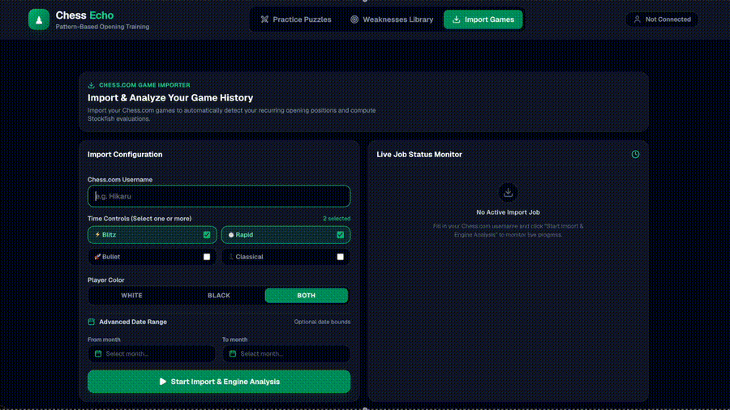
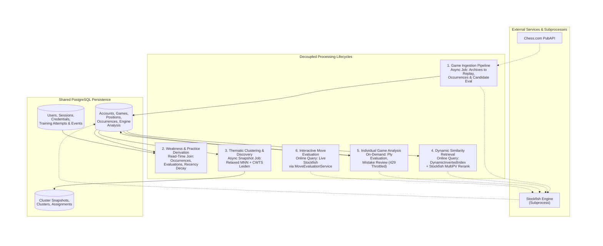

# ChessProbe ♟️

> Find not just what went wrong in a game — but what keeps going wrong across hundreds of them.



Traditional chess analysis tools show you every engine blunder across every game separately. ChessProbe takes a different approach: it finds **recurring board positions** where you repeatedly make sub-optimal decisions, analyzes them with Stockfish, and turns the highest-priority patterns into interactive personalized puzzles.

A single mistake may be accidental. A mistake you repeat across fifty games is a habit worth fixing.

---

## Why ChessProbe?

Most post-game analysis tools answer: *"What went wrong in this game?"*

ChessProbe answers: *"Which positions do I repeatedly reach, and where do I keep making weaker decisions?"*

The difference matters in practice. Suppose you reach a particular opening position 40 times over a year. You play Bf5 in 30 of those games, losing an average of 1.1 pawns each time. A standard analysis engine would show you 30 separate blunders. ChessProbe recognizes the same recurring decision and presents it as one weakness to fix.

The goal is to change habits, not to memorize engine lines.

---

## Features

- **6 Focused Analysis & Practice Views**:
  - **Practice Puzzles**: Drill your actual recurring mistakes with interactive move validation, continuation lines, and instant tactical feedback.
  - **Tactical Weaknesses**: Browse detected recurring weaknesses and thematic Leiden clusters with win/loss records and source game links.
  - **Long Decisions**: Isolate positions where you spent significant clock time deciding, filtered by time control and move phase.
  - **Similar Positions**: Retrieve structurally and dynamically similar tactical positions across your games using dual-mode retrieval.
  - **Import Games**: Asynchronous game ingestion from the Chess.com public API with live progress polling and resilient checkpointing.
  - **Game Analysis**: On-demand move-by-move engine evaluation of individual games with mistake categorization and retry practice.
- **Interactive Position Exploration (`ExplorePositionModal`)**: Freeform interactive exploration of any board position with live Stockfish move evaluations.
- **Time-control filtering**: Blitz, Rapid, Bullet, Classical (select one or more).
- **Color filtering**: Analyze as White, Black, or Both.
- **Normalized 4-field FEN identification**: Piece placement, active side, castling rights, and en passant square.
- **Stockfish depth-16 evaluation**: Baseline evaluations and historical candidate assessments with global position-level reuse.
- **Recency-weighted and practical-evidence ranking**: Blends historical frequency, eval loss, recency decay, and empirical win-rate Wilson score intervals.
- **Connected Chess.com accounts & personal training history**: Multi-user session management with server-authoritative private training history.

---

## Tech Stack

| Layer | Technology |
|---|---|
| **Backend** | Kotlin 2.1.0, Spring Boot 3.5.14, Java 21 |
| **Database** | PostgreSQL 16, Flyway |
| **Chess engine** | Stockfish (subprocess, depth 16) |
| **Chess libraries** | chesslib 1.3.7 (PGN parsing & FEN generation), CWTS Leiden 1.3.0 (graph community clustering) |
| **Frontend** | Next.js 16.4.1, React 19, TypeScript 5 |
| **Board UI** | react-chessboard, chess.js |
| **Styling** | Tailwind CSS 4 |
| **Backend testing** | JUnit 5, Mockito, Testcontainers (PostgreSQL 16), PIT (mutation testing) |
| **Frontend testing** | Vitest, Testing Library, Playwright (user journeys & sustained monkey campaigns) |
| **CI** | GitHub Actions |

---

## Getting Started

### Prerequisites

| Tool | Version |
|---|---|
| Java | 21 |
| Node.js | 20 |
| Docker + Docker Compose | any recent version |
| Stockfish | system installation (see below) |

### 1. Clone

```bash
git clone https://github.com/<your-username>/ChessProbe.git
cd ChessProbe
```

### 2. Install Stockfish

Stockfish must be installed separately and available on your system `PATH`.

**macOS:**
```bash
brew install stockfish
```

**Ubuntu / Debian:**
```bash
sudo apt install stockfish
```

Verify the installation:
```bash
stockfish
# Should print "Stockfish ..." and wait for UCI commands. Press Ctrl+C to exit.
```

### 3. Start the Database

```bash
make db-up
```

This starts a PostgreSQL 16 container (`chessprobe-postgres`) on port `5432` with:
- Database: `chessprobe`
- User: `chessprobe`
- Password: `chessprobe_pass`

Data is persisted in a named Docker volume (`postgres_data`).

### 4. Start the Backend

Running the backend requires the PostgreSQL database to be running first (`make db-up`).

**Option A — Run locally with Gradle (recommended for development)**

This is the standard inner loop for backend development, offering fast compilation, incremental builds, and IDE debugging. Requires Java 21 and Stockfish installed locally.

```bash
cd backend
CHESS_PUBAPI_USERNAME=your_chesscom_username \
CHESS_PUBAPI_CONTACT=your_email@example.com \
SPRING_DATASOURCE_URL=jdbc:postgresql://localhost:5432/chessprobe \
SPRING_DATASOURCE_USERNAME=chessprobe \
SPRING_DATASOURCE_PASSWORD=chessprobe_pass \
./gradlew bootRun
```

> **Note:** The [Chess.com PubAPI](https://support.chess.com/en/articles/9650547-what-is-the-pubapi-and-how-do-i-use-it) requires outbound API requests to declare a custom `User-Agent` header (`ChessProbe/1.0 (username: <username>; contact: <email>)`). Before running ChessProbe, set `CHESS_PUBAPI_USERNAME` to your operator Chess.com username (e.g., `your_chesscom_username`) and `CHESS_PUBAPI_CONTACT` to your contact email address.
>
> **Note:** The default `SPRING_DATASOURCE_URL` in `application.yml` points to `postgres:5432` (the Docker Compose hostname). When running the backend outside Docker, you must override the URL to `localhost:5432` as shown above.

**Option B — Docker (container workflow)**

Builds and runs the backend inside Docker from local source without requiring a local Java 21 JDK or Stockfish installation on the host, useful for verifying container parity. `make app-build` compiles the backend in a multi-stage container build and tags the image as `chess-probe`, which Docker Compose (`make app-up` or `make up`) reuses directly.

```bash
make app-build   # builds the Docker image (chess-probe) from local source
make app-up      # starts the application container on port 8080 reusing the built image
```

Or start both database and application together:

```bash
make up
```

To inspect container logs:

```bash
make app-logs          # follow application logs
make app-logs-static   # print last 50 application log lines
make db-logs           # follow database logs
```

To stop only the application container:

```bash
make app-down
```

**Option C — Run pre-built Docker image from Docker Hub (no local build)**

Runs the published backend container alongside PostgreSQL without needing to clone the source repository or build the image locally. This workflow pulls the pre-built `nathanzk/chessecho-backend:latest` image via standalone `docker run` commands; it does not compile or reflect local working-tree code changes.

> **Note:** The pre-built Docker image (`nathanzk/chessecho-backend:latest`) is published natively for **`linux/arm64` (Apple Silicon)**. If you are on a different architecture, use Option A (local Gradle) or Option B (local Docker build).

1. **Create a shared network:**
   Containers must share a user-defined network so the backend can resolve the database hostname (`chessprobe-postgres`) via Docker DNS:
   ```bash
   docker network create chessprobe-net
   ```

2. **Start PostgreSQL:**
   ```bash
   docker run -d \
     --name chessprobe-postgres \
     --network chessprobe-net \
     -p 5432:5432 \
     -e POSTGRES_DB=chessprobe \
     -e POSTGRES_USER=chessprobe \
     -e POSTGRES_PASSWORD=chessprobe_pass \
     -v postgres_data:/var/lib/postgresql/data \
     postgres:16-alpine
   ```

3. **Start the pre-built backend:**
   ```bash
   docker run -d \
     --name chessprobe-app \
     --network chessprobe-net \
     -p 8080:8080 \
     -e SPRING_DATASOURCE_URL=jdbc:postgresql://chessprobe-postgres:5432/chessprobe \
     -e SPRING_DATASOURCE_USERNAME=chessprobe \
     -e SPRING_DATASOURCE_PASSWORD=chessprobe_pass \
     -e STOCKFISH_PATH=stockfish \
     -e CHESS_PUBAPI_USERNAME=your_chesscom_username \
     -e CHESS_PUBAPI_CONTACT=your_email@example.com \
     nathanzk/chessecho-backend:latest
   ```

4. **Inspect logs:**
   ```bash
   docker logs chessprobe-app -f
   ```

5. **Update to the latest published image:**
   ```bash
   docker pull nathanzk/chessecho-backend:latest
   docker stop chessprobe-app && docker rm chessprobe-app
   # Re-run step 3
   ```

6. **Stop and tear down the standalone environment:**
   ```bash
   docker stop chessprobe-app chessprobe-postgres
   docker rm chessprobe-app chessprobe-postgres
   docker network rm chessprobe-net
   ```

The backend starts on **http://localhost:8080**.
Swagger UI is available at **http://localhost:8080/swagger-ui.html**.

### 5. Start the Frontend

```bash
cd frontend
npm ci
npm run dev
```

The frontend starts on **http://localhost:3000**.

By default, the frontend calls `http://localhost:8080/api`. To point it at a different backend, set:
```bash
NEXT_PUBLIC_API_URL=http://your-backend-host/api npm run dev
```

### Stop Everything

```bash
make down   # stops and removes both application and database containers
```

---

## How It Works

```
Import Chess.com games
        ↓
Replay each game move-by-move (chesslib)
        ↓
Identify unique board positions (4-field FEN hash)
        ↓
Count occurrences per account and player color
        ↓
Positions reached 5+ times → Stockfish analysis candidates
        ↓
Stockfish evaluates position baseline + each historically played move
        ↓
Compare historical moves against engine evaluation → compute eval loss
        ↓
Aggregate by account: mistakeCount, averageLoss, recency-weighted priority
        ↓
Rank recurring weaknesses and serve as personalized puzzles
```

### Why Recurring Positions?

Rather than collecting every individual engine blunder, ChessProbe focuses on positions you reach repeatedly. A single bad move in a game you will never see again is not worth drilling. A bad habit you repeat across 20 games is worth treating.

Filtering by recurrence means ChessProbe surfaces decisions you will likely encounter again — and gives you the opportunity to change the outcome.

### How Position Identity Is Defined

Two positions are considered identical only when all four of the following match:

- **Piece placement** — where every piece is on the board
- **Side to move** — whose turn it is
- **Castling rights** — which castling options remain available
- **En passant availability** — whether an en passant capture is currently legal

Move-order transpositions that produce legally identical positions are grouped together. Positions with the same piece placement but different castling rights are treated as distinct.

---

## Architecture

ChessProbe has no monolithic linear pipeline. It operates as **decoupled processing lifecycles** coordinating through shared PostgreSQL persistence and managed Stockfish engine subprocesses:



### Components

**Next.js frontend** — `/` contains 6 active views: Practice Puzzles, Tactical Weaknesses (with thematic Leiden cluster discovery), Long Decisions, Similar Positions, Import Games, and Game Analysis, plus interactive position exploration (`ExplorePositionModal`) and separate `/login` and `/register` routes. Tab state is reflected in the URL hash and browser storage; session identity remains server-authoritative. See the [frontend architecture guide](docs/architecture/frontend.md) for route-to-API/UI traces, state ownership, and diagrams.

**Kotlin/Spring Boot backend** — handles game import (via Chess.com's public API), PGN parsing, position detection, engine analysis orchestration, weakness calculation, and puzzle serving. Runs on port 8080. See the [backend architecture guide](docs/architecture/backend-architecture.md) for request-to-service and persistence traces.

**PostgreSQL** — stores provider-neutral users/sessions, canonical chess accounts, imported games, board positions, position occurrences, engine analysis results, and import jobs with immutable initiating-user attribution. Schema is managed by one clean `V1__baseline.sql` migration; the unreleased V1/V2 history and any V3 upgrade/quarantine path are not used. See [`docs/engineering/repository-conventions.md`](docs/engineering/repository-conventions.md) for the pre-deployment default this reflects and when it no longer applies.

Imported games and position occurrences belong to a `ChessAccount` and are shared account data, not data owned by the user who imported them. Engine analysis is shared by position, while weakness ranking is calculated for the selected account.

**Asynchronous import job** — when a game import is started, the backend creates a job record and executes the pipeline asynchronously. Live game progress is checkpointed after each archive. Game ingestion and the subsequent Stockfish analysis have independent statuses on the same job, and the frontend polls both every two seconds. Authenticated imports require the caller's explicit current connection; guests import by username regardless of connection state. Authenticated job polling is limited to the initiating user, while guests can poll guest-started jobs even after an account is connected.

**Stockfish analysis** — qualifying positions are analyzed by spawning Stockfish as a subprocess. The baseline position evaluation and the evaluation of each historically played move are stored. Analysis runs at depth 16.

**Global engine-analysis reuse** — engine analysis is stored at the position level, not the user level. If two different users have both reached the same position, Stockfish only runs once and results are shared.

**On-demand weakness calculation** — weakness ranking is computed per request by joining position occurrences, engine analysis, and per-move evaluations. There is no precomputed materialized view.

### Domain Model

```
ChessAccount
    │
    │ (via Game)
    ▼
PositionOccurrence ──── Position ──── EngineAnalysis
                                           │
                                      MoveEvaluation

UserPositionStats   (aggregated reach counts per account/position/color)
```

---

## How Weakness Detection Works

1. **Every imported game is replayed move-by-move.** For each move the target player makes, a record is created linking the player's account, the board position, the move played, and the source game.

2. **Positions are normalized to a 4-field FEN hash** (SHA-256 of piece placement + side to move + castling rights + en passant). Transpositions producing legally identical states are grouped.

3. **Occurrence counts are tracked per account and per color separately.** A position reached 4 times as White and 4 times as Black produces 4 White occurrences and 4 Black occurrences — not 8 combined.

4. **Positions reaching the occurrence threshold become Stockfish analysis candidates.** The default threshold is 5. Stockfish evaluates the baseline position and every historical move played from it.

5. **Eval loss is computed per move.** For each historical move, the difference between the engine's best-move evaluation and the evaluation of the move actually played is stored in pawns.

6. **Weaknesses are aggregated and ranked.** A weakness surfaces when, for a given account and position, the number of qualifying mistakes meets `minMistakeCount`. Priority is weighted by recency:

   ```
   weight   = max(0.1, 1.0 − (daysSinceGame / 365))
   priority = sum(evalLoss × weight) × (mistakeCount / timesReached)
   ```

   A mistake made this week weighs more than one made a year ago. Positions you consistently struggle with rank higher than positions where you had one bad day.

### Important Limitation: Exact Position Matching

ChessProbe currently works with **exact recurring positions**. It identifies games where the identical board state was reached, not games that share a broader strategic theme.

It does not currently recognize abstract patterns such as:
- *"You frequently push pawns in front of your castled king"*
- *"You tend to exchange your fianchettoed bishop too early"*

These are future research directions. The current system identifies concrete, frequently occurring board states where the player's historical move choices are demonstrably weaker than the engine's recommendation.

---

## Current Status

ChessProbe is a **functional MVP**. The core pipeline works end-to-end:

**Import → Engine Analysis → Weakness Detection → Personalized Puzzle Practice**

---

An important finding from testing the system:

> **Engine evaluation loss does not always correspond to a genuine player weakness.** Intentional opening experiments, unusual repertoire choices, or positions where the engine's preferred move is objectively correct but rarely played at the human level can all surface as apparent weaknesses. By default, the weakness ranking reflects objective evaluation loss, not a judgment about whether a move was actually a mistake in context.

This is a known open problem in the design — not a bug — and is an active area of improvement. The configurable `minEvalLoss` and `minMistakeCount` thresholds provide partial control but cannot fully eliminate false positives.

### Practical-Evidence Ranking (Enabled by Default)

Practical evidence ranking adjusts `recommendationPriority` using historical game outcomes reaching a position, leaving the underlying objective `priority` and engine evaluations unchanged. It applies a conservative Bernoulli Wilson score interval over distinct games ($N \ge 5$) against a fixed score rate baseline ($0.50 \pm 0.10$):
- **POOR** ($p^+ \le 0.40$): Increases recommendation priority by **+25%** ($\times 1.25$).
- **SUCCESSFUL** ($p^- \ge 0.60$): Reduces recommendation priority by **-25%** ($\times 0.75$).
- **Inconclusive** ($N < 5$ or interval spans threshold): Priority remains unchanged.

To roll back practical ranking without restarting the database, set `CHESS_WEAKNESS_PRACTICAL_RANKING_ENABLED=false` in the environment or `.env` file. For the full mathematical derivations, z-score calibration, and parameter specifications, see the [Practical Weakness Prioritization Specification](docs/architecture/practical-weakness-prioritization.md).

---

## Known Limitations

- **Optional authentication.** Guests can import and read shared Chess.com data by username regardless of connection state. Multiple users may connect the same Chess.com account, while each user may have only one active connection. Authenticated imports and personal Progress require the caller's explicit current connection; personal training history survives disconnect and is available again after reconnect.
- **Chess.com only.** Lichess is not currently implemented.
- **Engine analysis can take several minutes for large histories.** A player with thousands of games may have many qualifying positions, each requiring individual analysis.
- **Stockfish runs sequentially as a subprocess.** A new process is spawned per position analysis. There is no persistent engine connection or analysis pool. This is the primary performance bottleneck for large imports.
- **Exact position matching only.** Weaknesses are identified from identical recurring board states, not from generalized chess concepts or strategic patterns.
- **Intentional or unusual opening choices can produce false positives.** Evaluation loss does not always mean a recurring mistake by human standards.
- **No opening name classification.** Weakness positions are not currently labeled with ECO codes or opening names.
- **Position Progress requires authentication.** The Weaknesses Library offers a **View Progress** action for a position; the Position Progress view shows the signed-in user's historical baseline and interval observations for the selected account. Guests must sign in to view personal progress.

---

## Running Tests

### Backend

```bash
cd backend
./gradlew test          # run all tests
./gradlew ktlintCheck   # lint
./gradlew ktlintFormat  # auto-format
```

Backend tests use H2 in-memory and require neither PostgreSQL nor Stockfish. The suite includes:
- Unit tests for position parsing, weakness calculation, engine analysis orchestration, and priority ranking
- Integration tests covering the full game import pipeline with a mocked Chess.com HTTP client

### Frontend

```bash
cd frontend
npm run test           # vitest run (unit and model BFS suites)
npm run test:journeys  # deterministic Playwright user journeys and model-based specs
npm run test:monkey    # exploratory constrained monkey testing (local only, not in CI)
npx tsc --noEmit       # type-check
npm run lint           # eslint
npm run build          # production build
```

---

## API Overview

Backend responsibilities and implementation-level endpoint traces are documented in [`docs/architecture/backend-architecture.md`](docs/architecture/backend-architecture.md). Full API details are documented in [`API_CONTRACT.md`](./API_CONTRACT.md). A Swagger UI is available at **http://localhost:8080/swagger-ui.html** when the backend is running.

**Start a game import**
```http
POST /api/games/import
```
```json
{
  "username": "YourChessComUsername",
  "platform": "CHESS_COM",
  "timeControls": ["BLITZ", "RAPID"],
  "playerColor": "BOTH",
  "fromDate": "2024-01",
  "toDate": "2025-12"
}
```
Returns `202 Accepted` with a `jobId`. Returns `409 Conflict` if an import is already in progress for this account.

**Poll import job status**
```http
GET /api/jobs/{jobId}
```
Returns the ingestion status (`QUEUED`, `PROCESSING`, `COMPLETED`, or `FAILED`), live processed/imported/skipped game counters, and a separate Stockfish analysis status. Ingestion becomes `COMPLETED` before analysis begins; analysis failures do not change the completed import status.


**Get recurring weaknesses**
```http
GET /api/positions/weaknesses?platform=CHESS_COM&username=YourUsername&playerColor=BOTH&minEvalLoss=0.8&minMistakeCount=3&page=0&size=20
```

| Parameter | Default | Description |
|---|---|---|
| `platform` | required | `CHESS_COM` |
| `username` | required | Chess.com username |
| `playerColor` | required | `WHITE`, `BLACK`, or `BOTH` |
| `minEvalLoss` | `0.8` | Minimum pawn loss to count a move as a mistake |
| `minMistakeCount` | `3` | Minimum qualifying mistakes; can be set as low as 1 |
| `page` / `size` | `0` / `20` | Pagination |

**Get personalized puzzles**
```http
GET /api/puzzles?platform=CHESS_COM&username=YourUsername&playerColor=BOTH&minEvalLoss=0.8&minMistakeCount=3&limit=10&page=0
```

**Get imported games**
```http
GET /api/games?platform=CHESS_COM&username=YourUsername&page=0&size=20
```

---

## Design Principles

**Analyze patterns, not individual games.** A single mistake is noise. A mistake repeated across dozens of games reveals a habit.

**Separate chess knowledge from player behavior.** Stockfish evaluation is objective and shared globally. Player weaknesses are personal and computed per account.

**Store facts, compute insights.** The system stores raw positions, moves, and engine evaluations. Derived statistics — priority, weakness ranking, acceptable alternatives — are computed from those facts on request.

**Improve decisions, not engine imitation.** The goal is not to memorize engine moves. The goal is to recognize recurring situations and make stronger decisions from them.
