# Backend architecture

This guide is the implementation-oriented entry point for ChessProbe's backend.
It covers the controller-backed HTTP surface and the boundaries behind it; the
frontend-to-API/UI path is tracked separately by [#424](https://github.com/NathanZK/ChessEcho/issues/424).
The [API contract](../../API_CONTRACT.md) describes external behavior, while
the linked subsystem documents below retain deeper domain detail.

## Boundaries

| Boundary | Responsibility and data |
|---|---|
| HTTP | Spring MVC controllers bind query/path/body/multipart inputs to domain values or request DTOs. Responses are DTOs, pages, empty status responses, or (for artifact download) a streamed resource. |
| Request identity | `SessionAuthenticationFilter` resolves an opaque session cookie into an optional request principal and seeds the readable CSRF cookie. The principal argument resolver rejects only handlers that require a principal. The CSRF interceptor is registered for a finite set of paths. |
| Application behavior | Services coordinate identity/session lifecycle, account association and ownership, imports, analysis, recommendation, training, progress, and human-move corpus operations. Some controllers intentionally call repositories directly; those cases are shown below. |
| Persistence | Spring Data repositories persist users, identities, sessions, accounts, jobs, games, positions, occurrences, engine evaluations, training attempts/events, and human-move/corpus records in PostgreSQL. Flyway applies the pre-deployment baseline at `backend/src/main/resources/db/migration/V1__baseline.sql`; database constraints and triggers enforce invariants in addition to service checks. |
| External/process | `ChessComClient` calls the Chess.com PubAPI. `StockfishService` manages the Stockfish subprocess for analysis and move evaluation. Corpus artifacts cross a filesystem boundary under the configured archive root. |

The endpoint diagrams and tables below cover 42 method mappings across all 20
current controllers (28 public user-facing mappings and 14 internal admin mappings),
including routes behind profile/property conditions.

### Decoupled Processing Lifecycles

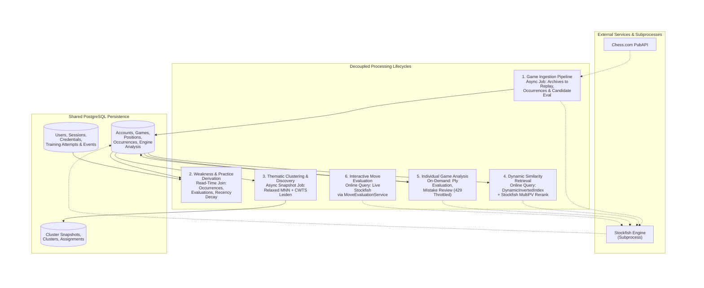

## Request identity, account scope, and errors

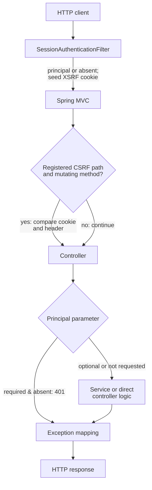

`SessionAuthenticationFilter` never rejects a request; an invalid, expired, or
absent session simply yields no principal. A required `AuthenticatedPrincipal`
is then rejected by `AuthenticatedPrincipalArgumentResolver` with 401. Optional
principal parameters opt into guest-capable routes. The session filter does not
by itself authorize access to an account or job.

The CSRF interceptor checks non-safe methods only when the path matches one of
these registrations: `/api/logout`, `/api/dev/session`, `/api/accounts`,
`/api/accounts/*/connection`, `/api/games/import`, `/api/register`, and
`/api/login`. For those handlers it compares `X-XSRF-TOKEN` with the
`XSRF-TOKEN` cookie in constant time. GET, HEAD, OPTIONS, and CORS preflight are
exempt. Other POST/DELETE routes do not acquire CSRF protection merely by using
the same controller package.

`AccountOwnershipService` is the application boundary for account connections
and account-backed access. `ChessAccount` holds shared identity and
`AccountConnection` links users to accounts; many users may connect one account,
but each user may have only one current connection. Guest username-based
reads/imports ignore connection state. Authenticated imports and personal
Progress require the caller's explicit current connection. Authenticated
shared-data reads by account UUID require a principal and an existing account,
not a current connection. Personal history is separately scoped by user and
account. A username, account UUID, or job UUID is not an authentication
credential.

The `/api/admin` prefix is not an authorization policy. The human-move corpus
controllers below have no principal parameter or invoked account guard, and
their paths are not in the CSRF registration lists. Do not infer administrative
authorization from the URL prefix.

`GlobalExceptionHandler` maps authentication and CSRF failures to 401
`UNAUTHENTICATED` and 403 `CSRF_FAILED`; account absence/denial to 404/403;
request validation to 400 `VALIDATION_ERROR`; and resource absence to 404
`NOT_FOUND`, using structured `ErrorResponse` bodies. It also maps duplicate
registration and active-import conflicts to 409. Corpus-run integrity errors
have a controller-local 409 mapping. Artifact, import, projection, and
cross-cohort routes use an advice for invalid input (400), artifact conflicts
(409), and persistence failures (500). Endpoint tables call out additional
route-specific responses.

See [identity and session](identity-and-session.md) and
[API contract](../../API_CONTRACT.md) for lifecycle
and ownership invariants.

## Identity and connected accounts

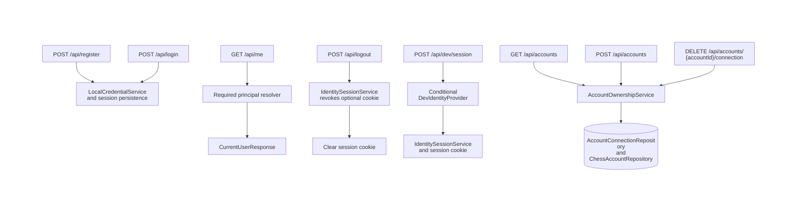

The dev-session route exists only under the `{dev, local}` profile allowlist
and when `chessprobe.auth.dev-mode.enabled=true`; otherwise its controller is
absent. The table records the response and access boundary for each route.

| Method and path | Controller inputs and execution/data path | Response | Access boundary |
|---|---|---|---|
| `POST /api/register` | `AuthController`; `RegistrationRequest` JSON → `LocalCredentialService` → identity/session persistence; writes the session cookie. | 201 `AuthResponse`. | CSRF; no pre-existing session required. Duplicate canonical email maps to 409. |
| `POST /api/login` | `AuthController`; `LoginRequest` JSON → `LocalCredentialService` → identity/session persistence; writes the session cookie. | 200 `AuthResponse`. | CSRF; no pre-existing session required. Unknown email and wrong password share 401 `INVALID_CREDENTIALS`. |
| `GET /api/me` | `SessionController`; required `AuthenticatedPrincipal` → `CurrentUserResponse`. | 200 `CurrentUserResponse`. | Required session; absent/expired session is 401. |
| `POST /api/logout` | `SessionController`; optional configured session-cookie value → `IdentitySessionService.revokeSession` when present → cookie clear. | 204, idempotent. | CSRF; no principal required. |
| `POST /api/dev/session` | `DevSessionController`; servlet request → `DevIdentityProvider.claims` → `IdentitySessionService.establishSession` → session cookie and `CurrentUserResponse`. | 200 `CurrentUserResponse`. | CSRF; conditional profile/property route, otherwise 404. |
| `GET /api/accounts` | `AccountController`; required principal → `AccountOwnershipService.listOwnedAccounts` → `AccountConnectionRepository` and `ChessAccountRepository`. | 200 zero-or-one `ChessAccountResponse` list. | Required session; returns the caller's current connection. |
| `POST /api/accounts` | `AccountController`; principal and `AccountAssociationRequest` JSON → `AccountOwnershipService` → locked user row, shared account lookup/create, and connection insert. | 201 when the shared account is new; 200 when already present or idempotently connected. | Required session and CSRF. A different second connection returns `409 ACCOUNT_CONNECTION_LIMIT_REACHED`. |
| `DELETE /api/accounts/{accountId}/connection` | `AccountController`; UUID path value and principal → `AccountOwnershipService.disconnect` → locked user row and connection deletion. | 204. | Required session and CSRF; removes only the caller's connection. |

## Imports and game reads

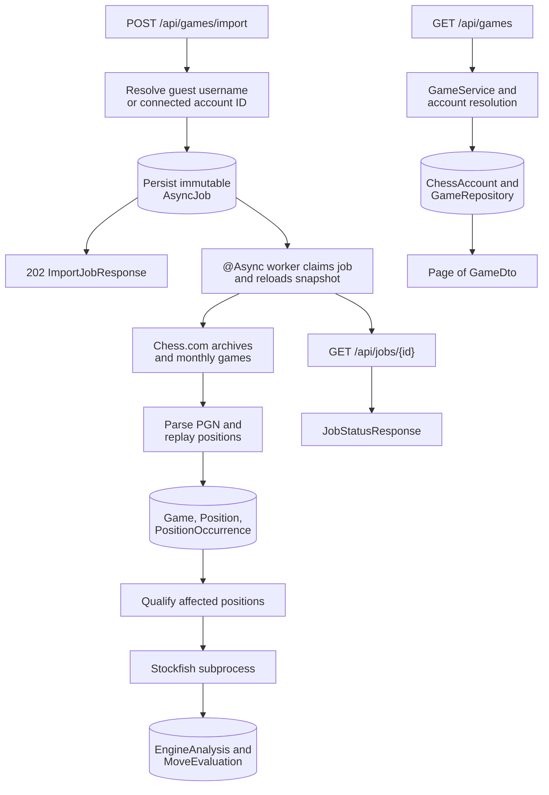

The import controller creates a job and submits its ID to
`GameImportService.executeImportJob`; the worker is asynchronous. The worker
reconstructs its command from the persisted immutable account/date/time-control/
color snapshot, not a later request. Transactions wrap database work rather
than outbound Chess.com calls. The job tracks import and analysis status
separately, uses worker tokens and leases, records progress, and can fail on
invalid persisted configuration or failed work. A database constraint prevents
overlapping active imports for one account.

Analysis is global per position. The orchestrator selects qualifying affected
positions; `EngineAnalysisService` evaluates missing candidates without holding
a database transaction around Stockfish. Unique position/move constraints
provide conflict-safe recovery. Evaluations persist root-relative centipawn
and mate scores (`baselineEvalMate`, `bestMoveEvalMate`, `evalMate`), which are
mutually exclusive and disallow zero mate. Evaluation loss uses an 8-case
piecewise function bounded in [0.0, 20.0]; losing mate against negative centipawns
returns null (horizon effect), causing downstream ranking and progress to skip
null-loss occurrences.

`GameParserService` replays PGN into account/game/color-scoped occurrences. Its
position key hashes the first four FEN fields; `EngineAnalysis` and its move
evaluations are shared by position, while weakness ranking is recalculated for
the selected account. The active import threshold is five occurrences by
default.

| Method and path | Controller inputs and execution/data path | Response | Access boundary |
|---|---|---|---|
| `POST /api/games/import` | `GameImportController`; optional principal and validated `ImportGamesRequest` JSON → `GameImportService.createImportJob` → connection check and persisted immutable `AsyncJob`; submits job ID to `@Async executeImportJob`. | 202 `ImportJobResponse`. | Optional session and CSRF. Guests select by username regardless of connection state; authenticated requests require an explicit currently connected account UUID. |
| `GET /api/jobs/{id}` | `GameImportController`; UUID and optional principal → direct `AsyncJobRepository` load plus optional `ArchiveDerivedProcessingRepository` status lookup → `AccountOwnershipService.authorizeJob` → `JobStatusResponse`. | 200 `JobStatusResponse`. | Optional session; guests may poll guest-started jobs regardless of later connections, and authenticated callers only jobs they initiated. Missing or unresolved jobs map to 404. |
| `GET /api/games` | `GameController`; optional query inputs `username`, `platform` (default `CHESS_COM`), `accountId`, Spring `Pageable`; optional principal → `GameService` → `AccountOwnershipService` and `GameRepository` → `Page<GameDto>`. | 200 page of `GameDto`. | Optional session. Authenticated reads select any existing account UUID; username-based guest reads ignore connection state. |
| `POST /api/games/{id}/analyze` | `GameAnalysisController`; game UUID path value and optional principal → `GameAnalysisService.analyzeGame` → evaluates missing plies via Stockfish under `SimilarityConcurrencyManager` capacity throttle. | 200 `GameAnalysisResponseDto` (complete) or 429 with `Retry-After: 5` header (capacity exceeded). | Optional session and CSRF. |

## Weaknesses and puzzles

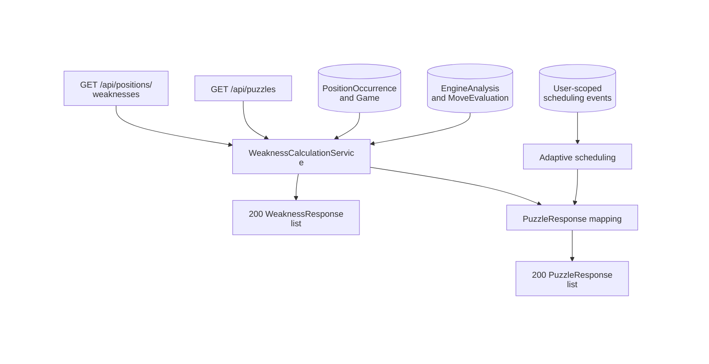

Weaknesses and puzzles are read-time interpretations of occurrences and engine
evaluations. `WeaknessCalculationService` combines objective move loss with
optional account-scoped practical outcome evidence, then returns stable
ordering to both consumers. These read routes do not invoke Stockfish or persist
a weakness materialization; the reserved `UserPositionWeakness` model is not
the active read path. See [precomputed weakness analysis](precomputed-weakness-analysis.md)
and [practical weakness prioritization](practical-weakness-prioritization.md).

| Method and path | Controller inputs and execution/data path | Response | Access boundary |
|---|---|---|---|
| `GET /api/positions/weaknesses` | `WeaknessController`; optional `platform`, `username`, `accountId`, `minEvalLoss` (default 0.8), `minMistakeCount` (default 3), `page` (default 0), `size` (default 20); required `playerColor`; optional principal → `WeaknessCalculationService` → occurrence/game, engine/move-evaluation, practical-evidence, and account-scoped scheduling reads → page slice. | 200 list of `WeaknessResponse`. | Optional session; authenticated shared reads select any existing account ID, while guest username reads ignore connection state. GET is CSRF-exempt. |
| `GET /api/puzzles` | `PuzzleController`; optional `platform`, `username`, `accountId`, `minEvalLoss` (default 0.8), `minMistakeCount` (default 3), `limit` (default 5), `page` (default 0); required `playerColor`; optional principal → same weakness read path → `PuzzleResponse` mapping. | 200 list of `PuzzleResponse`. | Optional session; account selection follows the weakness route rules. GET is CSRF-exempt. |

## Continuation and move evaluation

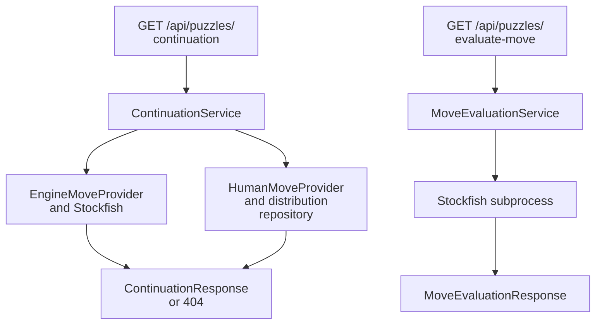

`ContinuationService` selects the requested provider. A HUMAN request with no
eligible empirical moves falls back to ENGINE; an ENGINE request uses Stockfish
directly. Move evaluation validates FEN and move legality before calling
Stockfish.

| Method and path | Controller inputs and execution/data path | Response | Access boundary |
|---|---|---|---|
| `GET /api/puzzles/continuation` | `PuzzleController`; required `fen`; optional `mode` (default `ENGINE`) and `ratingBand` → `ContinuationService` → engine/Stockfish or human distribution provider. | 200 `ContinuationResponse`, or 404 when no candidates exist. | No principal; GET is CSRF-exempt. |
| `GET /api/puzzles/evaluate-move` | `PuzzleController`; required `fen` and `move` → `MoveEvaluationService` validates position/move and calls Stockfish. | 200 `MoveEvaluationResponse`; invalid FEN/move maps to 400. | No principal; GET is CSRF-exempt. |

See [human-move provider architecture](human-move-provider.md) and
[puzzle continuation architecture](puzzle-continuation.md) for the
empirical provider, rating bands, candidate collection, and fallback behavior.

## Training and progress

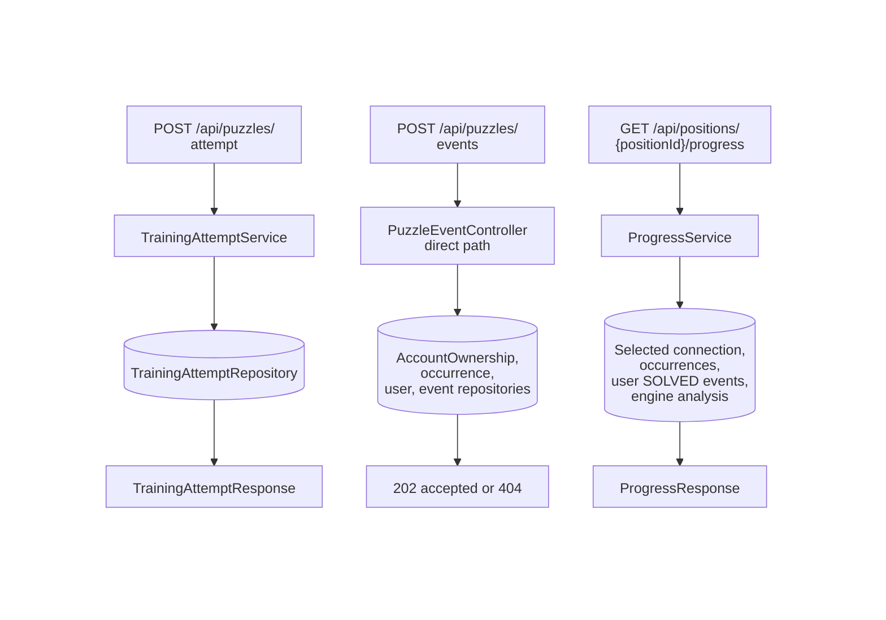

A training attempt is saved through `TrainingAttemptService`; a scheduling
event is written directly by `PuzzleEventController` after resolving the
account and matching occurrence (retaining only `SOLVED` and `FAILED` outcomes).
`ProgressService` reconstructs baseline and SOLVED-gated intervals deterministically
in memory on each read from the explicitly selected current connection's
occurrences, their `Game.playedAt` timestamps, and the authenticated user's SOLVED
events for that account. Checkpoint UUIDs serve as stable observation identities.
Late-imported games integrate deterministically upon read without summary invalidation
or persisted progress rows.

| Method and path | Controller inputs and execution/data path | Response | Access boundary |
|---|---|---|---|
| `POST /api/puzzles/attempt` | `TrainingAttemptRequest` JSON and optional principal → `TrainingAttemptService` validates timing/outcome, optionally resolves `accountId`, then saves `TrainingAttemptRepository` and optional user reference. | 200 `TrainingAttemptResponse`. | Optional session; authenticated attempts must select an account, and account UUIDs require a session. No CSRF registration. |
| `POST /api/puzzles/events` | `PuzzleEventRequest` JSON and required principal → direct `AccountOwnershipService.resolveSharedAccount`, `PositionOccurrenceRepository` lookup, `AppUserRepository` reference, then `PuzzleSchedulingEventRepository.save`. | 202 empty body; 404 if no matching occurrence. | Required session. No CSRF registration. |
| `GET /api/puzzles/{positionId}/attempt-count` | `PuzzleEventController`; `positionId` UUID path variable, `accountId` UUID, `playerColor` query param, required principal → `PuzzleSubmissionService.count` queries submission attempt count for the account/position. | 200 `PuzzleAttemptCountResponse`. | Required session. GET is CSRF-exempt. |
| `GET /api/positions/{positionId}/progress` | `ProgressController`; UUID path value, required `playerColor`, current connected `accountId`, positive finite `minEvalLoss`, and principal → `ProgressService` verifies the connection and reads that account's occurrences plus the user's SOLVED events and engine evaluation; classifies mistakes using the selected Weaknesses threshold and computes baseline/intervals in memory. | 200 `ProgressResponse`; 400 for missing selection or invalid threshold; 404 for unknown/unconnected account. | Required session and current connection. No derived progress row is written. |

## Long decisions

Isolates critical board positions where the player spent an unusually long time thinking before moving.

| Method and path | Controller inputs and execution/data path | Response | Access boundary |
|---|---|---|---|
| `GET /api/positions/long-decisions` | `LongDecisionController`; `accountId`, `timeControl`, `severity`, `minDurationSeconds`, `thresholdSeconds`, `page` (default 0), `size` (default 20), required `AuthenticatedPrincipal` → `LongDecisionService.findLongDecisions` → queries `PositionOccurrence` joined with `Game` filtered by move duration. | 200 `LongDecisionPageResponse`; 400 if no filter threshold provided. | Required session and CSRF-exempt GET. |

## Thematic recurring weaknesses

Discovers thematic weakness clusters across account positions using graph community detection (CWTS Leiden modularity optimization over a Relaxed Mutual Nearest Neighbor graph). Operates as an independent offline asynchronous job lifecycle.

| Method and path | Controller inputs and execution/data path | Response | Access boundary |
|---|---|---|---|
| `POST /api/weaknesses/recurring/discover` | `RecurringWeaknessController`; `RecurringDiscoveryRequest` JSON (`accountId`, optional `username`, `clusterType`, `minSize`) and optional principal → `RecurringWeaknessDiscoveryService.triggerDiscovery` → creates `AsyncJob` and starts background clustering. | 202 `RecurringDiscoveryJobResponse`. | Optional session; CSRF required. |
| `GET /api/weaknesses/recurring/jobs/{jobId}` | `RecurringWeaknessController`; job UUID path value and optional principal → `RecurringWeaknessDiscoveryService.getJob` → polls discovery job status. | 200 `RecurringDiscoveryJobResponse`. | Optional session; authenticated callers authorized for their jobs. |
| `POST /api/weaknesses/recurring/jobs/{jobId}/cancel` | `RecurringWeaknessController`; job UUID path value, optional `accountId`/`username`, optional principal → `RecurringWeaknessDiscoveryService.cancelJob` → transitions job to CANCELLED. | 200 `RecurringDiscoveryJobResponse`. | Optional session; CSRF required. |
| `GET /api/weaknesses/recurring` | `RecurringWeaknessController`; optional `accountId`/`username` and optional principal → `RecurringWeaknessDiscoveryService.getLatestRecurringWeaknesses` → returns latest cluster snapshot summary. | 200 list of `RecurringWeaknessResponse`. | Optional session. |
| `GET /api/weaknesses/recurring/{clusterId}/positions` | `RecurringWeaknessController`; cluster UUID path value, `page`, `size`, `playableOnly`, optional `accountId`, optional principal → `RecurringWeaknessDiscoveryService.getClusterMemberPositions` → paginated member positions. | 200 `ClusterMemberPositionsResponse`. | Optional session. |

## Tactical position similarity

Retrieves structurally or dynamically similar positions across historical games matching an input orthodox FEN.

| Method and path | Controller inputs and execution/data path | Response | Access boundary |
|---|---|---|---|
| `GET /api/positions/similar` | `PositionSimilarityController`; `fen`, optional `accountId`/`username`, `limit` (default 20), `depth` (default 8), `multiPv` (default 1), `mode` (`STRUCTURAL` or `DYNAMIC`), optional principal → `PositionSimilarityService`. Mode `STRUCTURAL` uses an in-memory inverted index on pawn and piece placement subvectors; mode `DYNAMIC` uses `DynamicInvertedIndex` with depth-16 MultiPV Stockfish candidate reranking under `SimilarityConcurrencyManager`. | 200 `SimilarPositionsResponse`; 400 for invalid FEN or parameters. | Optional session. GET is CSRF-exempt. |

## Stockfish Subprocess Lifecycle and Concurrency Model

Stockfish execution in ChessProbe is decoupled across five distinct lifecycles:
1. **Batch Background Analysis** (`EngineAnalysisService`): Invoked during game imports to analyze qualifying positions reached $\ge 5$ times. Executes depth-16 MultiPV-5 analysis sequentially with global deduplication across users.
2. **Dynamic Similarity Evaluation** (`PositionSimilarityService`): Evaluates candidate positions for query-time similarity matching using `DynamicInvertedIndex` tokens. Guarded by `SimilarityConcurrencyManager`.
3. **Interactive Move Evaluation** (`MoveEvaluationService`): Validates and scores user moves on-the-fly during freeform position exploration (`ExplorePositionModal`) and puzzle retry.
4. **Continuation Opponent Moves** (`EngineMoveProvider`): Generates candidate continuation lines for puzzle practice when human move empirical distributions are absent or exhausted.
5. **On-Demand Full Game Review** (`GameAnalysisService`): Evaluates all plies of an individual game upon user request (`POST /api/games/{id}/analyze`).

### Process Execution & Recycling
- **Subprocess Spawning**: Spawns the Stockfish executable declared in `chess.stockfish.path` via `ProcessBuilder`.
- **UCI Protocol**: Interacts using standard UCI commands (`uci`, `isready`, `position fen <fen>`, `go depth <d> multipv <m>`).
- **Watchdog Timeout**: Enforces a strict timeout on every engine invocation. If Stockfish fails to respond within the allotted window or produces malformed UCI output, the process is forcefully destroyed (`destroyForcibly()`) and recycled.

### Concurrency Control & Throttling
- **`SimilarityConcurrencyManager`**: Implements a bounded counting semaphore (configured via `chess.similarity.dynamic.max-concurrent-sessions`, default 2) protecting host CPU resources against thread saturation.
- **Dynamic Retrieval Fallback**: When all permits are in use during a `GET /api/positions/similar?mode=DYNAMIC` request, `PositionSimilarityService` returns a clean response with `fallbackReason: "CAPACITY_EXCEEDED"` without blocking the HTTP worker thread.
- **Game Analysis Throttling**: When all permits are in use during `POST /api/games/{id}/analyze`, `GameAnalysisController` returns HTTP **`429 Too Many Requests`** with a **`Retry-After: 5`** response header.

## Human-move distribution and corpus operations

> [!NOTE]
> **Admin API Boundary**: All endpoints under `/api/admin/human-move-distribution/*` (14 endpoint mappings across 6 controllers) are internal administration and benchmark infrastructure routes. They operate outside the user-facing session boundary and do not require user authentication or CSRF tokens. They are excluded from the public `API_CONTRACT.md`.

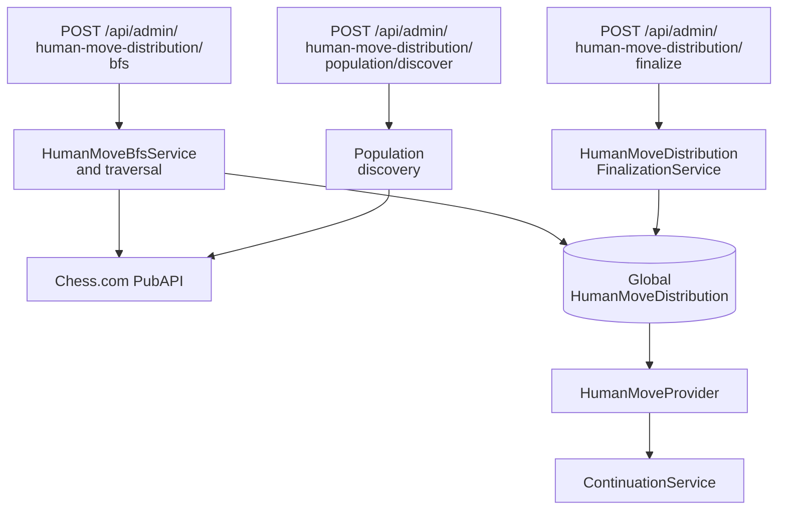

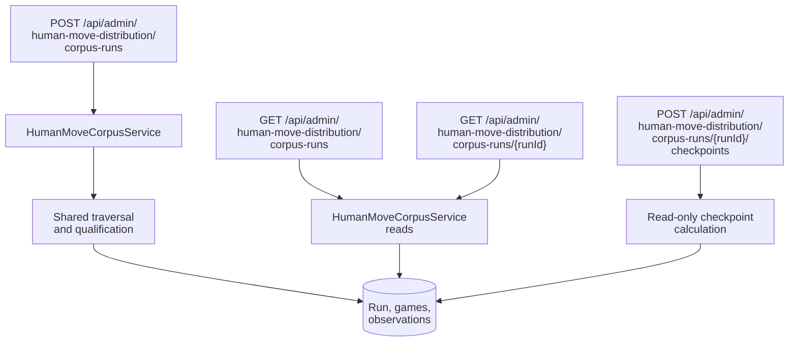

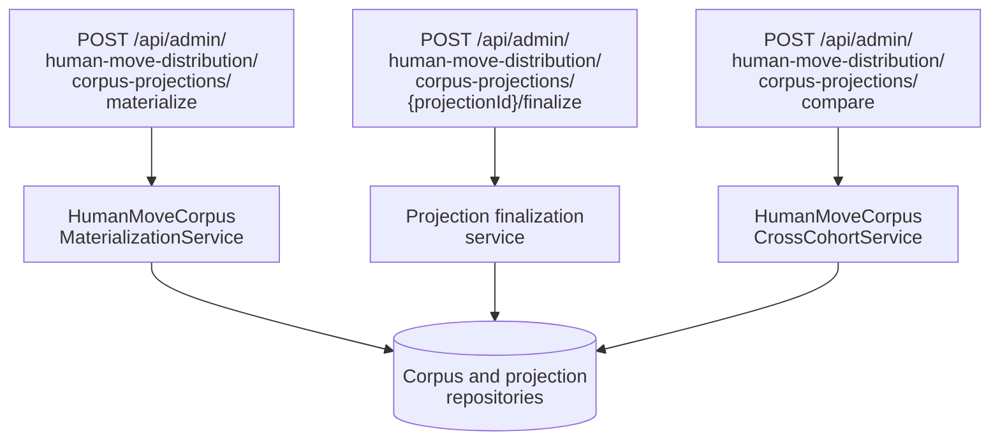

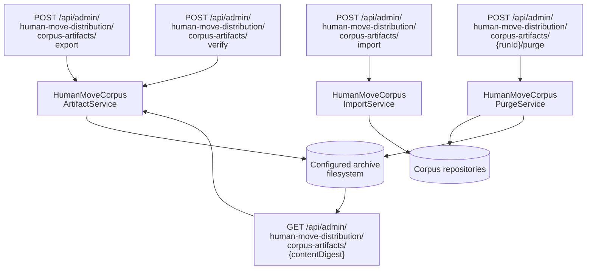

The `/bfs` collector accumulates global distribution observations and
`/finalize` applies its retention decision. Corpus runs have isolated run-scoped
game/observation state and read-only nested checkpoints. Artifact
export/import/verification and projections form separate file/database
lifecycles. Their integrity, atomicity, recovery, and portability details are
maintained in [human-move provider architecture](human-move-provider.md) and
[human-move corpus portability](../engineering/human-move-corpus-portability.md).

All routes in these diagrams are deliberately unauthenticated at the
application-controller level: they do not request a principal or invoke an
account guard, and no route matches the registered CSRF paths. `/api/admin` is
only a URL prefix, not an access control.

| Method and path | Controller inputs and execution/data path | Response | Access boundary |
|---|---|---|---|
| `POST /api/admin/human-move-distribution/bfs` | `HumanMoveBfsController`; `HumanMoveBfsRequest` JSON → `HumanMoveBfsService.runBfs` → Chess.com traversal and global distribution persistence. | 200 `HumanMoveBfsResponse`. | No principal; no CSRF registration. |
| `POST /api/admin/human-move-distribution/population/discover` | `HumanMoveBfsController`; `HumanMovePopulationDiscoveryRequest` JSON → `HumanMoveBfsService.discoverPopulation` → population discovery/provider logic. | 200 `HumanMovePopulationDiscoveryResponse`. | No principal; no CSRF registration. |
| `POST /api/admin/human-move-distribution/finalize` | `HumanMoveBfsController`; `HumanMoveFinalizeRequest` JSON → `HumanMoveDistributionFinalizationService` → transactional band-scoped distribution deletion. | 200 `HumanMoveFinalizeResponse`. | No principal; no CSRF registration. |
| `POST /api/admin/human-move-distribution/corpus-runs` | `HumanMoveCorpusController`; `HumanMoveCorpusRunRequest` JSON → `HumanMoveCorpusService.runCorpus` → traversal, external game fetch, and run/game/observation persistence. | 200 `HumanMoveCorpusRunResponse`. | No principal; no CSRF registration. |
| `GET /api/admin/human-move-distribution/corpus-runs` | `HumanMoveCorpusController`; no inputs → `HumanMoveCorpusService.listRuns` → corpus-run repository. | 200 list of `HumanMoveCorpusRunResponse`. | No principal; no CSRF registration. |
| `GET /api/admin/human-move-distribution/corpus-runs/{runId}` | `HumanMoveCorpusController`; UUID path value → `HumanMoveCorpusService.getRun` → corpus-run repository. | 200 `HumanMoveCorpusRunResponse`; missing run maps to 404. | No principal; no CSRF registration. |
| `POST /api/admin/human-move-distribution/corpus-runs/{runId}/checkpoints` | `HumanMoveCorpusController`; UUID and `HumanMoveCorpusCheckpointRequest` JSON → `HumanMoveCorpusCheckpointService.calculate` → integrity checks and read-only prefix aggregation. | 200 `HumanMoveCorpusCheckpointResponse`; integrity failure maps to 409. | No principal; no CSRF registration. |
| `POST /api/admin/human-move-distribution/corpus-projections/materialize` | `HumanMoveCorpusProjectionController`; `HumanMoveCorpusMaterializeRequest` JSON → `HumanMoveCorpusMaterializationService` → corpus/projection persistence. | 200 `HumanMoveCorpusMaterializeResponse`. | No principal; no CSRF registration. |
| `POST /api/admin/human-move-distribution/corpus-projections/{projectionId}/finalize` | `HumanMoveCorpusProjectionController`; UUID path value → `HumanMoveCorpusProjectionFinalizationService` → projection repository and transactional finalization. | 200 `HumanMoveCorpusProjectionFinalizeResponse`. | No principal; no CSRF registration. |
| `POST /api/admin/human-move-distribution/corpus-projections/compare` | `HumanMoveCorpusCrossCohortController`; `HumanMoveCorpusCrossCohortCompareRequest` JSON → `HumanMoveCorpusCrossCohortService` → read-only cross-cohort projection comparison. | 200 `HumanMoveCorpusCrossCohortCompareResponse`. | No principal; no CSRF registration. |
| `POST /api/admin/human-move-distribution/corpus-artifacts/export` | `HumanMoveCorpusArtifactController`; `HumanMoveCorpusExportRequest` JSON → `HumanMoveCorpusArtifactService.export` → archive filesystem and export receipt. | 200 `HumanMoveCorpusExportReceipt`. | No principal; no CSRF registration. |
| `GET /api/admin/human-move-distribution/corpus-artifacts/{contentDigest}` | `HumanMoveCorpusArtifactController`; digest path value → `HumanMoveCorpusArtifactService.verifiedArchivePath` → filesystem read as `application/octet-stream` resource. | 200 streamed `Resource`; missing artifact maps to 404. | No principal; no CSRF registration. |
| `POST /api/admin/human-move-distribution/corpus-artifacts/verify` | `HumanMoveCorpusArtifactController`; multipart `artifact` plus `expectedDigest` query parameter → controller size check → `HumanMoveCorpusArtifactService.verify`; no publication/write path. | 200 empty body. Invalid/oversized artifact maps to 400. | No principal; no CSRF registration. |
| `POST /api/admin/human-move-distribution/corpus-artifacts/import` | `HumanMoveCorpusImportController`; multipart `artifact` plus `expectedDigest` query parameter → `HumanMoveCorpusImportService.import` → verified artifact processing and transactional corpus publication. | 200 `HumanMoveCorpusImportReceipt`. | No principal; no CSRF registration. |
| `POST /api/admin/human-move-distribution/corpus-artifacts/{runId}/purge` | `HumanMoveCorpusImportController`; UUID and `HumanMoveCorpusPurgeRequest` JSON (`contentDigest`) → `HumanMoveCorpusPurgeService.purge` → corpus persistence and archive lifecycle. | 200 `HumanMoveCorpusPurgeResult`. | No principal; no CSRF registration. |

## Configuration and operational dependencies

| Concern | Current source/configuration |
|---|---|
| Database/schema | `SPRING_DATASOURCE_URL`, `SPRING_DATASOURCE_USERNAME`, and `SPRING_DATASOURCE_PASSWORD`; Hibernate validates the schema and Flyway loads `V1__baseline.sql`. |
| Chess.com PubAPI | `CHESS_PUBAPI_USERNAME` and `CHESS_PUBAPI_CONTACT` are required to build the User-Agent. `CHESS_PUBAPI_DELAY_MS`, `CHESS_PUBAPI_MAX_RETRIES`, `CHESS_PUBAPI_INITIAL_BACKOFF_MS`, and `CHESS_PUBAPI_MAX_BACKOFF_MS` control pacing/retries. Requests are globally serialized; 429 and selected transient 5xx responses are retried. |
| Stockfish | `STOCKFISH_PATH` selects the executable. Import analysis uses depth 16 and an occurrence threshold of 5 by default; `ENGINE_ANALYSIS_MULTI_PV` sets candidate breadth. Continuation uses `ENGINE_CONTINUATION_MULTI_PV` and `ENGINE_CONTINUATION_MAX_EVAL_LOSS`; move exploration uses `ENGINE_EXPLORATION_MAX_EVAL_LOSS`. |
| Human continuation | `human.continuation.min-observations` defaults to 10 observations before a stored human distribution is served; HUMAN mode falls back to ENGINE when the provider has no eligible moves. |
| Sessions/CSRF | `CHESSPROBE_AUTH_COOKIE_SECURE`, `CHESSPROBE_AUTH_COOKIE_SAME_SITE`, `CHESSPROBE_AUTH_SESSION_IDLE_TIMEOUT`, `CHESSPROBE_AUTH_SESSION_ABSOLUTE_TIMEOUT`, and `CHESSPROBE_AUTH_DEV_MODE_ENABLED`; defaults are documented in `application.yml`. |
| Practical ranking | `CHESS_WEAKNESS_PRACTICAL_*` settings control enablement, sample floor, comparator/confidence policy, observation window, and policy version. See [practical weakness prioritization](practical-weakness-prioritization.md). |
| Corpus artifacts | `CHESSPROBE_CORPUS_ARCHIVE_ROOT`, `CHESSPROBE_CORPUS_MAX_ARCHIVE_BYTES`, `CHESSPROBE_CORPUS_MAX_EXPANDED_BYTES`, `CHESSPROBE_CORPUS_MAX_GAMES`, `CHESSPROBE_CORPUS_MAX_OBSERVATIONS`, `CHESSPROBE_CORPUS_MAX_RECORD_BYTES`, `CHESSPROBE_CORPUS_MULTIPART_MAX_FILE_SIZE`, and `CHESSPROBE_CORPUS_MULTIPART_MAX_REQUEST_SIZE` bound the filesystem and upload boundary. |
| CORS | `AppConfig` allows credentialed requests from `http://localhost:3000` and `http://127.0.0.1:3000` with the configured API methods and headers. |

Springdoc's generated Swagger UI/OpenAPI endpoints, including `/swagger-ui.html`
and `/v3/api-docs`, are framework-generated rather than controller mappings and
are outside the endpoint tables. Exact configuration defaults are in
[`application.yml`](../../backend/src/main/resources/application.yml); operator setup
and required PubAPI User-Agent values are in the [README](../../README.md).
The high-level product model and package responsibilities are in
[`docs/tech-spec.md`](../tech-spec.md).
