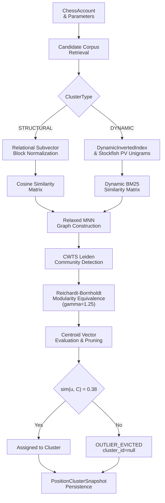
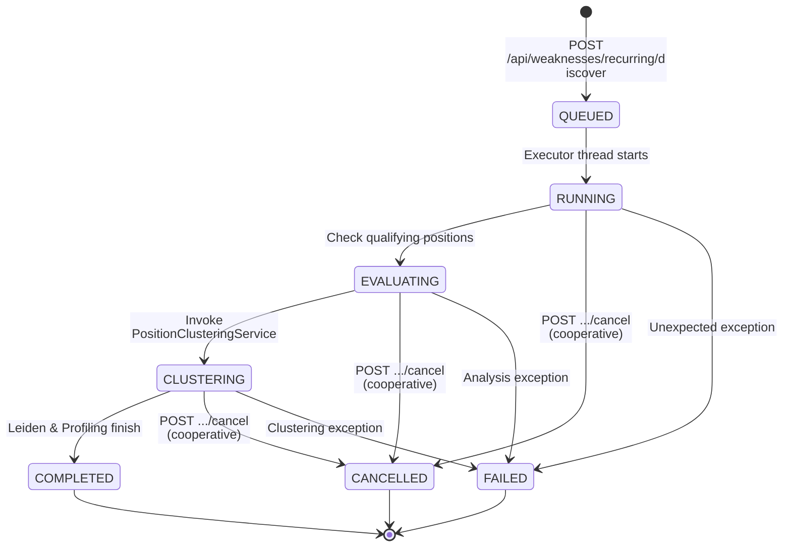
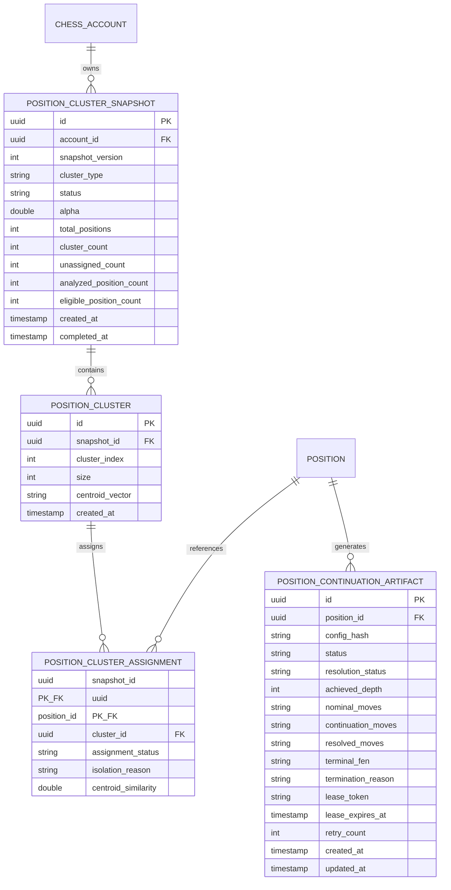

# Historical Position Clustering & Recurring Weakness Discovery Architecture

## 1. Overview

ChessProbe provides account-scoped offline position clustering to identify cohesive thematic position families from an account's historical games. It discovers recurring patterns across openings and middle-game structures where players repeatedly face tactical and positional challenges.

The subsystem operates through two primary components:
1. **`PositionClusteringService`**: Decoupled graph construction, CWTS Leiden community detection, and centroid cohesion pruning supporting both `ClusterType.STRUCTURAL` and `ClusterType.DYNAMIC` clustering pipelines.
2. **`RecurringWeaknessDiscoveryService`**: An asynchronous job coordinator managing background pipeline execution, cooperative cancellation, snapshot persistence, and analytical community profiling.

---

## 2. Clustering Pipeline Architecture



### 2.1 Decoupled Clustering Modes (`ClusterType`)
- **`ClusterType.STRUCTURAL`**: Uses static relational BM25 token representation partitioned into pawn-structure and piece-placement subvectors. A configurable internal weighting parameter $\alpha \in [0.0, 1.0]$ (default $\alpha = 0.60$) balances structural pawn tokens ($v_P$) and piece placement tokens ($v_{Pc}$):
  $$v(p) = [\sqrt{\alpha}\hat{v}_{\text{pawn}}, \sqrt{1-\alpha}\hat{v}_{\text{piece}}]$$
  Vectors use true cosine similarity with explicit zero-norm guards for boundary states.
- **`ClusterType.DYNAMIC`**: Uses precomputed quiescence-extended tactical continuations stored in `position_continuation_artifact`. The engine contract enforces a nominal depth-10 search (single-threaded, 16MB Hash, `Ponder=false`) preserving all MultiPV-1 moves, followed by an 8-ply bounded quiescence search (5,000 node cap). Only positions resolving cleanly (`RESOLVED_QUIET` via `QUIET_STOP` or `RESOLVED_TERMINAL` via checkmate/stalemate) are eligible for clustering tokens. Incomplete lines (`INCOMPLETE_LIMIT` from `PLY_LIMIT`, `NODE_LIMIT`, or `PV_EXHAUSTED`) and unanalyzed positions are excluded from vector generation and assigned `ISOLATE` with explicit `isolation_reason` metadata, tracked alongside `analyzed_position_count` and `eligible_position_count` on `PositionClusterSnapshot`.

### 2.2 Relaxed Mutual Nearest Neighbors (MNN) Graph Construction
To construct robust thematic similarity graphs while avoiding disconnected components:
1. **Symmetric $k$-NN**: Positions are connected if both nodes consider each other in their top-$k$ neighbors ($k = 30$, $\tau_{\text{floor}} = 0.40$).
2. **Asymmetric Top-1 Exception**: If position $u$ has an exceptionally strong top-1 match with $v$ ($\tau_{\text{top1}} = 0.65$), an edge is established even if reciprocity is not satisfied.
3. Deterministic tie-breaking is enforced by sorting candidate positions by `canonicalFen` ascending.
4. If the graph contains zero qualifying edges ($2m = 0.0$), community detection is bypassed and all positions are classified as `ISOLATE`.

### 2.3 CWTS Leiden Community Detection & Modularity Equivalence
The clustering engine integrates `nl.cwts:networkanalysis:1.3.0`:
- Node weights are set to total edge weights ($n_i = k_i$).
- The constant Potts model (CPM) resolution parameter is rescaled against total graph edge weight:
  $$\gamma_{\text{CWTS}} = \frac{\gamma_{\text{RB}}}{2m} \quad (\gamma_{\text{RB}} = 1.25)$$
- This rescaling produces mathematical equivalence with Reichardt-Bornholdt modularity:
  $$\text{calcQuality}_{\text{CWTS}} = Q_{\text{RB}}$$
- The Leiden algorithm is run with quality optimization to guarantee connected, cohesive community clusters.

### 2.4 Centroid Cohesion Pruning
To prevent loose cluster sprawl:
1. Member position vectors are averaged into a cluster centroid:
   $$C = \frac{1}{|K|} \sum_{u \in K} v(u)$$
2. Positions with cosine cohesion below threshold ($\tau_c = 0.38$) are evicted as `OUTLIER_EVICTED` with `cluster_id = null`.
3. Clusters where all members are evicted or that fall below minimum size thresholds are dropped.

---

## 3. Asynchronous Job Lifecycle & Discovery Service



### 3.1 Job Concurrency & Cancellation
- `RecurringWeaknessDiscoveryService` maintains state in memory via `ConcurrentHashMap<UUID, DiscoveryJobState>`.
- Only one active job is permitted per `ChessAccount` at a time. A concurrent duplicate request returns `409 ACTIVE_JOB_CONFLICT`.
- Jobs support cooperative cancellation (`cancellationRequested.set(true)`). Each pipeline phase checks the cancellation token between iterations to safely abort without database corruption.

### 3.2 Community Weakness Profiling (`CommunityWeaknessService`)
Once community clusters are identified, `CommunityWeaknessService` aggregates:
1. **Decision Timing Profile**: Uses `DecisionTimingPolicy` to compute median decision time and percentage of moves classified as `NORMAL`, `EXTENDED`, and `SEVERE`.
2. **Loss Metrics**: Aggregates mean evaluation loss and mistake frequencies.
3. **Format Breakdown**: Partitions performance across Bullet, Blitz, Rapid, and Classical time controls.

---

## 4. Persistence Model

The clustering subsystem persists entities to PostgreSQL across four tables in `V1__baseline.sql`:



- **`position_cluster_snapshot`**: Holds the versioned snapshot metadata, status (`GENERATING`, `ACTIVE`, `SUPERSEDED`, `EXPERIMENTAL`, `FAILED`), coverage telemetry (`analyzed_position_count`, `eligible_position_count`, `total_positions`), and configuration parameters.
- **`position_cluster`**: Represents an individual cohesive cluster with its JSON centroid vector and size metrics.
- **`position_cluster_assignment`**: Maps individual `Position` records to clusters, recording centroid similarity, assignment status (`ASSIGNED`, `OUTLIER_EVICTED`, `ISOLATE`), and explicit `isolation_reason` (`ZERO_TOKENS`, `OUTLIER_EVICTION`, `INCOMPLETE_RESOLUTION`, `UNANALYZED`, `PENDING`, `FAILED`, `GRAPH_ISOLATE`).
- **`position_continuation_artifact`**: Persists decoupled, precomputed nominal depth-10 MultiPV-1 principal variations and quiescence extensions. It supports atomic claiming, lease renewal, fenced completion, and bounded retries. Multiple configurations coexist safely under compound unique key `(position_id, config_hash)`.

---

## 5. End-to-End Reproducible Worked Example

The following trace demonstrates how two distinct historical positions sharing a tactical motif (the Greek Gift bishop sacrifice sequence on h7) are grouped into the same cluster.

### 5.1 Positions & Inputs
- **Position A (French Defense Structure)**:
  `r1bq1rk1/ppp2ppp/2n1pn2/3p4/3P4/2NBPN2/PPP2PPP/R1BQK2R w KQ - 0 7`
- **Position B (Queen's Gambit / Caro-Kann Structure)**:
  `r2q1rk1/pp1n1ppp/2p1pn2/8/1b1P4/2NBPN2/PPP2PPP/R1BQK2R w KQ - 2 9`

### 5.2 Nominal Search & PV Replay
1. **Nominal Engine Search (Stockfish depth 10, MultiPV 1)**:
   - Position A nominal PV: `d3h7 g8h7` (Bxh7+ Kxh7)
   - Position B nominal PV: `d3h7 g8h7` (Bxh7+ Kxh7)
2. **Replay to Search Horizon $B_k$**:
   Both positions replay the 2-ply nominal PV legally without reaching a terminal condition.
3. **Horizon Quietness Evaluation**:
   At $B_k$, the White bishop has been captured on h7 and Black's king is exposed on h7. The position remains forcing (unresolved tactical tension). Quiescence extension (`resolveForcingPvContinuation`) is triggered directly on $B_k$.

### 5.3 Quiescence Extension & Termination
- **Quiescence Options**: `maxDepth = 8, maxNodes = 5000L, timeoutMs = 250L, maxPlies = 10`.
- **Returned Continuation Moves**:
  - Position A: `f3g5 h7g8` (Ng5+ Kg8) $\to$ `TerminationReason.QUIET_STOP`
  - Position B: `f3g5 h7g6` (Ng5+ Kg6) $\to$ `TerminationReason.QUIET_STOP`
- **Complete Resolved Sequences**:
  - Position A: `d3h7 g8h7 f3g5 h7g8`
  - Position B: `d3h7 g8h7 f3g5 h7g6`

### 5.4 Feature Extraction & Clustering
1. **Dynamic Tactical Tokens (`DynamicTacticalScorer`)**:
   Both positions generate shared multi-ply tactical tokens:
   - `!SB` (Bishop sacrifice deliverer)
   - `?S` (Tactical sacrifice flag)
   - `!B>K`, `!N>K` (Created attacks against enemy King)
   - `!-BK`, `!-KN`, `!-NK` (Consecutive piece move pairs)
   - `!xPB` (Consecutive capture sequence)
   - `?px`, `?ox`, `?+` (Player capture, opponent capture, check)
2. **Dynamic TF-IDF Vector Construction**:
   Unpartitioned dynamic vectors with unit Euclidean $L_2$ norm ($|v|_2 = 1.0$).
3. **Candidate Shortlisting (`DynamicInvertedIndex`)**:
   Position B is retrieved as a top candidate for Position A.
4. **Cosine Similarity & Graph Edge**:
   Pairwise cosine similarity exceeds the floor threshold $\tau_{\text{floor}} = 0.40$, creating a mutual edge in `RelaxedMnnGraphBuilder`.
5. **Leiden Community Detection**:
   CWTS Leiden community detection ($\gamma_{\text{RB}} = 1.25$) groups Position A and Position B into the same tactical community cluster.
6. **Empirical Verification**:
   This exact sequence is verified end-to-end by running:
   ```bash
   ./gradlew test --tests 'com.chessprobe.similarity.clustering.DynamicClusteringWorkedExampleTest'
   ```
