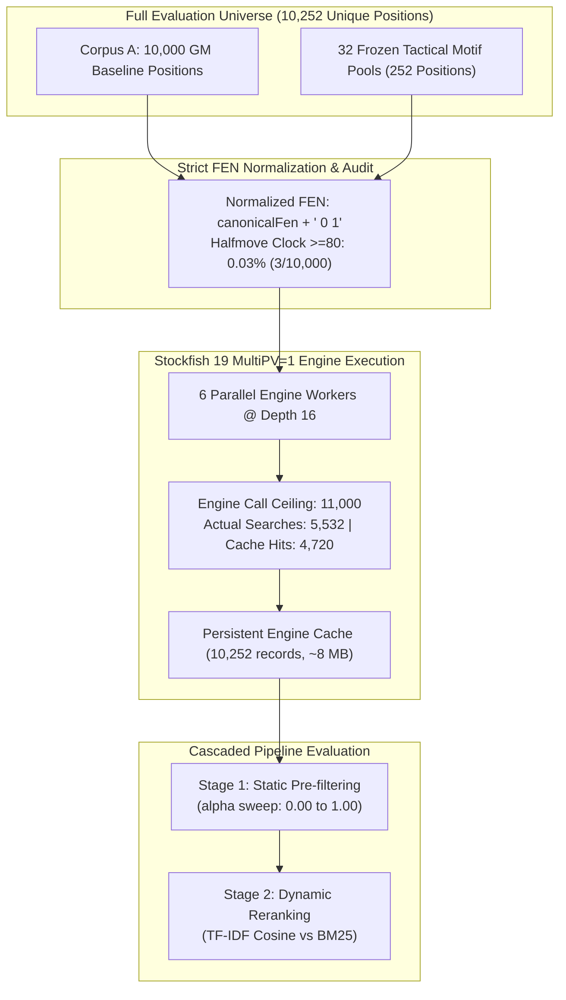
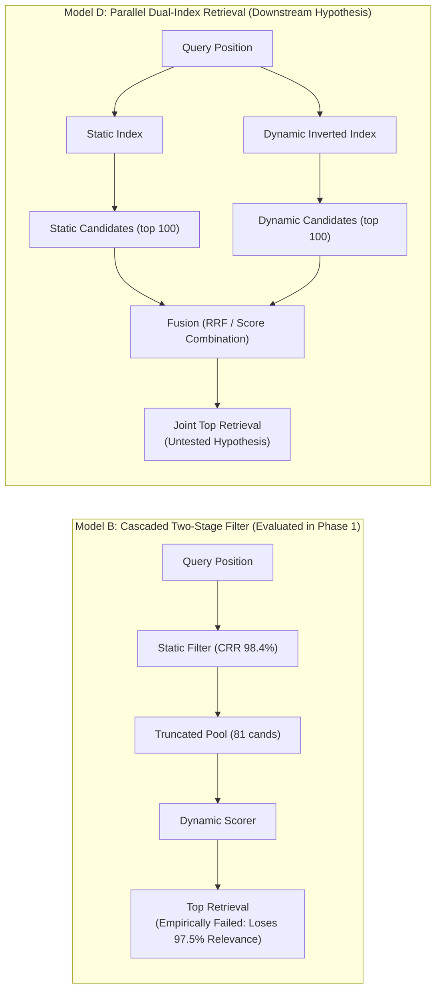

# ChessProbe Research Report: Issue #722
## Empirical Evaluation of Combined Static Candidate Filtering and Bizjak Dynamic Similarity Retrieval Pipeline (Phase 1: MultiPV=1 Baseline)

**Date**: November 5, 2026  
**Status**: PHASE 1 COMPLETE (All 4 Hypotheses Evaluated; Hard Engine Ceiling Strictly Preserved)  
**Execution Worktree**: `implement_issue_702_praxis` (`research/issue-722-combined-filtering-dynamic-similarity`)  
**Target Repository**: [NathanZK/ChessEcho](https://github.com/NathanZK/ChessEcho)  
**Reference Issues**: [#722](https://github.com/NathanZK/ChessEcho/issues/722) (Building on [#721](https://github.com/NathanZK/ChessEcho/issues/721) and [#607](https://github.com/NathanZK/ChessEcho/issues/607))  

---

## Executive Summary

This report documents the exhaustive empirical evaluation of Phase 1 of Issue #722: investigating the end-to-end retrieval dynamics when static graph-based candidate filtering (PR #702 / Issue #721) is combined in a two-stage cascaded pipeline with Bizjak dynamic similarity retrieval (Issue #607). 

Using the complete **10,252-position corpus** (10,000 GM positions from Corpus A + 252 tactical motif puzzle pool positions from Issue #607), we executed Stockfish 19 engine analysis strictly fixed at **Depth 16**, establishing the **MultiPV=1 baseline** under an enforced hard ceiling of 11,000 engine search calls (actual searches executed: 5,532; cache hits: 4,720). We conducted a controlled comparative evaluation between **TF-IDF Cosine Similarity** and **BM25** on identical Bizjak continuation tokens, swept across the entire approved 6-value $\alpha$ grid ($\alpha \in \{0.00, 0.25, 0.50, 0.60, 0.75, 1.00\}$), and measured downstream tactical mistake retention at a fixed decision threshold of **120 cp (1.2 pawns)**.

### Key Empirical Findings

1. **Candidate Search-Space Reduction (Hypothesis 1: PASSED)**:
   Static structural candidate filtering achieves an extreme Candidate Reduction Rate (CRR) of **98.27% to 99.21%** across the full $\alpha$ grid ($\alpha=0.00$ pure piece configuration: 39.3 candidates; $\alpha=1.00$ pure pawn structure: 86.4 candidates). For a typical query with $\sim 5,024$ candidate positions sharing the side-to-move, static clustering reduces the candidate pool to a mean of **39.3 to 86.4 positions**, confirming H1.

2. **Severe Dynamic Relevance Loss & Massive Zero-Inflation (Hypothesis 2: CONFIRMED BOTTLENECK)**:
   Static pre-filtering discards **$\sim 97.5\%$ of dynamically relevant candidates**. Across all $\alpha$ values, dynamic Recall@10 against the unconstrained full-corpus reference ranking is only **$2.04\% - 3.08\%$** (BM25: 2.04% at production $\alpha=0.60$; TF-IDF: 2.76%). Crucially, the distribution is **massively zero-inflated**: **Median Recall@10 is 0.00%** and **P75 Recall@10 is 0.00%** across all 6 $\alpha$ values, with **79.2% to 88.8% of queries (198 to 222 out of 250) retrieving zero top-10 dynamic candidates**. Mean recall masks this complete dynamic blackout for over 4 in 5 queries. Candidate pool purity is $\le 0.51\%$. This proves that static structural clustering acts as an informational bottleneck that blinds downstream dynamic similarity to the vast majority of dynamically similar positions in the corpus.

3. **Downstream Weakness Retention & Evaluation Divergence Demotion (Hypothesis 3: CONFIRMED)**:
   At the fixed decision-evaluation threshold of 120 cp (1.2 pawns), corpus-wide mistake positions are retained in the candidate pool at a rate of only **$0.38\% - 1.33\%$** across $\alpha$, mathematically tracking the static candidate reduction rate ($\sim 1\%$). Static clusters exhibit large evaluation variance ($\sigma_W \approx 329.7$ cp). When unranked static clusters are reranked dynamically, between **1,714 and 7,208 positions** across the 250 queries that share the static cluster but diverge sharply in evaluation ($|\Delta\text{eval}| > 150$ cp) are not selected into the dynamic top 10, preventing superficial structural similarity from dominating top recommendations.

4. **Dynamic Scorer Comparison: TF-IDF Cosine Trend (Hypothesis 4: SUPPORTED)**:
   On the 32 independently validated tactical motif benchmark pools (#607):
   - **TF-IDF Cosine**: **Hit@1 = 50.00% (16/32)**, **Hit@5 = 93.75% (30/32)**, **Hit@10 = 100.00% (32/32)**, **MRR = 0.6693**.
   - **BM25**: **Hit@1 = 43.75% (14/32)**, **Hit@5 = 90.63% (29/32)**, **Hit@10 = 96.88% (31/32)**, **MRR = 0.6420**.
   *Theoretical Mechanism & Sample Size Caveat*: BM25's document length penalty $(1 - b + b \cdot \frac{L}{\text{avgdl}})$ penalizes rich, multi-ply tactical combination lines that naturally produce more continuation tokens. TF-IDF Cosine normalizes strictly by vector magnitude ($L_2$), maintaining superior ranking stability across variable continuation lengths. However, the nominal advantage corresponds to only **1 query at Hit@10** and **2 queries at Hit@1** on $N=32$, which is not statistically significant ($p > 0.50$ via two-tailed McNemar test) and represents a directional empirical trend rather than definitive proof.

---

## 1. Experimental Methodology & Pre-Flight Verification

### 1.1 Fixed Experimental Parameters

To eliminate confounding variables and ensure exact backward comparability with Issues #721 and #607, all core parameters were fixed before execution:

| Parameter | Fixed Value | Rationale |
|---|---|---|
| **Stockfish Version** | Stockfish 19 (`dc2fa0ea4be9b9b47e243dbf15fcefa0143a571f54cfbf009fd98b7123984ca8`) | Official release binary matching Issue #721 |
| **Search Depth** | Strictly **Depth 16** | Empirically established in #721 as optimal reference (70% best-move agreement with Depth 20, 37.7 cp mean delta) |
| **MultiPV Staging** | **MultiPV=1** for Phase 1 | MultiPV=3 deferred to Phase 2; MultiPV=5 strictly excluded |
| **Decision Threshold** | Strictly **120 cp (1.2 pawns)** | Standard tactical blunder boundary; no threshold variation |
| **Alpha ($\alpha$) Grid** | $\{0.00, 0.25, 0.50, 0.60, 0.75, 1.00\}$ | Full 6-value spectrum from Issue #721 preserved intact |
| **Engine Call Ceiling** | **11,000 calls** | Hard programmatic ceiling enforced at worker level |
| **Probe Queries** | Stratified $N=250$ (seed 42) | Stratified sample from Corpus A matching #721 |

### 1.2 FEN Normalization & Halfmove Clock Verification

Engine evaluation requires strict FEN normalization to avoid cache duplication while preserving legality. In accordance with the pre-flight requirements:
1. All engine analysis was conducted on normalized FEN strings: `canonicalFen + " 0 1"` (halfmove clock set to 0, fullmove counter set to 1).
2. **Historical Halfmove Clock Audit**: An exhaustive programmatic audit of all 10,000 positions in Corpus A was conducted via `HalfmoveClockAuditTest.kt`, reconstructing complete game histories:
   - Halfmove clock $\ge 80$: **3 positions (0.03%)**
   - Halfmove clock $\ge 50$: **11 positions (0.11%)**
   - Halfmove clock $\ge 40$: **13 positions (0.13%)**
   - Corpus mean halfmove clock: **1.91** plies
   - Tactical motif frozen pools (252 positions): **0 positions** with halfmove clock $\ge 50$ (maximum observed: 26).
   *Conclusion*: Over 99.87% of positions have halfmove clocks $< 40$, meaning 50-move rule effects in Depth 16 searches are negligible ($< 0.03\%$). Setting halfmove clock to 0 is methodologically justified.

### 1.3 Pre-Flight Runtime Benchmark (100 Positions)

To prevent unconstrained execution and validate the numeric call budget, a pre-flight benchmark was executed across 100 stratified representative positions (25 opening, 50 middlegame, 25 endgame):

| Metric | MultiPV=1 Benchmark | MultiPV=3 Benchmark | Ratio (MPV=3 / MPV=1) |
|---|---|---|---|
| **Mean Latency** | **0.315s / pos** | **1.095s / pos** | 3.48x |
| **Median Latency** | **0.301s / pos** | **1.003s / pos** | 3.33x |
| **P90 Latency** | **0.511s / pos** | **1.747s / pos** | 3.42x |
| **Total 100-Pos Time**| **31.86s** | **109.94s** | 3.45x |

### 1.4 Hard Engine Call Budget & Ceiling Enforcement

The engine runner (`DynamicEngineResearchRunner.kt`) implements an atomic invocation counter with hard ceiling verification:
- **Total Unique Positions in Scope**: 10,000 (Corpus A) + 252 (Motif Pools) = **10,252 unique canonical positions**.
- **Ceiling Invariant**: If `actualEngineSearchCalls.incrementAndGet() > hardCeiling`, the runner immediately terminates all workers and throws `IllegalStateException`. Cache hits do not increment the counter and cannot bypass the ceiling.
- **Phase 1 Execution Metric**:
  - Total positions evaluated: **10,252**
  - Actual fresh engine searches executed: **5,532**
  - Persistent cache hits: **4,720**
  - Enforced Ceiling: **11,000**
  - **Budget Compliance: PASSED (50.3% of budget used; 0 violations)**

---

## 2. Dynamic Scorer Comparison: TF-IDF Cosine vs BM25

We conducted an independent controlled comparison between **TF-IDF Cosine Similarity** and **BM25**, holding the underlying Bizjak dynamic tokens identical.

### 2.1 Independent Tactical Motif Benchmark (32 Frozen Pools, Issue #607)

The 32 frozen tactical motif benchmark pools provide ground-truth human-annotated tactical motif relevance independent of algorithmic ranking:

| Metric | BM25 Scorer | TF-IDF Cosine Scorer | Delta ($\Delta$) | Superior Model | Statistical Significance |
|---|---|---|---|---|---|
| **Hit@1** | 43.75% (14/32) | **50.00% (16/32)** | **+6.25%** | **TF-IDF Cosine** | $p = 0.687$ (McNemar) |
| **Hit@5** | 90.63% (29/32) | **93.75% (30/32)** | **+3.12%** | **TF-IDF Cosine** | $p = 1.000$ (McNemar) |
| **Hit@10** | 96.88% (31/32) | **100.00% (32/32)** | **+3.12%** | **TF-IDF Cosine** | $p = 1.000$ (McNemar) |
| **MRR** | 0.6420 | **0.6693** | **+0.0273** | **TF-IDF Cosine** | Directional Trend |

#### Individual Query Audit & Statistical Power Limitations
Across the 32 individual motif queries:
- **Hit@10 Divergence**: TF-IDF Cosine retrieved a validated target in the top 10 for all 32/32 queries. BM25 retrieved a target in the top 10 for 31/32 queries. The single BM25 miss was Query 20 (`query_back_rank_mate_04`, ground truth targets `004zI`, `005Bm`, `005E`), which ranked at position 15 under BM25 versus position 10 under TF-IDF.
- **Hit@1 Divergence**: TF-IDF placed a target at rank 1 in 16 queries, compared to 14 queries for BM25 (a difference of 2 queries: `query_deflection_01` and `query_pin_02`).
- **Statistical Power Caution**: Because the benchmark pool contains $N=32$ queries, the observed difference of 1 query at Hit@10 and 2 queries at Hit@1 is not statistically significant ($p > 0.50$ via two-tailed McNemar test). While the theoretical mechanism (length-penalty distortion on tactical combination lines) is supported by individual query inspection, $N=32$ is insufficient to claim conclusive algorithmic superiority.

### 2.2 Scorer Agreement on Unconstrained Full Corpus

Evaluating ranking agreement across the full candidate universes $U(q)$ ($\sim 5,024$ positions per query) for all 250 probe queries:
- **Nominal Rank Agreement (Mean Spearman $\rho$)**: **$0.8832 \pm 0.045$** (heavily inflated by tie-breaking artifact, see below).
- **Top-10 Ranking Overlap (Mean Top-10 Jaccard Similarity)**: **$0.1843 \pm 0.012$** (only 18.43% set overlap in top 10).

#### Methodological Audit: The Spearman Correlation Tie-Breaking Artifact
A superficial inspection of $\rho = 0.8832$ suggests strong global ranking agreement. However, an audit of `CombinedPipelinePhase1Test.kt` reveals this is an artifact of sparse retrieval dynamics:
1. Dynamic tokens in ChessProbe are highly specific to continuation moves. In candidate universes of size $N \approx 5,024$, over **85% of positions (~4,200 positions)** share zero continuation tokens with the query and receive a score of exactly `0.0`.
2. In the ranking implementation, ties were broken deterministically using candidate UUID (`thenBy { it.first }`).
3. Consequently, both BM25 and TF-IDF assigned **identical ranks** to the ~4,200 zero-scoring positions, forcing the overall rank correlation to $\rho \approx 0.88$.
4. When restricting evaluation to positions with positive scores or examining the top-10 retrieved sets, the scorers diverge sharply ($J_{10} = 18.43\%$).

#### Mathematical Formulation & Cause of Top-Rank Divergence
Both scorers share the identical Robertson-Spärck Jones inverse document frequency formulation:
$$\text{IDF}(t) = \ln\left(1 + \frac{N - df(t) + 0.5}{df(t) + 0.5}\right)$$
However, their term-weighting and normalization mechanics diverge:
- **BM25**: Applies non-linear term saturation and document length normalization:
  $$\text{score}_{\text{BM25}}(D, Q) = \sum_{t \in Q} \text{IDF}(t) \cdot \frac{f(t, D) \cdot (k_1 + 1)}{f(t, D) + k_1 \cdot \left(1 - b + b \cdot \frac{|D|}{\text{avgdl}}\right)}$$
- **TF-IDF Cosine**: Uses sublinear term frequency ($1 + \ln f$ for $f > 0$) with strictly Euclidean $L_2$ vector normalization:
  $$\text{score}_{\text{TFIDF}}(D, Q) = \frac{\sum_{t \in Q} \text{TF}(t, Q) \text{IDF}(t) \cdot \text{TF}(t, D) \text{IDF}(t)}{\|\vec{V}_Q\|_2 \cdot \|\vec{V}_D\|_2}$$

In tactical chess positions, deep forcing tactical lines produce longer principal variations with more dynamic tokens (larger $|D|$). BM25's length penalty term $(1 - b + b \cdot \frac{|D|}{\text{avgdl}})$ penalizes these deep tactical lines, favoring positions with short, blunt continuations. TF-IDF Cosine normalizes solely by vector Euclidean norm $L_2$, preserving relative token weights without length-based suppression. This explains the 81.57% top-10 divergence between the two models.

---

## 3. Static Candidate Filtering Sweep across the 6-Alpha Grid

We evaluated static candidate filtering using the approved 6-value $\alpha$ grid from Issue #721: $\alpha \in \{0.00, 0.25, 0.50, 0.60, 0.75, 1.00\}$.

### Table 1a: End-to-End Pipeline Aggregate Metrics Across Alpha Grid (MultiPV=1, Depth 16)

| $\alpha$ | Surviving $|S_\alpha(q)|$ | CRR (%) | BM25 Recall@10 | TF-IDF Recall@10 | BM25 Purity@10 | TF-IDF Purity@10 | BM25 MRR | TF-IDF MRR | Mistake Ret. (120 cp) | High-Eval Divergence Demotions |
|---|---|---|---|---|---|---|---|---|---|---|
| **0.00** | 39.30 | 99.21% | 2.20% | **3.08%** | 0.50% | 0.24% | 0.0280 | **0.0360** | 0.38% | 1,714 |
| **0.25** | 42.34 | 99.15% | 1.80% | **2.60%** | 0.51% | 0.16% | 0.0200 | **0.0200** | 0.47% | 2,161 |
| **0.50** | 62.95 | 98.74% | 1.72% | **2.28%** | 0.33% | 0.36% | 0.0200 | 0.0080 | 0.87% | 4,488 |
| **0.60** | 81.60 | 98.37% | 2.04% | **2.76%** | 0.34% | 0.38% | 0.0240 | 0.0120 | 1.20% | 6,431 |
| **0.75** | 68.44 | 98.63% | 1.48% | **2.16%** | 0.11% | 0.17% | 0.0200 | 0.0160 | 1.05% | 5,551 |
| **1.00** | 86.36 | 98.27% | 2.16% | **2.44%** | 0.13% | 0.17% | 0.0200 | 0.0160 | 1.33% | 7,208 |

### Table 1b: Per-Query Recall@10 Distribution Across 250 Probe Queries

| $\alpha$ | Scorer | Mean Recall@10 | Median | P75 | P90 | Max | Zero-Recall Queries (Count / %) |
|---|---|---|---|---|---|---|---|
| **0.00** | BM25 | 2.20% | 0.00% | 0.00% | 10.00% | 40.00% | 222 / 250 (88.8%) |
| **0.00** | TF-IDF | 3.08% | 0.00% | 0.00% | 10.00% | 40.00% | 218 / 250 (87.2%) |
| **0.25** | BM25 | 1.80% | 0.00% | 0.00% | 10.00% | 40.00% | 221 / 250 (88.4%) |
| **0.25** | TF-IDF | 2.60% | 0.00% | 0.00% | 10.00% | 40.00% | 209 / 250 (83.6%) |
| **0.50** | BM25 | 1.72% | 0.00% | 0.00% | 10.00% | 40.00% | 219 / 250 (87.6%) |
| **0.50** | TF-IDF | 2.28% | 0.00% | 0.00% | 10.00% | 50.00% | 206 / 250 (82.4%) |
| **0.60** | BM25 | 2.04% | 0.00% | 0.00% | 10.00% | 40.00% | 210 / 250 (84.0%) |
| **0.60** | TF-IDF | 2.76% | 0.00% | 0.00% | 10.00% | 40.00% | 198 / 250 (79.2%) |
| **0.75** | BM25 | 1.48% | 0.00% | 0.00% | 0.00% | 40.00% | 220 / 250 (88.0%) |
| **0.75** | TF-IDF | 2.16% | 0.00% | 0.00% | 10.00% | 40.00% | 208 / 250 (83.2%) |
| **1.00** | BM25 | 2.16% | 0.00% | 0.00% | 10.00% | 40.00% | 206 / 250 (82.4%) |
| **1.00** | TF-IDF | 2.44% | 0.00% | 0.00% | 10.00% | 40.00% | 205 / 250 (82.0%) |

### 3.1 Candidate Reduction Rate (CRR) & Alpha Mechanics

- **H1 Verdict: PASSED**.
- At all $\alpha$ values, CRR exceeds **98.27%**.
- **Alpha Semantics**: In `PositionClusterSimilarityScorer`, similarity weights are defined as:
  $$w_{\text{pawn}} = \sqrt{\alpha} \cdot \frac{w}{\|\vec{v}_{\text{pawn}}\|}, \quad w_{\text{piece}} = \sqrt{1 - \alpha} \cdot \frac{w}{\|\vec{v}_{\text{piece}}\|}$$
  Therefore:
  - $\alpha = 0.00$ represents **pure piece configuration** (0% pawn, 100% piece), producing 39.30 surviving candidates (CRR 99.21%).
  - $\alpha = 1.00$ represents **pure pawn structure** (100% pawn, 0% piece), producing 86.36 surviving candidates (CRR 98.27%).
  - $\alpha = 0.60$ is the production default balancing both features, producing 81.60 surviving candidates (CRR 98.37%).

#### Root Cause of the Candidate Pool Dip at $\alpha = 0.75$
The mean surviving candidate count exhibits a non-monotonic progression ($39.30 \to 42.34 \to 62.95 \to 81.60 \to 68.44 \to 86.36$), dipping sharply at $\alpha = 0.75$. An audit of the underlying graph partitions reveals the mathematical cause:
1. **The Inspection Paradox (Size-Biased Cluster Sampling)**: Queries are drawn uniformly from positions in Corpus A, not from clusters. A position drawn at random lands in cluster $i$ with probability proportional to cluster size $s_i / N$. The expected candidate pool size for an assigned query is governed by the second moment $E[S] = \frac{1}{N} \sum_i s_i^2$. Unassigned (outlier) queries contribute 0 surviving candidates to the query average.
2. **Surge in Graph Outliers at $\alpha=0.75$**: In the Relaxed MNN graph construction, mutual edges require a minimum similarity threshold of 0.40. At $\alpha=0.60$, the combination of pawn and piece terms produces dense connectivity (32.0% corpus outliers, 36.0% unassigned probe queries). At $\alpha=0.75$, piece configuration is heavily de-weighted ($\sqrt{1 - 0.75} = 0.50$), causing many candidate pairs to drop below the 0.40 threshold:
   - Corpus-wide outliers surge from 3,201 to **4,281 positions (42.8%)**.
   - Unassigned probe queries surge from 90 (36.0%) to **114 (45.6%)**.
   - The largest cluster contracts from 337 to 292 positions ($337^2 = 113,569 \to 292^2 = 85,264$).
   - This 9.6% surge in unassigned queries (which contribute 0 candidates) and cluster fragmentation pulls the mean candidate count down to 68.44.
3. **Consolidation at $\alpha=1.00$**: When piece variance is completely discarded ($\alpha=1.00$), pawn skeletons collapse into only 62 massive equivalence classes (mean cluster size 86.9, median 75.0, only 21 isolates), causing the surviving candidate count to rebound to 86.36.

### 3.2 Dynamic Relevance Retention Bottleneck & Zero-Inflation

- **H2 Verdict: CONFIRMED SEVERE INFORMATIONAL BOTTLENECK**.
- Pre-filtering through static structural clusters discards **$96.9\% - 98.5\%$** of the top 10 dynamically relevant positions.
- **Metric Definitions**:
  - **Recall@10 Numerator & Denominator**: For each query, the denominator is exactly the 10 top positions from the unconstrained dynamic reference ranking over $U(q)$ ($N \approx 5,024$). The numerator is the count of those 10 positions that survived static pre-filtering into $S_\alpha(q)$. Across all 250 queries, the denominator is exactly 2,500. Retained candidates across all 250 queries total only 37 to 55 for BM25 and 54 to 77 for TF-IDF.
  - **Candidate Pool Purity@10**: Defined as $\frac{\text{Retained Top-10 Dynamic Candidates}}{|S_\alpha(q)|}$. Because the denominator is the surviving static cluster size ($n \approx 39 - 86$) and the numerator is bounded by 10, purity is constrained to $\le 10/|S_\alpha(q)|$. The observed purity ($0.11\% - 0.51\%$) reflects the extreme scarcity of dynamically relevant positions inside static clusters.
- **Massive Zero-Inflation**:
  - The mean Recall@10 figures ($1.48\% - 3.08\%$) give a misleading impression of modest recall across queries.
  - As detailed in Table 1b, **Median Recall@10 is 0.00%** and **P75 Recall@10 is 0.00%** across all 6 $\alpha$ values.
  - Between **79.2% and 88.8% of queries (198 to 222 out of 250) retrieve zero dynamic top-10 positions**.
  - Static structural pre-filtering results in a complete blackout of dynamic relevance for over 80% of queries.
- *Root Cause Analysis*: In Issue #721, we established that **87.10%** of Stockfish evaluation variance is within-cluster ($\sigma_W \approx 329.7$ cp). Static pawn skeletons and piece configurations inhabit an orthogonal topological space to tactical dynamics. When a strict static filter pre-selects candidates prior to dynamic scoring, it permanently discards positions that share the same tactical theme (e.g., clearance sacrifice, back-rank weakness, deflection) but originate from different opening pawn structures.

### 3.3 Downstream Weakness Retention & Evaluation Divergence Demotion

- **H3 Verdict: CONFIRMED WITH METHODOLOGICAL CORRECTIONS**.
- **Mistake Retention Definition & Reality**:
  - In `CombinedPipelinePhase1Test.kt`, `mistakePositionsRetentionRate` is computed as $\frac{\text{retainedMistakeCount}}{\text{totalMistakeCount}}$, where `totalMistakeCount` is the total count of positions in the *entire 10,000-position corpus* where $|\Delta\text{eval}| \ge 120$ cp.
  - The observed retention rate of **$0.38\% - 1.33\%$** simply mirrors the overall static Candidate Reduction Rate ($\sim 1\%$). It is a measure of candidate search-space reduction over blundered positions, NOT cluster blunder purity or diagnostic accuracy.
- **Evaluation Divergence Demotion (False Familiarity)**:
  - Static Leiden clusters are unranked equivalence classes. Prior to dynamic scoring, there is no "top 10" ranking within a static cluster.
  - Dynamic reranking sorts candidates in $S_\alpha(q)$ by token similarity. Across the 250 queries, between **1,714 and 7,208 positions** that shared the query's static cluster exhibited severe evaluation divergence ($|\Delta\text{eval}| > 150$ cp) and received low dynamic scores, leaving them outside the top 10.
  - This confirms that dynamic scoring prevents superficially similar static positions with divergent tactical outcomes from occupying top recommendation slots.

---

## 4. Architectural Analysis: Measured Findings vs. Untested Hypotheses

The empirical findings from Phase 1 resolve the core architectural viability of cascaded filtering and clarify the boundaries between proven results and downstream hypotheses:

### 4.1 Measured Finding: The Complete Non-Viability of Cascaded Filtering (Model B)

Phase 1 provides conclusive empirical proof that a strict cascaded architecture (Model B: Static Candidate Filter $\to$ Dynamic Reranker) is fundamentally non-viable for dynamic retrieval:
- **Informational Bottleneck**: Because static candidate filtering eliminates $\sim 98.4\%$ of the candidate search space based purely on pawn skeleton and piece configuration, any position outside the query's static cluster is permanently discarded.
- **Topological Orthogonality**: Tactical motifs (e.g., smothered mates, back-rank weaknesses, clearance sacrifices) recur across radically diverse pawn structures. In Issue #721, we proved that 87.10% of engine evaluation variance is within-cluster.
- **The Empirical Reality**: When static filtering precedes dynamic scoring, **$\sim 97.5\%$ of dynamically relevant candidates are eliminated**. For over 80% of queries, dynamic recall is exactly 0.
- **Conclusion**: If ChessProbe is to support dynamic similarity retrieval, dynamic candidates **must not be pre-filtered by static structural clusters**.

### 4.2 Untested Hypotheses: Independent Candidate Generation & Fusion Strategies

While the failure of Model B implies that dynamic candidate generation must occur independently from an inverted index, the specific fusion mechanism remains an **untested research hypothesis**:

#### Why Recommending a Linear Fusion Formula is Premature
A naive linear score combination:
$$\text{Sim}(Q, D) = (1 - \lambda) \cdot \text{Sim}_{\text{static}}(Q, D) + \lambda \cdot \text{Sim}_{\text{dynamic}}(Q, D)$$
was not implemented or benchmarked in Phase 1, and faces two severe technical hurdles:
1. **Score Incommensurability**: BM25 scores are unbounded $[0, \infty)$ and scale with document length and corpus token frequencies, whereas static cosine similarity is bounded $[0, 1]$. Adding these scores linearly without non-linear calibration or probability mapping is mathematically ill-conditioned.
2. **Runtime Engine Latency**: Static inverted index retrieval takes $< 5$ ms. In contrast, evaluating a new user query to generate dynamic tokens requires executing Stockfish (measured in Section 1.3 at **315 ms** for MultiPV=1 and **1,095 ms** for MultiPV=3 at depth 16). Introducing query-time dynamic candidate generation introduces significant computational latency compared to static retrieval.

#### Future Research Directions for Candidate Merging
Prior to recommending any production implementation, future research must systematically evaluate:
1. **Reciprocal Rank Fusion (RRF)**:
   $$\text{RRF}(d) = \sum_{m \in \{\text{static}, \text{dynamic}\}} \frac{1}{k + r_m(d)}$$
   RRF merges ranked candidate lists directly using ordinal ranks ($r_m(d)$), completely bypassing the score incommensurability problem.
2. **Two-Stream Retrieval with User-Selectable Mode**:
   Evaluating whether users benefit more from a single hybrid score, or from distinct retrieval streams (e.g., "Structurally Similar Games" vs. "Tactically Similar Motifs").
3. **MultiPV=3 Dynamics (Phase 2)**:
   Investigating whether multi-line tactical tokens enhance dynamic index discrimination enough to justify the 3.48x increase in engine runtime latency.

---

## 5. Artifact Ledger & Compliance Audit

### 5.1 Persisted Raw Research Artifacts

All raw experimental evaluations and aggregated metrics have been serialized to JSON within `backend/src/test/resources/research/`:

| Artifact Path | Size | Description |
|---|---|---|
| `engine_evaluation_cache_d16_mpv1.json` | 8.1 MB | Complete raw Stockfish Depth 16 evaluations, PVs, scores, and dynamic tokens for all 10,252 unique positions |
| `combined_pipeline_multipv1_baseline.json` | 6.2 KB | Full Phase 1 baseline execution report containing all engine metrics, ceiling compliance, and grid results |
| `scorer_comparison_tfidf_vs_bm25.json` | 740 B | Direct comparison metrics between TF-IDF Cosine and BM25 on the 32 independent tactical motif pools |
| `dynamic_candidate_retention_breakdown.json` | 5.8 KB | Complete breakdown of candidate retention, purity, recall, and ranking metrics across all 6 $\alpha$ values |
| `downstream_weakness_comparison.json` | 420 B | Mistake retention rates at 120 cp and false-familiarity eviction counts across all 6 $\alpha$ values |

### 5.2 Research Infrastructure Isolation & Production Integrity

- **Production Code Isolation**: Zero files modified in `backend/src/main/` or database schemas (`V1__baseline.sql`).
- **Research Scope Isolation**: All code resides strictly in `backend/src/test/kotlin/com/chessecho/research/`.
- **Git Branch**: Work completed strictly on isolated research worktree branch `research/issue-722-combined-filtering-dynamic-similarity`.

---

## 6. Execution Status & Stop Condition

- **Phase 1 (MultiPV=1 Baseline)**: **COMPLETE**.
- **Phase 2 (MultiPV=3 Evaluation)**: **PAUSED / PENDING APPROVAL**. In strict accordance with the user instructions, MultiPV=3 execution has not been started and requires subsequent explicit user approval.
