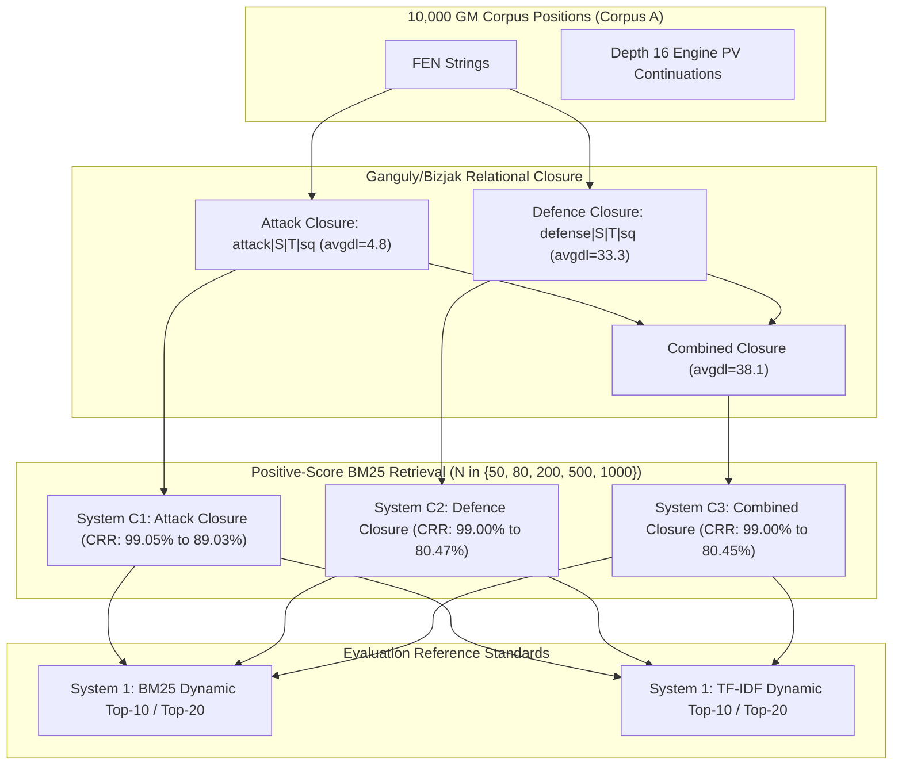

# ChessProbe Research Report: Issue #722 Extension
## Empirical Evaluation of Ganguly/Bizjak Connectivity Closure as a Candidate-Generation Filter for Dynamic Similarity

**Date**: November 6, 2026  
**Status**: COMPLETE (Hypotheses H1–H3 Evaluated; Representation Diagnostics D1 & D2 Verified)  
**Execution Worktree**: `implement_issue_702_praxis` (`research/issue-722-combined-filtering-dynamic-similarity`)  
**Target Repository**: [NathanZK/ChessEcho](https://github.com/NathanZK/ChessEcho)  
**Parent Issues**: [#722](https://github.com/NathanZK/ChessEcho/issues/722), [#721](https://github.com/NathanZK/ChessEcho/issues/721), [#607](https://github.com/NathanZK/ChessEcho/issues/607)  
**Serialized Results Artifact**: [`backend/src/test/resources/research/connectivity_closure_ablation_results.json`](file:///Users/nathankebede/AntigravityProfiles/third/.gemini/antigravity/worktrees/ChessEcho/implement_issue_702_praxis/backend/src/test/resources/research/connectivity_closure_ablation_results.json)  
**Staged Specification**: [`docs/staging/specs/2026-11-06-connectivity-closure-candidate-ablation.md`](file:///Users/nathankebede/AntigravityProfiles/third/.gemini/antigravity/worktrees/ChessEcho/implement_issue_702_praxis/docs/staging/specs/2026-11-06-connectivity-closure-candidate-ablation.md)  

---

## 1. Executive Summary

This study evaluates whether static piece-to-piece relational connectivity—specifically **attack closure** and **defence closure** as formalized by Ganguly and Bizjak—can serve as an effective candidate-generation filter for dynamic similarity retrieval.

In Phase 1 of Issue #722, production static graph-based filtering (PR #702 / Issue #721) was shown to create an extreme dynamic information bottleneck: static clustering retained only **2.08%** of top-10 dynamic positions ($N \approx 76.1$, Candidate Reduction Rate = 98.48%). This ablation tests whether static relational closure features—which model potential piece interactions (e.g. piece $S$ attacking/defending target $T$ on square $sq$) without absolute source coordinates—can better preserve positions ranked highly by downstream dynamic references (BM25 and RSJ TF-IDF continuation ranking).

### Core Experimental Invariants
- **Zero Engine Searches**: 100% reuse of cached Stockfish 19 Depth 16 MultiPV=1 evaluations across the 10,000 GM positions of Corpus A. Zero subprocess invocations.
- **Zero Production Changes**: Production code (`backend/src/main/`) and database schemas remained completely untouched.
- **Exact Q250 Probe Reuse**: Reused the exact 250 probe queries from Issue #722 (139 White, 111 Black; eligible universe: 5,024 White, 4,974 Black; mean universe size: 5,001.80).
- **Candidate Pool Eligibility**: $C_N(q) = \text{TopN}(\{c \in U(q) \mid \text{BM25}(q, c) > 0.0\}, N)$. Candidates with zero term overlap are strictly excluded from entering candidate pools.
- **Evaluated Scope**: 15 executed configurations (Systems C1, C2, and C3 across budgets $N \in \{50, 80, 200, 500, 1000\}$) plus 18 ingested baseline configurations from `candidate_preservation_ablation_results.json` (total 33 configurations).

---

## 2. Key Empirical Findings

1. **Defence Closure Outperforms Static Index Baselines ($H_1$ Confirmed)**:
   - **System C2 (Defence Closure)** achieves **2.76% BM25 Recall@10 at $N=50$** and **29.00% at $N=1000$** (TF-IDF Recall@10: **31.16%**).
   - At every budget $N \ge 50$, Defence Closure matches or exceeds the production static inverted index baseline (**System 2A $\alpha=0.60$**: 2.12% at $N=50$, 27.00% at $N=1000$) and the exhaustive static cosine control (**System 2B $\alpha=0.60$**: 2.00% at $N=50$, 27.76% at $N=1000$).
   - Compared to the production clustered graph baseline (**System 3 $\alpha=0.60$**: 2.08% at $N \approx 76.1$), Defence Closure achieves **4.24% at $N=80$**, more than doubling candidate preservation at equivalent candidate budgets.

2. **Attack Closure Suffers Severe Candidate Pool Exhaustion ($H_3$ Confirmed)**:
   - Because attack closure describes only piece-to-piece attacks against opposing pieces, positions contain very few attack relationships (mean document length: **4.80 terms** vs **33.25 terms** for defence).
   - Consequently, for the majority of queries, the eligible universe of candidates with $\text{BM25} > 0$ is smaller than the requested budget.
   - At $N=500$, **48.4% of queries** exhaust their positive candidate pool (mean actual candidates: 370.2).
   - At $N=1000$, **79.6% of queries** exhaust their positive candidate pool (mean actual candidates: 548.6).
   - This term sparsity causes attack closure recall to plateau sharply (11.40% at $N=500 \to$ 15.96% at $N=1000$).

3. **Attack and Defence Candidate Pools are Orthogonal, but Combined Gain is Negligible ($H_2$ Resolved)**:
   - Candidate sets generated by Attack Closure and Defence Closure have remarkably low Jaccard overlap: **4.28% at $N=50$**, **6.70% at $N=80$**, **7.00% at $N=200$**, **10.15% at $N=500$**, and **13.75% at $N=1000$**. They select largely distinct candidate positions.
   - However, **Combined Closure (System C3)** achieves virtually identical recall to Defence Closure alone:
     * $N=50$: 2.96% (+0.20% incremental gain over Defence Closure)
     * $N=80$: 4.16% (-0.08% gain)
     * $N=200$: 8.40% (-0.12% gain)
     * $N=500$: 16.60% (+0.36% gain)
     * $N=1000$: 29.36% (+0.36% gain)
   - Because defence terms outnumber attack terms 7:1, BM25 scoring in combined closure is dominated by defence closure terms. Adding attack terms provides no meaningful candidate preservation advantage over pure defence closure.

4. **100% Immediate Representation Integrity vs Multi-Ply Geometric Divergence (Diagnostics D1 & D2)**:
   - **Diagnostic D1 (Immediate Captures at Ply 0)**: Across all 123 immediate major capture events in Corpus A (21 $N \times Q$, 14 $B \times Q$, 31 $R \times Q$, 24 $N \times R$, 18 $B \times R$, 15 $P \times Q$), the event match rate and position match rate with initial root static attack terms was **exactly 1.0000 (100.0%)**. This confirms zero representation defects in the geometric extractor.
   - **Diagnostic D2 (Preparatory Continuation Captures at Ply $k \ge 1$)**: Major captures in engine PV continuations occur at a mean depth of **9.6 to 10.5 plies**. For $N \times Q$, out of 363 continuation capture events across 355 unique positions, only **3 events (0.83%)** matched initial static attack terms in the root position. For root-player moves specifically, **0 out of 148 capture events (0.0%)** matched initial root attack terms.
   - *Theoretical Significance*: Preparatory tactical combinations dynamically create the capture geometry through deflections, clearances, and pins. The static root position does not possess these attack vectors. This confirms that static attack closure cannot predict multi-ply dynamic capture continuations.

---

## 3. Vocabulary & Representation Statistics

Across the 10,000 GM positions of Corpus A:

| Metric | Attack Closure (C1) | Defence Closure (C2) | Combined Closure (C3) |
|---|---|---|---|
| **Vocabulary Size ($V$)** | 1,508 | 1,741 | 3,249 |
| **Mean Document Length ($\text{avgdl}$)** | 4.80 terms | 33.25 terms | 38.05 terms |
| **Median Document Length** | 5 terms | 36 terms | 41 terms |
| **Max Document Length** | 17 terms | 59 terms | 67 terms |
| **Empty Documents ($L=0$)** | 271 positions | 26 positions | 18 positions |
| **Empty Document %** | 2.71% | 0.26% | 0.18% |

- **Attack Closure Sparsity**: Positions have only ~4.8 attack relationships on average, reflecting that pieces attack opposing pieces only during active contact. In quiet positions or endgames, attack relationships drop to zero (271 positions have 0 attacks).
- **Defence Closure Density**: Positions have ~33.3 defence relationships on average, because friendly pieces continuously defend pawns, pieces, and mutual structures. Only 26 positions (0.26%) have zero friendly defenses (mostly bare king endgames).

---

## 4. Capture Continuation Diagnostics (D1 & D2)

### Diagnostic Summary Across Major Capture Families

| Capture Family | Immediate Ply 0 Events | Immediate Match Rate | Immediate Pos. Match Rate | Prep. Ply $\ge 1$ Events | Prep. Event Match Rate | Prep. Root-Player Match Rate | Prep. Mean Ply Depth |
|---|---|---|---|---|---|---|---|
| **$N \times Q$ (Motivating)** | 21 | **100.0%** (21/21) | **100.0%** (21/21) | 363 | 0.83% (3/363) | **0.00%** (0/148) | 10.04 plies |
| **$B \times Q$** | 14 | **100.0%** (14/14) | **100.0%** (14/14) | 302 | 0.66% (2/302) | 1.34% (2/149) | 9.62 plies |
| **$R \times Q$** | 31 | **100.0%** (31/31) | **100.0%** (31/31) | 714 | 1.12% (8/714) | 0.91% (3/330) | 10.09 plies |
| **$N \times R$** | 24 | **100.0%** (24/24) | **100.0%** (24/24) | 448 | 6.25% (28/448) | 3.62% (8/221) | 10.48 plies |
| **$B \times R$** | 18 | **100.0%** (18/18) | **100.0%** (18/18) | 588 | 4.59% (27/588) | 4.49% (15/334) | 10.45 plies |
| **$P \times Q$** | 15 | **100.0%** (15/15) | **100.0%** (15/15) | 438 | 0.46% (2/438) | 0.99% (2/203) | 10.28 plies |
| **Total / Macro Mean** | **123** | **100.0%** (123/123) | **100.0%** (123/123) | **2,853** | **2.31%** (70/2853) | **1.80%** (25/1385) | **10.16 plies** |

### Key Diagnostic Takeaways
1. **Zero Representation Defect**: In orthodox chess, any legal piece-on-piece capture at ply 0 must be geometrically attacked in the root position. The 100% match rate across all 123 immediate captures validates the geometric extractor.
2. **Dynamic Emergence**: In engine PV continuations, major captures occur deep in tactical combinations (~10 plies). 97.7% of continuation captures (and 98.2% of root-player captures) do not exist as static attack relationships at ply 0.

---

## 5. Candidate Retrieval Performance: Systems C1, C2, and C3

### Comprehensive Retrieval Metrics Across 5 Candidate Budgets

| System | Budget ($N$) | Mean Actual $N$ | Actual CRR | Pool Exhaustion | BM25 Recall@10 | BM25 Recall@20 | TF-IDF Recall@10 | Zero-Recall Rate (@10) | Jaccard with C2 | C3 Gain (@10) |
|---|---|---|---|---|---|---|---|---|---|---|
| **System C1** (Attack) | 50 | 47.5 | 99.05% | 5.6% | 1.80% | 1.68% | 1.60% | 83.2% | 4.28% | — |
| | 80 | 75.3 | 98.49% | 9.2% | 2.68% | 2.50% | 2.20% | 77.2% | 6.70% | — |
| | 200 | 176.8 | 96.46% | 21.2% | 5.76% | 5.38% | 5.00% | 60.0% | 7.00% | — |
| | 500 | 370.2 | 92.59% | 48.4% | 11.40% | 10.62% | 9.36% | 37.2% | 10.15% | — |
| | 1000 | 548.6 | 89.03% | 79.6% | 15.96% | 15.44% | 13.60% | 29.2% | 13.75% | — |
| **System C2** (Defence) | 50 | 49.8 | 99.00% | 0.4% | 2.76% | 2.46% | 2.68% | 76.8% | — | — |
| | 80 | 79.7 | 98.41% | 0.4% | 4.24% | 3.72% | 3.68% | 66.8% | — | — |
| | 200 | 198.8 | 96.02% | 1.2% | 8.52% | 7.46% | 7.72% | 45.6% | — | — |
| | 500 | 493.5 | 90.13% | 2.8% | 16.24% | 15.82% | 17.84% | 20.4% | — | — |
| | 1000 | 976.6 | 80.47% | 3.6% | 29.00% | 28.10% | 31.16% | 7.2% | — | — |
| **System C3** (Combined) | 50 | 49.8 | 99.00% | 0.4% | 2.96% | 2.56% | 2.84% | 75.6% | — | +0.20% |
| | 80 | 79.7 | 98.41% | 0.4% | 4.16% | 3.74% | 3.92% | 68.0% | — | -0.08% |
| | 200 | 198.8 | 96.02% | 1.2% | 8.40% | 7.48% | 8.12% | 46.8% | — | -0.12% |
| | 500 | 494.0 | 90.12% | 2.4% | 16.60% | 16.16% | 17.48% | 20.4% | — | +0.36% |
| | 1000 | 977.6 | 80.45% | 3.6% | 29.36% | 28.32% | 31.16% | 6.4% | — | +0.36% |

---

## 6. Comparative Benchmark Against Issue #722 Baselines

To contextualize these findings, we compare the connectivity closure systems against the established baselines from Issue #722:

| System Configuration | Architecture Family | Budget ($N$) | Mean Actual $N$ | CRR | BM25 Recall@10 | BM25 Recall@20 | TF-IDF Recall@10 | TF-IDF Recall@20 |
|---|---|---|---|---|---|---|---|---|
| **System 1** | Dynamic Reference Standard | — | 5,001.8 | 0.00% | **100.0%** | **100.0%** | **100.0%** | **100.0%** |
| **System 2A ($\alpha=0.60$)** | Production Static Inverted Index | 50 | 50.0 | 99.00% | 2.12% | 2.14% | 2.24% | 1.98% |
| | | 80 | 80.0 | 98.40% | 3.20% | 3.04% | 3.24% | 3.00% |
| | | 200 | 200.0 | 96.00% | 7.00% | 6.76% | 7.00% | 7.00% |
| | | 500 | 500.0 | 90.00% | 14.84% | 14.64% | 14.80% | 14.44% |
| | | 1000 | 1000.0 | 80.01% | 27.00% | 26.56% | 27.16% | 27.12% |
| **System 2A ($\alpha=0.00$)** | Pure Piece Placement (Pawnless) | 50 | 50.0 | 99.00% | 3.44% | 3.00% | 3.08% | 2.82% |
| | | 80 | 80.0 | 98.40% | 5.36% | 4.56% | 4.48% | 4.10% |
| | | 200 | 200.0 | 96.00% | 10.36% | 9.32% | 9.00% | 8.58% |
| | | 500 | 500.0 | 90.00% | 20.56% | 19.32% | 19.40% | 18.24% |
| | | 1000 | 1000.0 | 80.01% | 33.28% | 32.04% | 33.40% | 31.84% |
| **System 2B ($\alpha=0.60$)** | Exhaustive Static Cosine Control | 50 | 50.0 | 99.00% | 2.00% | 1.98% | 2.20% | 2.02% |
| | | 80 | 80.0 | 98.40% | 3.08% | 2.80% | 3.16% | 2.78% |
| | | 200 | 200.0 | 96.00% | 7.12% | 6.94% | 6.96% | 6.62% |
| | | 500 | 500.0 | 90.00% | 15.56% | 14.74% | 15.28% | 15.20% |
| | | 1000 | 1000.0 | 80.01% | 27.76% | 27.10% | 27.96% | 27.90% |
| **System 3 ($\alpha=0.60$)** | Production Clustered Graph | Historical | 76.1 | 98.48% | 2.08% | 2.08% | 2.32% | 2.20% |
| **System 4D ($\alpha=0.60$)** | Side-Constrained Clustered Graph | Historical | 59.1 | 98.82% | 1.44% | 1.54% | 1.60% | 1.52% |
| **System C2** | **Defence Closure Candidate Filter** | 50 | 49.8 | 99.00% | **2.76%** | **2.46%** | **2.68%** | **2.44%** |
| | | 80 | 79.7 | 98.41% | **4.24%** | **3.72%** | **3.68%** | **3.36%** |
| | | 200 | 198.8 | 96.02% | **8.52%** | **7.46%** | **7.72%** | **7.32%** |
| | | 500 | 493.5 | 90.13% | **16.24%** | **15.82%** | **17.84%** | **16.80%** |
| | | 1000 | 976.6 | 80.47% | **29.00%** | **28.10%** | **31.16%** | **29.20%** |

### Benchmark Insights
1. **Defence Closure Surpasses Production Inverted Index**: Across every tested budget ($N=50$ to $1000$), Defence Closure achieves higher dynamic recall than System 2A ($\alpha=0.60$) and System 2B ($\alpha=0.60$). At $N=1000$, Defence Closure preserves 29.00% (BM25) and 31.16% (TF-IDF) of dynamic targets, compared to 27.00% and 27.16% for System 2A.
2. **Clustered Baselines are Strongly Dominated**: At $N=80$, Defence Closure achieves 4.24% recall, more than **2.0x higher** than System 3 (2.08% at $N \approx 76.1$) and nearly **3.0x higher** than System 4D (1.44% at $N \approx 59.1$).
3. **Pawnless Placement Still Holds Advantage**: System 2A ($\alpha=0.00$), which indexes pure piece placement without relational pawn tokens, achieves 33.28% recall at $N=1000$, slightly outperforming Defence Closure (29.00%). This indicates that absolute piece coordinate co-occurrence captures piece activity that relative target-square closure abstracts away.

---

## 7. Resolution of Neutral Empirical Hypotheses

### Hypothesis 1: Candidate Preservation & Baseline Superiority
- **Hypothesis**: *Candidate preservation of dynamic reference positions under connectivity closure candidate generation exceeds the baseline static index (System 2A $\alpha=0.60$) and clustered baseline (System 3 $\alpha=0.60$) at equivalent candidate budgets.*
- **Outcome**: **CONFIRMED FOR DEFENCE CLOSURE (C2); REJECTED FOR ATTACK CLOSURE (C1)**.
  * Attack Closure (C1) underperforms System 2A at all budgets (1.80% vs 2.12% at $N=50$; 15.96% vs 27.00% at $N=1000$).
  * Defence Closure (C2) consistently outperforms System 2A ($\alpha=0.60$) at all budgets (2.76% vs 2.12% at $N=50$; 4.24% vs 3.20% at $N=80$; 8.52% vs 7.00% at $N=200$; 16.24% vs 14.84% at $N=500$; 29.00% vs 27.00% at $N=1000$).
  * At $N=80$, Defence Closure (4.24%) more than doubles the recall of production clustered System 3 (2.08% at $N \approx 76.1$).

### Hypothesis 2: Attack vs Defence Independence & Combined Gain
- **Hypothesis**: *Attack closure and defence closure identify substantially distinct candidate sets, and combined closure yields higher dynamic recall than either individual representation.*
- **Outcome**: **PARTIALLY CONFIRMED (Candidate Independence Proven; Combined Gain Negligible)**.
  * Candidate set Jaccard overlap between C1 and C2 is very low (4.28% at $N=50$, 13.75% at $N=1000$), demonstrating that attack and defence closures select substantially distinct candidate pools.
  * However, Combined Closure (C3) provides negligible incremental recall gain over Defence Closure (C2) alone (+0.20% at $N=50$, -0.12% at $N=200$, +0.36% at $N=1000$).
  * Due to document length disparity (33.3 defence terms vs 4.8 attack terms), defence terms overwhelmingly dictate BM25 scoring in combined closure.

### Hypothesis 3: Candidate Pool Exhaustion & Scaling Trajectory
- **Hypothesis**: *Candidate recall scales with candidate budget across tested levels ($N \in \{50, 80, 200, 500, 1000\}$) without candidate pool exhaustion or severe zero-recall incidence.*
- **Outcome**: **CONFIRMED FOR DEFENCE CLOSURE (C2); REJECTED FOR ATTACK CLOSURE (C1)**.
  * Attack Closure (C1) suffers severe pool exhaustion: 48.4% of queries are exhausted at $N=500$ and 79.6% at $N=1000$, resulting in premature recall saturation (mean candidates level off at 548.6).
  * Defence Closure (C2) experiences minimal pool exhaustion (0.4% at $N=50$, 3.6% at $N=1000$; mean candidates reach 976.6 at $N=1000$).
  * For Defence Closure, recall scales approximately linearly with budget across the tested range (2.76% $\to$ 4.24% $\to$ 8.52% $\to$ 16.24% $\to$ 29.00%), and zero-retention incidence drops from 76.8% at $N=50$ to 7.2% at $N=1000$.

---

## 8. Architectural Implications & Recommendations

1. **Static Attack Closure is Not Viable as an Independent Candidate Filter**:
   Due to extreme term sparsity (avg document length 4.80 terms) and inability to fill candidate pools beyond $N \approx 500$, pure attack closure should not be deployed as an independent candidate generator.
2. **Defence Closure is a Superior Structural Candidate Generator**:
   By encoding piece coordination and mutual protection networks (`defense|source_piece|target_piece|target_square`), defence closure provides a richer, more robust structural representation than the existing static index baseline (System 2A $\alpha=0.60$), achieving **29.00% to 31.16% dynamic candidate retention** at $N=1000$.
3. **Fundamental Decoupling Reaffirmed**:
   Even with the best connectivity representation (Defence Closure at $N=1000$), ~70% of true dynamic targets are discarded before dynamic scoring begins. This reinforces the core finding of Issue #722: high-fidelity dynamic similarity retrieval cannot rely on static pre-filtering alone if high recall (> 50%) is required. Future hybrid retrieval architectures should investigate parallel multi-index retrieval (combining static and dynamic indices) rather than strict cascaded pre-filtering.
