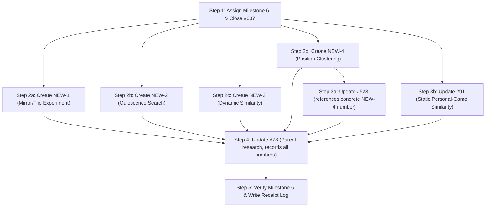

# Specification: Position Similarity, Clustering, and Weakness Determination Roadmap Reconciliation

milestone: M6 (06 - Position Similarity)

## Summary & Declarations

This specification defines the audited, reconciled roadmap for Milestone 6 (`06 - Position Similarity`, milestone number `6`, milestone id `17493016`) in `NathanZK/ChessEcho`. It audits all existing similarity, clustering, and weakness-determination issues, establishes repository truth from code and experimental evidence, and defines the exact GitHub issue mutations (updates, closes, and new issues) strictly conforming to `.github/ISSUE_TEMPLATE/product-issue.md`.

**Scope boundary**: This task performs GitHub issue management (updating issue bodies, titles, labels, assigning milestones, closing completed issue #607, and creating missing issues in Milestone 6). No backend or frontend application or test code in the repository is modified.

**Execution safety & idempotency**:
- All issue bodies will be written to temporary local files under `build/tmp/roadmap/` and passed to `gh` via `--body-file` to completely avoid shell escaping or math syntax corruption (`$`, `<`, `>`).
- Before creating any new issue, `gh issue list --search "<exact title> in:title" --json number` will be executed to guarantee idempotency. If an issue with that exact title already exists, its existing number will be reused rather than creating a duplicate.
- All executed mutations and resulting GitHub issue URLs/numbers will be recorded in an execution receipt log: `docs/experiments/2026-10-26-roadmap-reconciliation-log.md`.

---

## Key Architectural Invariants & Decisions

1. **Static FEN similarity for personal games (#91)**:
   - Initial corpus is strictly the authenticated user's personal games (`Game`, `Position`, `PositionOccurrence`).
   - Candidate generation MUST use an inverted index (e.g. relational tokens) to filter candidates without full-corpus linear scans.
   - Candidate generation is strictly decoupled from the scoring algorithm (Ganguly relational BM25 / Bizjak static pawns).
   - Full-stack exploration requires: username filtering, source-game attribution, exact-ply Chess.com links, and opening existing Line Exploration flow (`SuppliedPositionExploration`) while preserving source navigation context.

2. **Quiescence-search capability (NEW-2)**:
   - Engine quiescence search is scoped as a standalone backend engine capability for arbitrary positions.
   - Evaluated as an engine capability (search depth, tactical resolution, performance overhead).
   - Distinct from dynamic similarity: faithful Bizjak dynamic similarity operates on known move sequences (game or puzzle continuations) and does not require quiescence search. Dynamic similarity depends on quiescence search only if tactical resolution beyond immediate move sequences is investigated in a later pass.

3. **Dynamic FEN similarity (NEW-3)**:
   - Primary baseline must reproduce Bizjak dynamic similarity (dynamic flags and solution tokens) on known move sequences without alterations.
   - Acceptable-move evaluation (e.g. engine-approved candidate moves) is an explicit extension evaluated against the unchanged baseline.
   - Speculative metrics lacking literature foundation (e.g. "centipawn-loss similarity") are strictly prohibited.
   - Does NOT depend on quiescence search (NEW-2); operates directly on game or puzzle move sequences.

4. **Static mirror/flip experiment (NEW-1)**:
   - Dedicated experimental investigation isolating horizontal (file), vertical (rank/color inversion), and combined flips.
   - Experimental investigation only; does NOT block the initial static personal-game feature (#91).

5. **Position clustering (NEW-4)**:
   - Distinct from similarity scoring: similarity scores define pairwise distances, whereas clustering requires an explicit grouping representation (e.g. pawn structures, piece placement graphs) and clustering algorithm (e.g. agglomerative, DBSCAN, or k-medoids).
   - Evaluated on real personal games using standard cluster validation (silhouette score, cluster coherence, separation, stability) against a meaningful baseline before any weakness evaluation is attempted.

6. **Weakness determination across related positions (#523)**:
   - Explicitly compared against ChessEcho's existing exact-position recurrence detector in `WeaknessCalculationService.kt` (which requires $\ge 5$ occurrences, $\ge 3$ mistakes with eval loss $\ge 0.8$ pawns at Stockfish depth 16).
   - Weakness aggregation metrics must be explicit: mistake rate, average evaluation loss, move consistency.
   - Distinct from clustering: clustering groups positions; weakness determination evaluates player performance within those groups.
   - Explicit failure modes addressed: false aggregation of unrelated tactical contexts, dilution of sharp position-specific tactics, masking opening repertoire mistakes.
   - Depends on Position Clustering (NEW-4).

7. **General-population corpus**:
   - Deferred until personal-game retrieval and indexing are validated.
   - Core similarity engine and candidate generation remain decoupled from specific storage layers, allowing future ingestion of human-move corpus or master games.

---

## Execution Sequencing & Dependency Graph

To prevent dangling placeholders or broken issue references, operations must be executed in the following strict order:



---

## Issue Reconciliation Matrix

| Target Ref | Title | Priority & Labels | Target State & Milestone | Planned Action |
|---|---|---|---|---|
| **#607** | `Prototype: Bizjak tactical-motif evaluation (Stages 1 & 2)` | `P1, backend, experiment, research` | CLOSED (`06 - Position Similarity`) | Assign milestone `06 - Position Similarity`, add closing comment, and close with reason `completed`. |
| **NEW-1** | `Experiment: evaluate board symmetries (horizontal, vertical, combined) on static FEN similarity` | `P2, backend, experiment, research` | OPEN (`06 - Position Similarity`) | Create new issue using `build/tmp/roadmap/new1_body.md`. |
| **NEW-2** | `Research & capability: bounded engine quiescence search for arbitrary positions` | `P2, backend, research` | OPEN (`06 - Position Similarity`) | Create new issue using `build/tmp/roadmap/new2_body.md`. |
| **NEW-3** | `Research & experiment: dynamic FEN similarity with Bizjak baseline and acceptable-move evaluation` | `P2, backend, experiment, research` | OPEN (`06 - Position Similarity`) | Create new issue using `build/tmp/roadmap/new3_body.md`. |
| **NEW-4** | `Research & evaluation: position clustering representations and coherence on personal games` | `P2, backend, research` | OPEN (`06 - Position Similarity`) | Create new issue using `build/tmp/roadmap/new4_body.md`. |
| **#91** | `Find similar personal-game positions from an arbitrary FEN (full-stack)` | `P1, full-stack, enhancement` | OPEN (`06 - Position Similarity`) | Update title, labels, milestone, and body using `build/tmp/roadmap/issue91_body.md`. |
| **#523** | `Measure chess weakness across related positions compared to exact-FEN recurrence` | `P3, backend, experiment, research` | OPEN (`06 - Position Similarity`) | Update title, labels, milestone, and body using `build/tmp/roadmap/issue523_body.md` (substituting concrete issue number of NEW-4). |
| **#78** | `Research decision: similar-position retrieval` | `P1, backend, experiment, research` | OPEN (`06 - Position Similarity`) | Update body using `build/tmp/roadmap/issue78_body.md` (substituting all concrete issue numbers). |
| **#522** | `Stage 1 implementation: FEN similarity V1` | `backend, experiment, research` | CLOSED (`06 - Position Similarity`) | Keep CLOSED. Historical record of Stage 1 baseline at `8793d58`. |
| **#526** | `Evaluate FEN similarity retrieval effectiveness` | `backend, experiment, research` | CLOSED (`06 - Position Similarity`) | Keep CLOSED. Historical record of symmetry orbit evaluation on baseline. |

---

## Detailed Payloads and Issue Bodies

### 1. Issue #607 Closing Comment

```markdown
Issue #607 is completed and closed:
- **Prototype and baseline preservation**: The Stage 1 Ganguly baseline (`8793d58`) and Stage 2 Bizjak feature scorer (`BizjakFeatureScorer.kt`, `TacticalMotifBenchmarkRunner.kt`) are fully implemented, tested, and preserved on `exp/tactical-motif-v1` at commit `7d11b3f`.
- **Benchmark results**: Evaluated across both the original frozen candidate pool (`705ab4cb...`) and the independent evaluation pool (`e7c8dd49...`), verifying that static pawns achieve Hit@10 = 0.500 / 0.533 and dynamic flags achieve Hit@10 = 0.800 / 0.700.
- **Durable handoff documentation**: Complete algorithm specification, ranking analysis, retrieval-goal assessment, and research handoff committed under `docs/experiments/` (see `docs/experiments/2026-10-26-tactical-motif-handoff.md`).
- **Review evidence**: Fully audited and reviewed via Praxis review comment #6401620119.
- **Closure limitation**: Closed strictly as a completed prototype experiment. This prototype validates motif-token matching on Lichess puzzle pairs with known solution sequences; it explicitly does not validate production-ready general FEN similarity or arbitrary-FEN retrieval without solution sequences.
```

---

### 2. Issue #91 Body: `Find similar personal-game positions from an arbitrary FEN (full-stack)`

```markdown
## Problem

When exploring an arbitrary chess position (from Line Exploration or direct FEN input), players cannot see whether comparable positions have occurred in their own historical games. Currently, ChessEcho only supports exact-position recurrence lookup (`Position` keyed by SHA-256 of the first 4 FEN fields). If the exact FEN was never reached, no historical personal games or decisions are surfaced, missing opportunities to learn from recurring structures and analogous decisions. Furthermore, evaluating similarity across the entire corpus using linear pairwise scoring is unscalable.

## Goal

Provide a full-stack feature that allows a user to input an arbitrary FEN, query their personal-game corpus for historically similar positions using an inverted index candidate filter followed by static relational BM25 scoring, view the ranked results with full source-game attribution (opponent, date, result, exact-ply Chess.com link), and click through into Line Exploration while preserving the source context.

## Relevant failure modes

1. **Full-corpus linear scan latency**: Querying thousands of personal-game positions with unindexed pairwise relational BM25 computation causes request timeouts (>5s) or excessive CPU consumption.
2. **Loss of exploration context**: Transitioning from a similarity result into Line Exploration loses the source game/ply context, preventing the user from returning or understanding which historical decision was being explored.
3. **Broken Chess.com game links**: Generating external game links without validating the exact ply number or URL scheme leads to 404s or navigates to move 1 rather than the relevant position.
4. **Empty or unpopulated corpus confusion**: When an account has no imported games or no positions exceed the minimum similarity threshold, displaying a generic error instead of a helpful guidance state confuses the user.

## Repository constraints

- Deployment state: pre-deployment, per `docs/engineering/repository-conventions.md`.
- Target corpus: personal games of the authenticated/selected user only (`Game`, `Position`, `PositionOccurrence`). Do not require or depend on an unindexed general-population corpus.
- Architecture: Candidate generation (via inverted index on relational tokens) MUST be decoupled from the scoring algorithm (`FenPositionSimilarity` / `BizjakFeatureScorer` static pawns).
- Storage decoupling: Core similarity interfaces must remain independent of PostgreSQL or in-memory storage, allowing future corpus adapters.
- Frontend: Must integrate with existing Line Exploration (`SuppliedPositionExploration` / `LongDecisionsView.tsx`) preserving source context.

## Acceptance criteria

1. **Input & Validation**: The backend and frontend accept and validate an arbitrary FEN string before initiating retrieval, returning explicit 400 validation errors with descriptive error messages for invalid FENs.
2. **Inverted Index Candidate Generation**: Candidate positions from the user's personal games are retrieved using an inverted index over relational piece-placement/attack tokens, filtering the candidate pool to <=200 candidates before scoring.
3. **Static Relational BM25 Scoring**: Candidate positions are ranked by static relational similarity, returning similarity score, rank, and member occurrences.
4. **Full-Stack Attribution & Links**: The UI displays each result with the played move, game date, opponent username, time control, game result, and an exact-ply Chess.com game URL.
5. **Exploration Navigation**: Clicking a similar position opens the existing Line Exploration flow pre-populated with that FEN, while retaining a back-navigation link to the similarity search results.
6. **Account & Empty States**: Supports username filtering and displays explicit empty states when no similar positions meet the threshold.
7. **Visual & Interaction Evidence**: Reviewable visual screenshots of the results view, empty state, and transition into Line Exploration, accompanied by automated component/integration tests verifying the user flow.

## Validation

- Backend: `./gradlew ktlintCheck` and `./gradlew test` (including unit tests for candidate generator, indexer, and controller integration tests).
- Frontend: `npm run lint`, `npx tsc --noEmit`, `npm run test`, and `npm run build` from `frontend/`.
```

---

### 3. Issue #523 Body: `Measure chess weakness across related positions compared to exact-FEN recurrence`

*(Note: `{CLUSTERING_ISSUE_NUMBER}` will be substituted with the concrete issue number of NEW-4 upon creation)*

```markdown
## Problem

ChessEcho's current weakness detection (`WeaknessCalculationService.kt`) identifies player mistakes exclusively on exact-position recurrence ($\ge 5$ occurrences, $\ge 3$ mistakes with eval loss $\ge 0.8$ pawns at Stockfish depth 16). Players frequently face comparable tactical motifs and pawn structures that differ slightly in non-critical piece placements, falling short of the exact-FEN threshold and leaving real tactical or positional weaknesses undetected. However, naively aggregating moves across similar positions risks false grouping of tactically disparate positions.

## Goal

Conduct an empirical evaluation on real personal games comparing weakness detection aggregated across coherent position clusters against the existing exact-FEN recurrence baseline, quantifying additional detected weaknesses, mistake rate consistency, and failure rates.

## Relevant failure modes

1. **False tactical aggregation**: Grouping positions that share pawn structures but have subtle tactical differences (e.g. an open file or undefended piece) causes sound moves to be misclassified as recurring mistakes.
2. **Sharp tactic dilution**: Aggregating a sharp tactical position where only one move is playable with quieter positions dilutes the severity of critical mistakes.
3. **Opening repertoire masking**: Grouping positions across different opening variations can obscure deliberate repertoire choices or opening preparation.

## Repository constraints

- Deployment state: pre-deployment, per `docs/engineering/repository-conventions.md`.
- Baseline comparison: Must explicitly compare against `WeaknessCalculationService.kt` exact-FEN recurrence on the same player-game sample.
- Dependency: Depends on validated position clustering ({CLUSTERING_ISSUE_NUMBER}); does not invent ad-hoc clusters.
- Engine evidence: Reuse stored depth-16 Stockfish evaluations; do not re-rank clusters using engine evaluations.

## Acceptance criteria

1. **Sample & Metric Definition**: Evaluate on a bounded sample of >=3 real player accounts, defining explicit cluster-level weakness metrics (cluster mistake rate, average evaluation loss, move consistency across cluster members).
2. **Baseline Comparison**: For each detected cluster-level weakness, report: total occurrences, evaluated moves, mistake occurrences ($\ge 0.8$ pawns loss), cluster mistake rate, and whether any member FEN individually qualified under the exact-FEN baseline.
3. **Failure Mode Analysis**: Quantify cases of false aggregation, tactic dilution, and opening masking by manual master-level or engine-refutation inspection of top candidate cluster weaknesses.
4. **Empirical Findings Report**: Commit a durable evaluation report under `docs/experiments/` documenting whether similarity-based clustering reliably surfaces actionable weaknesses beyond exact recurrence.

## Validation

- Bounded experimental evaluation script and reproducible report.
- Backend: `./gradlew test` confirming existing `WeaknessCalculationServiceTest` remains green and unchanged.
```

---

### 4. NEW-1 Body: `Experiment: evaluate board symmetries (horizontal, vertical, combined) on static FEN similarity`

```markdown
## Problem

ChessEcho's static relational FEN similarity representations (Ganguly relational BM25 and Bizjak static pawns) use absolute square coordinates (e.g., `wp_e4`, `reach_N_c3_d5`). In Issue #526, symmetry-orbit retrieval failed (Recall@10 = 0.125) because representations are not transform-invariant. However, #526 tested all symmetries combined. It remains unknown how horizontal reflection (king-side/queen-side flip), vertical reflection (color/rank inversion), and 180-degree rotation independently affect retrieval effectiveness.

## Goal

Isolate and measure the individual impact of horizontal, vertical, and combined board symmetries on static FEN similarity retrieval quality using controlled probe positions, providing clear guidance on whether coordinate canonicalization or symmetry expansion is beneficial.

## Relevant failure modes

1. **Pawn asymmetry distortion**: Horizontal flipping preserves pawn mechanics, but vertical flipping reverses pawn promotion direction and color rights, which can produce illegal or semantically meaningless chess positions if not handled with proper color/en-passant inversion.
2. **Castling rights destruction**: Symmetries can invalidate castling rights and king safety heuristics if tokens are transformed without adjusting king/queen side flags.

## Repository constraints

- Deployment state: pre-deployment.
- Scope: Experimental investigation only; does NOT block the initial static personal-game implementation (#91).
- Baseline: Must use the frozen Stage 1 baseline (`8793d58`) and/or Bizjak static scorer.

## Acceptance criteria

1. **Independent Transformations**: Implement and test three distinct transformations on FEN and relational tokens: (a) horizontal flip (file $a \leftrightarrow h$), (b) vertical color inversion (rank $1 \leftrightarrow 8$ with piece color swap and turn flip), (c) combined 180-degree rotation.
2. **Controlled Evaluation**: Evaluate retrieval across each symmetry independently on a test set of >=50 positions with known structural motifs.
3. **Comparative Metrics**: Measure Hit@k, MRR, and Rank correlation between original queries and transformed counterparts for all three symmetry modes separately.
4. **Documented Findings**: Publish experiment report in `docs/experiments/` stating the quantitative impact of each symmetry and recommending whether symmetry-invariant indexing is justified.

## Validation

- Unit tests verifying symmetry transformations on FENs and relational tokens.
- Backend: `./gradlew test`.
```

---

### 5. NEW-2 Body: `Research & capability: bounded engine quiescence search for arbitrary positions`

```markdown
## Problem

ChessEcho's current engine integration (`StockfishService.kt`) only supports fixed-depth UCI evaluations (`position fen ...`, `go depth <d>`). When evaluating dynamic positions or arbitrary FENs for similarity, fixed-depth search can evaluate positions mid-tactical sequence (the "horizon effect"), yielding volatile evaluations and misleading dynamic features. ChessEcho lacks a bounded quiescence search capability that resolves tactical trades to a quiet position before feature extraction.

## Goal

Implement and validate a bounded engine quiescence search capability that extends tactical lines to a stable, quiet position, providing tactical resolution, principal continuation, and quiet FEN extraction with configurable search limits.

## Relevant failure modes

1. **Tactical search explosion**: Unbounded capture searches can hang or timeout on complex tactical positions with long capture chains or queen checks.
2. **Process starvation**: Spawning multiple engine subprocesses for quiescence search can exhaust system resources and degrade API responsiveness.
3. **Horizon misattribution**: Terminating quiescence search at an arbitrary bound without quietness verification produces misleading evaluations.

## Repository constraints

- Deployment state: pre-deployment.
- Integration: Must extend or integrate with existing `StockfishService` UCI architecture without breaking existing depth-16 analysis paths.
- Distinct from #497: Issue #497 researches bounded puzzle continuation in Milestone 4. This issue establishes the engine quiescence search service API for arbitrary positions.

## Acceptance criteria

1. **API Contract**: Provide a service method in `StockfishService` (`resolveToQuietPosition(fen: String, options: QuiescenceOptions): QuiescenceResult`) accepting an arbitrary FEN and configurable bounds (max depth, timeout ms, quietness threshold).
2. **Quiet Position Extraction**: Returns `QuiescenceResult` containing terminal quiet FEN, principal variation moves, final evaluation in centipawns/mate, and plies searched.
3. **Resource & Timeout Bounds**: Enforces hard timeout and node limits, falling back safely to static evaluation if search limits are exceeded.
4. **Verification Tests**: Test against a suite of sharp tactical positions (e.g. pending captures, checks) verifying that the returned terminal position is tactically quiet.

## Validation

- Backend: `./gradlew ktlintCheck` and `./gradlew test` (including dedicated quiescence search unit/integration tests).
```

---

### 6. NEW-3 Body: `Research & experiment: dynamic FEN similarity with Bizjak baseline and acceptable-move evaluation`

```markdown
## Problem

Issue #607 validated Bizjak tactical-motif dynamic similarity on puzzles with known solution sequences, but dynamic similarity on arbitrary positions requires generating tactical moves and handling alternative acceptable moves. Bizjak's published method only evaluates the single played/solution move. In practical games, multiple moves may be tactically acceptable or equivalent, and positions without known solutions require engine-generated candidate moves.

## Goal

Reproduce the exact Bizjak dynamic similarity baseline on game positions, then implement and evaluate an explicit extension supporting multiple acceptable candidate moves (from engine evaluation), measuring retrieval fidelity and ranking sensitivity against the unchanged baseline without inventing ungrounded metrics.

## Relevant failure modes

1. **Metric corruption by speculative loss formulas**: Introducing invented "centipawn-loss similarity" formulas distorts retrieval rankings and departs from verified research.
2. **Combinatorial explosion of token spaces**: Generating dynamic tokens for too many candidate moves dilutes token discriminability and increases scoring latency.
3. **Inconsistent move generation**: Generating dynamic tokens from inconsistent engine search depths makes similarity scores non-reproducible.

## Repository constraints

- Deployment state: pre-deployment.
- Baseline fidelity: Must preserve the exact Bizjak dynamic baseline (`BizjakFeatureScorer`) as the reference comparator.
- Metric discipline: Acceptable moves must be evaluated via token weighting or rank fusion; do NOT invent speculative metrics like "centipawn-loss similarity".
- Dependency: None (evaluates known move sequences directly from games or tactical puzzles; does not require engine quiescence search).

## Acceptance criteria

1. **Bizjak Baseline Fidelity**: Run the exact Bizjak dynamic scorer on a benchmark set of game positions, recording baseline Hit@k and MRR.
2. **Acceptable-Move Extension**: Implement acceptable-move support where candidate moves within a tight engine threshold ($\Delta \le 20$ cp from best move) contribute dynamic tokens with normalized weights.
3. **Controlled Comparison**: Compare the acceptable-move extension directly against the unchanged single-move baseline on identical candidate pools, measuring ranking shift and motif retrieval accuracy.
4. **Reproducible Report**: Document results in `docs/experiments/` analyzing whether acceptable-move expansion improves motif retrieval or introduces noise.

## Validation

- Backend: `./gradlew test` (verifying dynamic feature extraction and scoring tests).
```

---

### 7. NEW-4 Body: `Research & evaluation: position clustering representations and coherence on personal games`

```markdown
## Problem

Pairwise position similarity scores alone do not partition a player's games into meaningful decision groups. Without a clustering methodology, positions cannot be systematically aggregated to uncover structural patterns or recurring weaknesses. Previous proposals conflated similarity scoring with clustering and lacked objective validation criteria for cluster quality.

## Goal

Research, implement, and evaluate unsupervised position clustering representations (e.g. pawn structure features, static relational embeddings) and algorithms (e.g. agglomerative clustering, DBSCAN) on real player-game corpora, establishing quantitative baselines for cluster coherence, separation, and stability.

## Relevant failure modes

1. **Giant cluster collapse**: Over-weighting common opening pawn structures causes thousands of unrelated middlegame positions to collapse into a single uninformative cluster.
2. **Over-fragmentation**: Strict distance thresholds produce hundreds of singleton clusters, providing no aggregation value.
3. **Instability across game additions**: Adding new games shifts cluster centroids drastically, invalidating historical cluster assignments.

## Repository constraints

- Deployment state: pre-deployment.
- Corpus: Personal games of real player samples from ChessEcho's database.
- Separation: Clustering is evaluated on structural and semantic coherence, NOT on player mistake status or engine loss.
- Foundation: Provides the cluster foundation required by Issue #523.

## Acceptance criteria

1. **Feature Representation**: Define and extract fixed-dimensional or sparse vector representations of positions based on static board features and pawn structures.
2. **Clustering Algorithm**: Implement at least two clustering approaches (e.g. Hierarchical Agglomerative and Medoid/Centroid-based) with configurable similarity thresholds.
3. **Quantitative Metrics**: Evaluate clusters using standard cluster validity indices: silhouette coefficient, within-cluster variance, and stability across random game subsets.
4. **Qualitative Inspection**: Inspect top clusters to verify that grouped positions represent recognizable chess themes (e.g. Carlsbad structure, Isolated Queen Pawn, French defense chains).
5. **Report**: Publish evaluation report in `docs/experiments/` documenting optimal representations, hyperparameter choices, and cluster quality.

## Validation

- Backend/offline clustering evaluation scripts and reproducible report.
- Backend: `./gradlew test`.
```

---

### 8. Issue #78 Update: `Research decision: similar-position retrieval`

*(Note: Concrete issue numbers for NEW-1..NEW-4 will be inserted during execution)*

```markdown
## Problem

ChessEcho deliberately treats a position as recurring only when its first four FEN fields match. That supports precise recurrence, but cannot retrieve different positions that might present a comparable decision. Whether such retrieval would help ChessEcho is an open research question, not an observed defect: ChessEcho is a personal, pre-deployment project with no real-user population or demonstrated demand for similar-position retrieval.

## Goal

Keep this issue as a parent research/decision document: state what the cited research and current repository actually establish, distinguish that from ChessEcho-specific hypotheses, record experimental prototype results, and define the sequenced delivery roadmap for Milestone 6 (`06 - Position Similarity`).

## Research Evidence & Completed Prototype Baseline

### 1. Literature Grounding & Baselines
- **Ganguly, Leveling & Jones (SIGIR 2014)**: Relational BM25 representation (piece placement, attacks, defenses, rays). Clean-room implemented in `FenPositionSimilarity.kt` and frozen at commit `8793d58` (#522). Tested on metamorphic fixtures. Evaluated on symmetry orbits (#526) with Recall@10 = 0.125 (coordinate-bound).
- **Bizjak & Guid (ACG 2021 / Thesis 2020)**: Distinct static resemblance (pawn structures) and dynamic tactical/motif features.

### 2. Completed Issue #607 Prototype Findings (exp/tactical-motif-v1 at commit 7d11b3f)
- **Implementations**: `BizjakFeatureScorer.kt`, `TacticalMotifBenchmarkRunner.kt`, motif detectors for `fork_N` and `back_rank_mate`.
- **Primary Benchmark (705ab4cb...)**: Static pawns Hit@10 = 0.500, MRR = 0.283; Dynamic flags Hit@10 = 0.800, MRR = 0.605; Combined Hit@10 = 0.867, MRR = 0.639.
- **Independent Evaluation (e7c8dd49...)**: Disjoint canonical FENs and games. Static pawns Hit@10 = 0.533, MRR = 0.353; Dynamic flags Hit@10 = 0.700, MRR = 0.490; Combined Hit@10 = 0.733, MRR = 0.528.
- **Documentation**: Completed algorithm specification, per-query ranking analysis, retrieval-goal assessment, and durable research handoff in `docs/experiments/` (commit `7d11b3f`, reviewed via comment #6401620119).

## Milestone 6 Delivery Roadmap & Sequence

Following the completed research baseline in #607, Milestone 6 (`06 - Position Similarity`) is structured into the following focused delivery issues:

1. **#607 [CLOSED]**: Prototype Bizjak tactical-motif evaluation (Stages 1 & 2). Completed research baseline and handoff.
2. **#91 [OPEN, P1]**: `Find similar personal-game positions from an arbitrary FEN (full-stack)`. The core user-facing feature: inverted index candidate generation, static relational BM25 scoring, personal-game corpus, username filtering, source-game attribution, exact-ply Chess.com links, and line exploration integration.
3. **{NEW_1_NUMBER} [OPEN, P2]**: `Experiment: evaluate board symmetries (horizontal, vertical, combined) on static FEN similarity`. Isolated investigation of reflection and rotation invariance.
4. **{NEW_2_NUMBER} [OPEN, P2]**: `Research & capability: bounded engine quiescence search for arbitrary positions`. Standalone engine capability for tactical resolution to quiet positions.
5. **{NEW_3_NUMBER} [OPEN, P2]**: `Research & experiment: dynamic FEN similarity with Bizjak baseline and acceptable-move evaluation`. Depends on quiescence search for arbitrary positions.
6. **{NEW_4_NUMBER} [OPEN, P2]**: `Research & evaluation: position clustering representations and coherence on personal games`. Unsupervised grouping representations and coherence metrics on personal games.
7. **#523 [OPEN, P3]**: `Measure chess weakness across related positions compared to exact-FEN recurrence`. Aggregating mistake rates across position clusters compared to `WeaknessCalculationService.kt`. Depends on position clustering ({NEW_4_NUMBER}).
```

---

## Working notes

### Spec Review Synthesis
- **Reviewers**: `spec-compliance` (`c75f9238`), `safety` (`b442f19d`), `implementability` (`e78c890d`).
- **Trigger Matches**: Triggers 1, 5, 6 fired.
- **Synthesis Findings & Resolutions**:
  - `BLOCK` #78 update description missing -> Resolved: Full issue body for #78 provided with complete research summary and roadmap sequencing.
  - `BLOCK` Unresolved placeholders `(Issue NEW-4)` in #523 and `(New Issue 2)` in NEW-3 -> Resolved: Defined strict execution sequence. NEW issues created first with title search idempotency guards, then concrete numbers substituted into #523 and #78.
  - `BLOCK` Idempotency and duplicate prevention -> Resolved: Mandated `gh issue list --search "<title> in:title"` checks before creation; write bodies via `--body-file` using `build/tmp/roadmap/*.md`.
  - `GAP` Mutation commands and parameters -> Resolved: Fully specified in execution matrix and planned execution steps.
  - `GAP` Acceptance criteria for roadmap reconciliation -> Resolved: Verification step verifies milestone membership, state, and labels for all issues, with an execution log written to `docs/experiments/2026-10-26-roadmap-reconciliation-log.md`.
