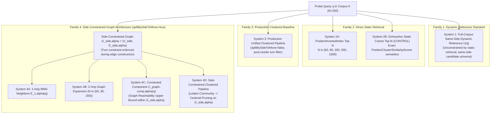

# Experiment Design Specification: Static Candidate Preservation & Dynamic Retrieval Ablation (Issue #722)

**Spec ID**: `2026-11-05-candidate-preservation-ablation`  
**Date**: November 5, 2026  
**Context**: GitHub Issue [#722](https://github.com/NathanZK/ChessEcho/issues/722) (Building on [#721](https://github.com/NathanZK/ChessEcho/issues/721) and [#607](https://github.com/NathanZK/ChessEcho/issues/607))  
**Status**: REVISED SPECIFICATION (Full-Corpus Same-Side Dynamic Reference Standard, Exact 103/109 Configuration Reconciliation, Alpha-Parameterized Graph Sets, and Bounded Reachability Qualification)

---

## 1. Declarative Contract & Invariants

```
contract:   com.chessecho.research.CandidatePreservationAblationRunner
topology:   single
invariants:
  - ZERO_ENGINE_SEARCHES: Reuses existing Stockfish Depth 16 cache (10,252 records in backend/src/test/resources/research/engine_evaluation_cache_d16_mpv1.json). Zero Stockfish subprocess invocations. Missing cache entries trigger an immediate IllegalStateException fail-fast.
  - ZERO_PRODUCTION_CHANGES: Zero edits to backend/src/main/ or database schemas. All logic isolated strictly to test harness under backend/src/test/kotlin/com/chessecho/research/.
  - NO_MULTIPV3: MultiPV=3 execution remains paused; evaluation strictly uses MultiPV=1 baseline dynamic tokens.
  - SIX_ALPHA_GRID: Evaluates all six alpha values: {0.00, 0.25, 0.50, 0.60, 0.75, 1.00}.
  - PRODUCTION_GRAPH_BASELINE: System 3 strictly preserves splitBySideToMove = false matching existing production clustering behavior in PositionClusteringService. Edges in this baseline graph span the unified corpus without active turn partitioning.
  - SIDE_CONSTRAINED_GRAPH_FAMILY: System 4 variants (4A, 4B, 4C, 4D) enforce side-to-move eligibility during graph edge construction (splitBySideToMove = true, restricting candidate edges prior to mutual nearest-neighbor calculation such that (u, v) in E implies sideToMove(u) == sideToMove(v)). Graph traversal and clustering are structurally confined to same-turn subgraphs.
  - ALPHA_PARAMETERIZED_SETS: Graphs and derived candidate sets in Family 4 are explicitly parameterized by alpha: G_side,alpha, C_graph-comp,alpha(q), C_leiden-side,alpha(q), and S_side,alpha(q). H4a and H4b evaluate sets derived from the identical graph and identical alpha.
  - REACHABILITY_UPPER_BOUND_QUALIFICATION: System 4C (C_graph-comp,alpha) is an upper bound strictly on reachability within the constructed side-constrained graph G_side,alpha, not an upper bound on dynamic candidate retrieval across the full candidate universe U(q).
  - CONTROLLED_LEIDEN_ABLATION: System 4D applies Leiden community detection and centroid outlier pruning to the exact same side-constrained graph G_side,alpha as Systems 4A-4C, isolating modularity boundary separation loss from centroid eviction loss on an identical graph topology.
  - STATIC_SCORER_PARITY: System 2B directly binds to PositionClusterSimilarityScorer.buildVector and PositionClusterSimilarityScorer.cosineSimilarity. Automated parity tests across all six alpha values assert strict numerical equivalence (epsilon <= 1e-12) against reference fixtures.
  - ALGORITHMIC_REFERENCE_TERMINOLOGY: System 1 is termed "Full-Corpus Same-Side Dynamic Reference". Its ranking is unconstrained by static candidate retrieval or pruning, but its candidate universe is strictly constrained to the same side-to-move U(q). Algorithmic retrieval rankings (BM25 and TF-IDF Cosine) are termed "algorithmic dynamic reference rankings" throughout; neither is designated chess ground truth.
  - POSITIVE_SCORE_AUDIT: Dynamic reference rankings are audited independently for BM25 and TF-IDF. Positive-only recall is acknowledged as mathematically redundant when all Top-K reference candidates have positive scores, retained solely as a defensive diagnostic.
  - LINEAGE_ACCOUNTING: Differentiates direct index retrieval (c in C_index,200(q)) from graph-expanded recovery (c not in C_index,200(q)) independently for BM25 and TF-IDF.
  - BENCHMARK_SEPARATION: Human-annotated #607 tactical motif puzzle pools (N=32) are strictly isolated from full-corpus algorithmic dynamic reference rankings.
  - DETERMINISTIC_EXECUTION: Probe queries (N=250) selected via corpusDocs.shuffled(Random(42L)).take(250). All ties broken deterministically by canonicalFen ascending, then positionId ascending.
test:       backend/src/test/kotlin/com/chessecho/research/CandidatePreservationAblationTest.kt
artifact:   backend/src/test/resources/research/candidate_preservation_ablation_results.json
convention: Kotlin 2.1.0, JUnit 5, ktlint, detekt, strict immutability, zero production dependency leakage
deferred:
  - Production deployment of dynamic candidate indices
  - Phase 2 MultiPV=3 execution
  - Production selection of candidate fusion algorithms
```

### 1.1 Class Contract

```kotlin
package com.chessecho.research

import com.chessecho.similarity.PositionDocument
import java.io.File

interface CandidatePreservationAblationRunner {
    fun runAblation(
        corpusDocs: List<PositionDocument>,
        probeQueries: List<PositionDocument>,
        alphas: List<Double> = listOf(0.00, 0.25, 0.50, 0.60, 0.75, 1.00),
        directBudgets: List<Int> = listOf(50, 80, 200, 500, 1000),
        graphBudgets: List<Int> = listOf(50, 80, 200),
        engineCacheFile: File = File("backend/src/test/resources/research/engine_evaluation_cache_d16_mpv1.json"),
        frozenPoolsFile: File = File("backend/src/test/resources/research/tactical-motif-frozen-pools.json"),
    ): AblationExperimentResult
}
```

### 1.2 Output Data Schema (`candidate_preservation_ablation_results.json`)

```kotlin
data class AblationExperimentResult(
    val metadata: Map<String, Any>,
    val referenceAudit: DynamicReferenceAuditReport,
    val tacticalMotifBenchmarkValidation: Map<String, Any>,
    val systemResults: Map<String, SystemAblationRecord>,
)

data class DynamicReferenceAuditReport(
    val totalProbeQueries: Int,
    val bm25Audit: ScorerAuditSummary,
    val tfidfAudit: ScorerAuditSummary,
)

data class ScorerAuditSummary(
    val meanPositiveScoreCandidates: Double,
    val minPositiveScoreCandidates: Int,
    val medianPositiveScoreCandidates: Int,
    val maxPositiveScoreCandidates: Int,
    val zeroScoreInTop10Count: Int,
    val zeroScoreInTop20Count: Int,
    val minTop10Score: Double,
    val medianTop10Score: Double,
    val minTop20Score: Double,
    val medianTop20Score: Double,
)

data class SystemAblationRecord(
    val systemId: String,
    val systemType: String, // "DIRECT_INDEX", "STATIC_COSINE_CONTROL", "PRODUCTION_CLUSTERED_BASELINE", "SIDE_CONSTRAINED_GRAPH_EXPANSION", "SIDE_CONSTRAINED_CLUSTERED_PIPELINE"
    val targetBudget: Int?,
    val alphaResults: Map<String, AlphaSystemMetrics>, // Keyed by "alpha_0.60"
)

data class AlphaSystemMetrics(
    val alpha: Double,
    val meanCandidateCount: Double,
    val candidateReductionRate: Double,
    val oppositeSideCandidatesExcludedCount: Int,
    val bm25Metrics: ScorerAblationMetrics,
    val tfidfMetrics: ScorerAblationMetrics,
    val lineageBreakdown: IndependentLineageMetrics?,
)

data class ScorerAblationMetrics(
    val dynamicRecallAt10: Double, // Evaluated over same-side reference R_10
    val dynamicRecallAt20: Double, // Evaluated over same-side reference R_20
    val positiveOnlyRecallAt10: Double, // Defensive diagnostic (identical to dynamicRecallAt10 when zeroScoreCount == 0)
    val positiveOnlyRecallAt20: Double,
    val purityAt10: Double, // Evaluated with denominator |C(q)|
    val purityAt20: Double, // Evaluated with denominator |C(q)|
    val retainedAt10Distribution: MetricDistribution,
    val retainedAt20Distribution: MetricDistribution,
)

data class MetricDistribution(
    val min: Int,
    val p25: Int,
    val median: Int,
    val p75: Int,
    val p90: Int,
    val max: Int,
    val mean: Double,
    val zeroCount: Int,
    val zeroPct: Double,
)

data class IndependentLineageMetrics(
    val bm25DirectRecalledAt10: Int,
    val bm25GraphRecalledAt10: Int,
    val bm25GraphRecoveryRatioAt10: Double,
    val bm25DirectRecalledAt20: Int,
    val bm25GraphRecalledAt20: Int,
    val bm25GraphRecoveryRatioAt20: Double,
    val tfidfDirectRecalledAt10: Int,
    val tfidfGraphRecalledAt10: Int,
    val tfidfGraphRecoveryRatioAt10: Double,
    val tfidfDirectRecalledAt20: Int,
    val tfidfGraphRecalledAt20: Int,
    val tfidfGraphRecoveryRatioAt20: Double,
)
```

---

## 2. Source-Verified Reconciliation of $\alpha = 0.60$ Recall Metrics

Seemingly divergent recall numbers for the $\alpha = 0.60$ baseline in previous reports represent distinct evaluation scopes:

| Metric Scope | Reported $\alpha=0.60$ Value | Source Artifact | Algorithmic Dynamic Reference | Candidate Pool Evaluated |
|---|---|---|---|---|
| **1. Static-on-Static Pruning Fidelity (#721)** | **Recall@10 = 98.36%** | `issue-721-clustering-evaluation-report.md:110` | Exhaustive Static Cosine Similarity | Top-200 Inverted Index ($C_{\text{index}, 200}$) |
| **2. Dynamic Pipeline Recall (#722 Baseline)** | **Recall@10 = 2.76%** (TF-IDF, 69/2,500)<br/>**Recall@10 = 2.04%** (BM25, 51/2,500) | `dynamic_candidate_retention_breakdown.json:97,109` | Stockfish Depth 16 Dynamic Continuation Tokens | Final Surviving Static Cluster ($S_{0.60}(q)$, historical mean size 81.6) |
| **3. Raw Inverted Index Retention (#722 Stage 1)** | **Recall@10 = 7.56%** (TF-IDF, 189/2,500)<br/>**Recall@10 = 7.40%** (BM25, 185/2,500) | `stage_by_stage_retention_analysis.json:18` | Stockfish Depth 16 Dynamic Continuation Tokens | Raw Top-200 Inverted Index ($C_{\text{index}, 200}$) before Graph/Leiden |
| **4. Direct-Lineage Waterfall Retention (#722 Waterfall)** | **Recall@10 = 1.40%** (TF-IDF, 35/2,500)<br/>**Recall@10 = 1.04%** (BM25, 26/2,500) | `stage_by_stage_retention_analysis.json:15` | Stockfish Depth 16 Dynamic Continuation Tokens | Final Cluster candidates originating in query's top-200 ($S_{0.60} \cap C_{\text{index}, 200}$) |
| **5. Graph-Expanded Recovery (#722 Waterfall)** | **Recall@10 = 1.36%** (TF-IDF, 34/2,500)<br/>**Recall@10 = 1.00%** (BM25, 25/2,500) | `stage_by_stage_retention_analysis.json` (Final minus Direct) | Stockfish Depth 16 Dynamic Continuation Tokens | Final Cluster candidates recovered via multi-hop edges ($S_{0.60} \setminus C_{\text{index}, 200}$) |
| **6. Diagnostic Tactical Benchmark (#607 / #722)** | **Hit@10 = 100.0%** (TF-IDF, 32/32)<br/>**Hit@10 = 96.88%** (BM25, 31/32) | `scorer_comparison_tfidf_vs_bm25.json:4` | Human Puzzle Annotations | 32 Frozen Puzzle Pools ($N \approx 8$ per pool) |

---

## 3. Dynamic Reference Ranking Audit & Metric Definitions

### 3.1 Pre-Flight Reference Score Audit (MultiPV=1, Depth 16)
An empirical audit across all 250 probe queries evaluated against the candidate universe $U(q) \approx 5,024$ was conducted independently for BM25 and TF-IDF Cosine:

- **BM25 Dynamic Reference Scoring Audit**:
  - Positive-scoring candidates ($\text{score}_{\text{BM25}}(q, c) > 0.0$):
    - Mean: **4,991.6 out of ~5,024 (99.35%)**
    - Min: **4,634** candidates
    - Median: **4,995** candidates
    - Max: **5,023** candidates
  - Score distribution at reference cutoffs:
    - 10th-position cutoff score: Min **7.3522**, Median **23.0641**
    - 20th-position cutoff score: Min **7.0655**, Median **22.2588**
  - Zero-score contamination:
    - Queries with $< 10$ positive BM25 candidates: **0 / 250 (0.0%)**
    - Queries with $< 20$ positive BM25 candidates: **0 / 250 (0.0%)**
    - Zero-score entries in $R_{10}^{\text{BM25}}$ or $R_{20}^{\text{BM25}}$: **0 entries**

- **TF-IDF Dynamic Reference Scoring Audit**:
  - Positive-scoring candidates ($\text{sim}_{\text{TF-IDF}}(q, c) > 0.0$):
    - Mean: **4,991.6 out of ~5,024 (99.35%)**
    - Min: **4,634** candidates
    - Median: **4,995** candidates
    - Max: **5,023** candidates
  - Score distribution at reference cutoffs:
    - 10th-position cutoff score: Min **0.2463**, Median **0.6238**
    - 20th-position cutoff score: Min **0.1970**, Median **0.5949**
  - Zero-score contamination:
    - Queries with $< 10$ positive TF-IDF candidates: **0 / 250 (0.0%)**
    - Queries with $< 20$ positive TF-IDF candidates: **0 / 250 (0.0%)**
    - Zero-score entries in $R_{10}^{\text{TF-IDF}}$ or $R_{20}^{\text{TF-IDF}}$: **0 entries**

*Observation*: Because both BM25 and Robertson-Spärck Jones TF-IDF assign positive score to any candidate sharing $\ge 1$ continuation token with positive IDF, the sets of positive-scoring candidates over $U(q)$ are identical across all 250 queries. Their score distributions and intra-corpus rankings, however, diverge as reflected in their cutoff scores.

### 3.2 Mathematical Metric Formulations & Diagnostic Redundancies

The evaluation harness computes the following core retrieval metrics for each query $q$ across all systems:

1. **Dynamic Recall@K** (formerly termed "Unconstrained Recall"):
   $$\text{Recall@K}(q) = \frac{|C(q) \cap R_K(q)|}{K}$$
   $$\text{MeanRecall@K} = \frac{1}{|Q|} \sum_{q \in Q} \text{Recall@K}(q) = \frac{\sum_{q \in Q} |C(q) \cap R_K(q)|}{|Q| \times K}$$
   - **Numerator**: $|C(q) \cap R_K(q)|$, the count of dynamic reference top-$K$ candidates captured by candidate set $C(q)$.
   - **Denominator**: Exactly $K$ ($K=10$ or $K=20$), because the same-side reference set $R_K(q) \subset U(q)$ contains exactly $K$ targets for every query.
   - *Renaming Note*: Renamed from "Unconstrained Recall" to "Dynamic Recall" to eliminate ambiguity; the reference set $R_K(q)$ is strictly evaluated over the same-side universe $U(q) = \{c \in \text{Corpus A} \mid c \ne q, \text{sideToMove}(c) == \text{sideToMove}(q)\}$.

2. **Purity@K**:
   $$\text{Purity@K}(q) = \begin{cases} \frac{|C(q) \cap R_K(q)|}{|C(q)|}, & \text{if } |C(q)| > 0 \\ 0.0, & \text{if } |C(q)| = 0 \end{cases}$$
   $$\text{MeanPurity@K} = \frac{1}{|Q|} \sum_{q \in Q} \text{Purity@K}(q)$$
   - **Numerator**: $|C(q) \cap R_K(q)|$, the count of candidates in $C(q)$ that belong to the query's dynamic reference set $R_K(q)$.
   - **Denominator**: $|C(q)|$, the total candidate pool size returned by the evaluated system for query $q$.
   - **Outlier Eviction Edge Case**: If $|C(q)| = 0$ (e.g. query $q$ is evicted as a centroid outlier in System 3 or System 4D, yielding an empty surviving set), $\text{Purity@K}(q) \equiv 0.0$.
   - **Distinction from Recall**: Recall@K measures target coverage relative to the fixed reference budget (denominator $K$), whereas Purity@K measures the density of dynamic reference candidates within the candidate payload delivered downstream (denominator $|C(q)|$).

3. **Positive-Only Recall@K (Defensive Diagnostic)**:
   $$\text{Recall@K}_{\text{pos}}(q) = \frac{|C(q) \cap R_{K, \text{pos}}(q)|}{\max(1, |R_{K, \text{pos}}(q)|)}$$
   where $R_{K, \text{pos}}(q) = \{ c \in R_K(q) \mid \text{dynamicScore}(q, c) > 0.0 \}$.

> [!NOTE]
> **Mathematical Redundancy of Positive-Only Recall**:
> Because 100% of candidates in $R_{10}(q)$ and $R_{20}(q)$ have verified positive token overlap (min score $> 0$ for all 250 queries), $R_{K, \text{pos}}(q) \equiv R_K(q)$ and $|R_{K, \text{pos}}(q)| \equiv K$.
> Therefore, $\text{Recall@K}_{\text{pos}}(q) \equiv \text{Recall@K}(q)$.
> Positive-only recall is mathematically redundant under Depth 16 MultiPV=1 tokens. It is retained strictly as an automated defensive diagnostic in `ScorerAblationMetrics` to fail-fast if future queries or token filters ever introduce zero-score reference positions.

---

## 4. Comparative Systems & Candidate Set Specifications (Eight Named System Variants across Four Architecture Families)

All candidate retrieval systems enforce side-to-move eligibility:
$$\text{eligible}(c, q) \iff c \ne q \land \text{sideToMove}(c) == \text{sideToMove}(q)$$

The experiment benchmarks **eight named system variants** across four architectural families:



### System 1: Full-Corpus Same-Side Dynamic Reference (Benchmark Standard)
- **Methodological Scope**:
  System 1 establishes the benchmark standard for evaluating dynamic candidate retention.
  - **Candidate Universe**: $U(q) = \{ c \in \text{Corpus A} \mid c \ne q, \text{sideToMove}(c) == \text{sideToMove}(q) \}$ ($N \approx 5,024$ positions matching query turn).
  - **Unconstrained Dynamic Ranking**: The ranking of positions in $U(q)$ is unconstrained by any static inverted-index filtering, graph edge pruning, Leiden community partitioning, or centroid outlier eviction. Every eligible same-side corpus position is scored directly against $q$.
  - **Same-Side Constraint**: Unlike an unconstrained cross-turn reference, the candidate universe is strictly constrained to positions where `sideToMove(c) == sideToMove(q)`.
- **Scorers**: BM25 and Robertson-Spärck Jones TF-IDF Cosine over Stockfish Depth 16 MultiPV=1 continuation tokens.
- **Deterministic Tie-Breaking**: Dynamic score descending; ties broken by `canonicalFen` ascending, then `positionId` ascending.

### System 2A: Direct Static Top-$N$ Inverted-Index Candidate Retrieval
- **Candidate Pool**: $C_{\text{index}, N}(q) = \text{PositionInvertedIndex.generateCandidates}(q, \text{activeTurn}=\text{sideToMove}, \text{maxCandidates}=N, \alpha)$.
- **Candidate Budgets**: $N \in \{50, 80, 200, 500, 1000\}$.
- **Self-Match Filter**: $q$ excluded before truncation (`candidates.filter { it.positionId != q.positionId }.take(N)`).
- **Tie-Breaking**: Accumulated posting score descending, then `canonicalFen` ascending, then `positionId` ascending.

### System 2B (Control): Exhaustive Full-Corpus Static Cosine Top-$N$ Retrieval
- **Methodological Purpose**: Directly isolates inverted-index posting pruning from static-dynamic representation misalignment.
- **Derivation of Exact Scoring Semantics from `PositionClusterSimilarityScorer`**:
  For query $q$ and candidate $c$, let $w_p(t) = tf_p(t) \cdot idf(t)$ for $tf_p(t) > 0 \land idf(t) > 0$.
  The subvector $L_2$ norms are:
  $$\text{pawnNorm}(p) = \sqrt{\sum_{t \in T_p \cap T_{\text{pawn}}} w_p(t)^2}, \quad \text{pieceNorm}(p) = \sqrt{\sum_{t \in T_p \cap T_{\text{piece}}} w_p(t)^2}$$
  The block-weighted vector components $\vec{u}_p$ are:
  $$u_p(t) = \begin{cases} \sqrt{\alpha} \cdot \frac{w_p(t)}{\text{pawnNorm}(p)}, & \text{if } t \in T_{\text{pawn}} \land \text{pawnNorm}(p) > 0 \land \alpha > 0 \\ \sqrt{1 - \alpha} \cdot \frac{w_p(t)}{\text{pieceNorm}(p)}, & \text{if } t \in T_{\text{piece}} \land \text{pieceNorm}(p) > 0 \land \alpha < 1.0 \\ 0.0, & \text{otherwise} \end{cases}$$
  Total vector norm is $\|\vec{u}_p\| = \sqrt{\sum_t u_p(t)^2}$.
  Cosine similarity is defined by:
  $$\text{Sim}_{\text{static}}(q, c) = \left( \frac{\sum_{t \in \text{terms}(q) \cap \text{terms}(c)} u_q(t) \cdot u_c(t)}{\|\vec{u}_q\| \cdot \|\vec{u}_c\|} \right).coerceIn(0.0, 1.0)$$
  *(Identity: $\text{Sim}_{\text{static}}(q, q) = 1.0$ if $\|\vec{u}_q\| > 0$)*.
  
  *Algebraic Equivalence*: When both $q$ and $c$ contain non-zero pawn and piece terms and $0 < \alpha < 1$, $\|\vec{u}_q\| = \|\vec{u}_c\| = 1.0$, and the expression expands to:
  $$\text{Sim}_{\text{static}}(q, c) = \alpha \cdot \cos(\vec{w}_{q,\text{pawn}}, \vec{w}_{c,\text{pawn}}) + (1 - \alpha) \cdot \cos(\vec{w}_{q,\text{piece}}, \vec{w}_{c,\text{piece}})$$
  confirming linear weights $\alpha$ and $(1 - \alpha)$ in the resulting dot product.
- **Implementation Binding**: System 2B directly calls `PositionClusterSimilarityScorer.buildVector(...)` and `PositionClusterSimilarityScorer.cosineSimilarity(u, v)`, eliminating any mathematical divergence.
- **Automated Parity Tests**: Parity tests across all six alphas ($\alpha \in \{0.00, 0.25, 0.50, 0.60, 0.75, 1.00\}$) evaluate:
  1. Standard middlegames with both pawn and piece features.
  2. Pure pawn endgames (zero piece tokens).
  3. Pawnless endgames (zero pawn tokens).
  4. Boundary alphas ($\alpha = 0.00$ and $\alpha = 1.00$).
  5. Assertion tolerance: $\Delta \le 10^{-12}$.
- **Candidate Budgets**: $N \in \{50, 80, 200, 500, 1000\}$.
- **Tie-Breaking**: Cosine similarity descending, then `canonicalFen` ascending, then `positionId` ascending.

### System 3: Production Clustered Baseline (Unified Graph, `splitBySideToMove = false`)
- **Pipeline**:
  1. `PositionInvertedIndex.generateCandidates(maxCandidates=200, alpha)`
  2. `RelaxedMnnGraphBuilder.buildGraph(topK=30, floorThreshold=0.40, top1Threshold=0.65)` with `splitBySideToMove = false`, producing $G_{\text{unified},\alpha}$
  3. `PositionLeidenCommunityDetector.detectCommunities(rbResolution=1.25, randomSeed=42L)`
  4. `PositionClusterCentroidEvaluator.evaluateClusters(centroidThreshold=0.38)`
- **Side Constraint Handling**:
  The underlying Relaxed MNN graph $G_{\text{unified},\alpha}$ spans the unified 10,000-position corpus without turn partitioning, matching production.
  Surviving cluster candidates are filtered to same-turn positions at the evaluation boundary:
  $$S_{\text{unified},\alpha}(q) = \{ v \in \text{cluster}(q) \mid v \ne q \land \text{sideToMove}(v) == \text{sideToMove}(q) \}$$
  The runner logs `oppositeSideCandidatesExcludedCount` to record the exact number of opposite-turn positions discarded from the raw cluster.

### System 4: Side-Constrained Graph Architecture (`splitBySideToMove = true`)
- **Alpha-Parameterized Graph Construction**:
  The corpus is split into White and Black subgraphs parameterized by $\alpha$:
  $$G_{\text{white},\alpha} = (V_{\text{white}}, E_{\text{white},\alpha}), \quad G_{\text{black},\alpha} = (V_{\text{black}}, E_{\text{black},\alpha})$$
  Collectively denoted $G_{\text{side},\alpha}$. Each node $u$ queries candidate neighbors strictly within its same-turn pool ($C_{\text{index}, 200}(u) \cap V_{\text{side}(u)}$). Edges are formed via Relaxed MNN ($k=30, \text{floor}=0.40, \text{top1}=0.65$) using static vector similarity at parameter $\alpha$. No cross-turn edges can exist by construction.
- **System 4A (1-Hop Direct MNN Neighbors)**:
  $$C_{\text{graph-1hop},\alpha}(q) = \{ v \in V_{\text{side}(q)} \mid (q, v) \in E_{\text{side}(q),\alpha} \}$$
  (Inherently same-turn; mean degree $\approx 15$).
- **System 4B (Budget-Capped 2-Hop Graph Expansion)**:
  Candidates reachable within 1 or 2 hops in $G_{\text{side},\alpha}$ ($1 \le \text{dist}_G(q, v) \le 2, v \ne q$). Ranked by maximum 2-hop path weight:
  $$\text{score}_{\text{graph}}(q, v) = \max_{p \in \text{paths}(q, v), |p| \in \{1, 2\}} \prod_{e \in p} w(e)$$
  Truncated to budgets $N \in \{50, 80, 200\}$, yielding $C_{\text{graph-2hop@N},\alpha}(q)$.
- **System 4C (Side-Constrained Connected Component Graph Reachability Upper Bound)**:
  $$C_{\text{graph-comp},\alpha}(q) = \{ v \in V_{\text{side}(q)} \setminus \{q\} \mid \text{path}_{G_{\text{side}(q),\alpha}}(q, v) \text{ exists} \}$$
  > [!WARNING]
  > **Reachability Upper Bound Qualification**:
  > $C_{\text{graph-comp},\alpha}(q)$ is an upper bound strictly on **candidate reachability within the constructed graph** $G_{\text{side},\alpha}$, NOT an upper bound on dynamic candidate retrieval across the full candidate universe $U(q)$ ($N \approx 5,024$). Any dynamic reference candidate $c \in R_K(q)$ that was omitted by initial inverted index candidate gathering ($C_{\text{index}, 200}$) or excluded by MNN reciprocal edge thresholds ($k=30, \text{floor}=0.40, \text{top1}=0.65$) is absent from $G_{\text{side},\alpha}$ and cannot be reached by component traversal.
- **System 4D (Side-Constrained Clustered Pipeline: Leiden + Centroid Pruning on $G_{\text{side},\alpha}$)**:
  Applies the exact production Leiden community detection and centroid pruning algorithms to the **exact same side-constrained graph** $G_{\text{side},\alpha}$:
  1. `PositionLeidenCommunityDetector.detectCommunities(rbResolution=1.25, randomSeed=42L)` detects communities within $G_{\text{side},\alpha}$, yielding unpruned community $C_{\text{leiden-side},\alpha}(q) \subset C_{\text{graph-comp},\alpha}(q)$.
  2. `PositionClusterCentroidEvaluator.evaluateClusters(centroidThreshold=0.38)` computes cluster centroids and evicts outlier members, yielding surviving cluster $S_{\text{side},\alpha}(q)$.
  3. Evaluates both the unpruned community $C_{\text{leiden-side},\alpha}(q)$ and the centroid-pruned cluster $S_{\text{side},\alpha}(q)$ to isolate modularity partition loss from outlier eviction loss on an identical graph and alpha.

---

## 5. Candidate Budget Parity, Measurement Distinctions, and Lineage Tracking

### 5.1 Experimental Configuration Matrix & Budget Normalization

#### 5.1.1 Explicit Reconciliation of Experimental Configurations
The experiment evaluates candidate retention across the eight named system variants, the 6-value $\alpha$ grid ($\{0.00, 0.25, 0.50, 0.60, 0.75, 1.00\}$), and defined budget levels:

| System Variant | Architecture Family | Candidate Budgets ($N$) | Alpha Values ($\alpha$) | Evaluated Configurations | Description |
|---|---|---|---|---|---|
| **System 1** | Family 1: Reference Standard | Full $U(q)$ ($N \approx 5,024$) | Alpha-invariant | **1** | Full-corpus same-side dynamic reference ranking ($K \in \{10, 20\}$) |
| **System 2A** | Family 2: Direct Static Retrieval | $\{50, 80, 200, 500, 1000\}$ (5 budgets) | 6 values | **30** ($5 \times 6$) | `PositionInvertedIndex` direct candidate retrieval |
| **System 2B** | Family 2: Direct Static Retrieval | $\{50, 80, 200, 500, 1000\}$ (5 budgets) | 6 values | **30** ($5 \times 6$) | Exhaustive full-corpus static cosine top-$N$ control |
| **System 3** | Family 3: Production Baseline | Production pipeline (input $N=200$) | 6 values | **6** ($1 \times 6$) | Surviving same-turn cluster $S_{\text{unified},\alpha}(q)$ from unified graph |
| **System 4A** | Family 4: Side-Constrained Graph | Direct 1-hop neighbors ($N \approx 15$) | 6 values | **6** ($1 \times 6$) | Direct 1-hop MNN neighbors $C_{\text{graph-1hop},\alpha}(q)$ in $G_{\text{side},\alpha}$ |
| **System 4B** | Family 4: Side-Constrained Graph | $\{50, 80, 200\}$ (3 budgets) | 6 values | **18** ($3 \times 6$) | Budget-capped 2-hop expansion $C_{\text{graph-2hop@N},\alpha}(q)$ |
| **System 4C** | Family 4: Side-Constrained Graph | Full component ($N \approx 1,500 - 4,000$) | 6 values | **6** ($1 \times 6$) | Connected component $C_{\text{graph-comp},\alpha}(q)$ reachability bound |
| **System 4D** | Family 4: Side-Constrained Graph | Clustered pipeline (input $N=200$) | 6 values | **6** ($1 \times 6$)<br/>*(or **12** with $C_{\text{leiden-side}}$)* | Surviving cluster $S_{\text{side},\alpha}(q)$ (and unpruned community $C_{\text{leiden-side},\alpha}(q)$) |

**Total Experimental Configurations**:
- **103 primary candidate-pool configurations** ($1 + 30 + 30 + 6 + 6 + 18 + 6 + 6$).
- **109 total configurations** when tracking the intermediate unpruned community stage $C_{\text{leiden-side},\alpha}(q)$ for $H_{4\text{a}}$ / $H_{4\text{b}}$.
Each configuration evaluates 250 probe queries across both BM25 and TF-IDF dynamic scorers at reference cutoffs $K \in \{10, 20\}$.

#### 5.1.2 Budget Normalization Matrix
The experiment distinguishes between:
1. **Historical Baseline Cluster Sizes**: Measured cluster sizes from the Issue #721 / Phase 1 baseline ($|S_\alpha|$).
2. **Calculated Budget Reductions (Theoretical CRR)**: Analytic reductions calculated as $\text{CRR}_{\text{calc}}(N) = 1.0 - \frac{N}{|U(q)|}$ based on the mean eligible universe $|U(q)| \approx 5,024$.
3. **New Experimental Measurements**: Empirical candidate pool sizes, realized CRR, agreement rates with static cosine, and dynamic Recall@10/@20 measured directly during this ablation run.

| Budget Tier | Direct Index (System 2A) | Static Cosine Control (System 2B) | Graph Expansion (System 4B) | Production Baseline Cluster Size (Historical $|S_\alpha|$) | Side-Constrained Clustered Pipeline (System 4D) | Calculated Budget Reduction ($\text{CRR}_{\text{calc}}$) |
|---|---|---|---|---|---|---|
| **Tight Budget (~50 cands)** | $N=50$ | $N=50$ | $N=50$ | $\alpha=0.00$ ($39.3$), $\alpha=0.25$ ($42.3$) | Measured per $\alpha$ | $99.00\%$ |
| **Cluster Parity (~80 cands)** | $N=80$ | $N=80$ | $N=80$ | $\alpha=0.60$ ($81.6$), $\alpha=1.00$ ($86.4$) | Measured per $\alpha$ | $98.41\%$ |
| **Standard Ingest (200 cands)**| $N=200$| $N=200$| $N=200$| N/A (Graph ingest input) | N/A | $96.02\%$ |
| **Expanded (500 cands)** | $N=500$| $N=500$| N/A | N/A | N/A | $90.05\%$ |
| **Deep (1,000 cands)** | $N=1000$| $N=1000$| N/A | N/A | N/A | $80.10\%$ |
| **Graph Reachability Upper Bound** | N/A | N/A | System 4C ($C_{\text{graph-comp},\alpha}$) | N/A | N/A | Measured per query ($\sim 1,500 - 4,000$) |

### 5.2 Independent Lineage Accounting (BM25 and TF-IDF)
For every recalled dynamic candidate ($c \in C(q) \cap R_K(q)$) across all graph and clustered systems (Systems 3, 4A, 4B, 4C, 4D):
- **Direct Retrieval Lineage**: $c \in C_{\text{index}, 200}(q)$
- **Graph-Expanded Recovery Lineage**: $c \notin C_{\text{index}, 200}(q)$ AND $c \in C(q)$
- Lineage counts ($\text{DirectRecalled}$, $\text{GraphRecalled}$) and ratio ($\frac{\text{GraphRecalled}}{\text{TotalRecalled}}$) are computed and reported **independently for BM25 and TF-IDF** across all $\alpha$ configurations.

---

## 6. Neutral Empirical Hypotheses

All hypotheses are formulated neutrally without presumed outcomes:

1. **Hypothesis $H_1$ (Index Budget Scaling)**:
   Tests whether increasing candidate budget $N \in \{50, 80, 200, 500, 1000\}$ in `PositionInvertedIndex` yields a linear, sublinear, or saturating increase in dynamic Recall@10 and Recall@20 across the 6-value $\alpha$ grid.
2. **Hypothesis $H_2$ (Static Index Implementation vs Representation Alignment)**:
   Tests whether exhaustive static cosine similarity ($C_{\text{static-cosine}, N}$) achieves higher dynamic Recall@K than inverted index candidate retrieval ($C_{\text{index}, N}$) at identical candidate budgets, isolating inverted index pruning loss from fundamental static-dynamic feature orthogonality.
3. **Hypothesis $H_3$ (Graph Expansion vs Direct Index Budget Parity)**:
   Tests whether budget-matched 2-hop graph expansion in the side-constrained graph ($C_{\text{graph-2hop@80},\alpha}$) achieves higher, lower, or equivalent dynamic Recall@K compared to direct index retrieval of the identical budget ($C_{\text{index}, 80}$) and the clustered pipelines ($S_{\text{unified},\alpha}$ and $S_{\text{side},\alpha}$).
4. **Hypothesis $H_4$ (Decomposition of Graph Clustering and Edge-Construction Losses)**:
   Decomposes dynamic candidate losses across three distinct comparisons:
   - **$H_{4\text{a}}$ (Connected Component vs Leiden Modularity Partitioning)**:
     For fixed $\alpha \in \{0.00, 0.25, 0.50, 0.60, 0.75, 1.00\}$, measures candidate retention in the side-constrained connected component $C_{\text{graph-comp},\alpha}(q)$ versus the unpruned Leiden community $C_{\text{leiden-side},\alpha}(q)$ on the identical graph $G_{\text{side},\alpha}$, isolating the loss caused purely by modularity-driven community boundary separation.
   - **$H_{4\text{b}}$ (Leiden Community vs Centroid Outlier Eviction)**:
     For fixed $\alpha \in \{0.00, 0.25, 0.50, 0.60, 0.75, 1.00\}$, measures candidate retention in the unpruned Leiden community $C_{\text{leiden-side},\alpha}(q)$ versus the centroid-pruned cluster $S_{\text{side},\alpha}(q)$ on the identical graph $G_{\text{side},\alpha}$, isolating the loss caused purely by centroid distance thresholding ($d > 0.38$) and query outlier eviction.
   - **$H_{4\text{c}}$ (Production Unified Graph vs Side-Constrained Graph)**:
     For fixed $\alpha$, compares the final clustered pipeline retention between the production unified graph ($S_{\text{unified},\alpha}$, System 3) and the side-constrained graph ($S_{\text{side},\alpha}$, System 4D), isolating the impact of edge-level turn constraints (`splitBySideToMove = false` vs `true`) without conflating graph construction rules with clustering algorithms.

---

## 7. Methodological Limitations

1. **Fixed Search Depth 16 (MultiPV=1)**:
   Stockfish evaluations are conducted at depth 16 with MultiPV=1. This baseline measures primary principal variations only; multi-line tactical branching effects (MultiPV=3) remain unmeasured until Phase 2.
2. **Static Candidate Budget Ceiling ($N \le 1000$)**:
   The direct candidate budget grid truncates at $N=1000$ ($\sim 20\%$ of the candidate universe $U(q)$). Dynamic recall scaling beyond $N=1000$ (e.g. 50% of corpus) is not directly sampled.
3. **Corpus Scale ($N=10,000$)**:
   The evaluation corpus comprises 10,000 GM baseline positions. Graph connectivity, component diameters, and cluster size distributions reflect this corpus size and may exhibit different characteristics on larger multi-million game collections.
4. **Frozen Static Feature Space**:
   Static features are restricted to relational pawn structures and piece configurations weighted by $\alpha$. Alternative static representations (e.g. neural piece-square embeddings or sub-graph isomorphism) are outside the scope of Issue #722.
