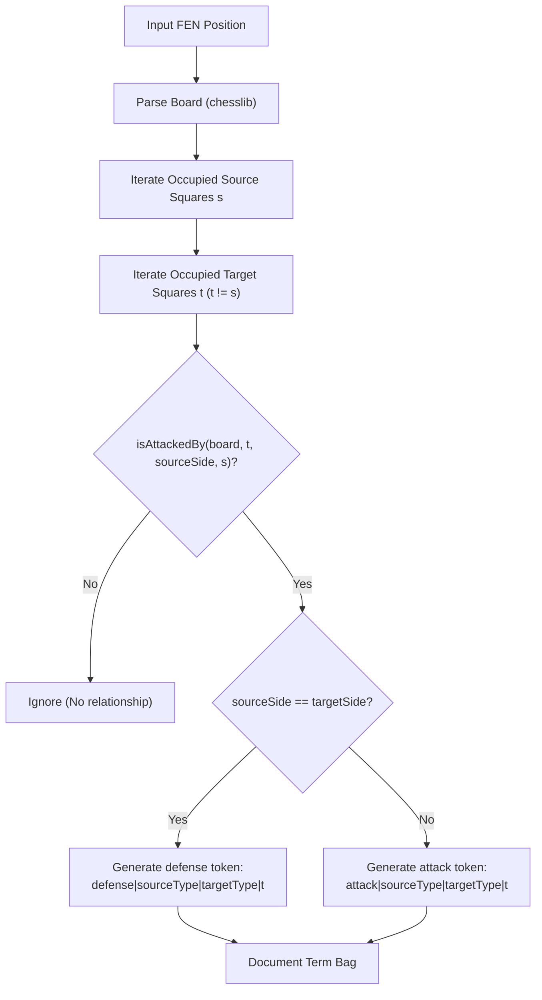

# Experiment Design Specification: Ganguly/Bizjak Connectivity Closure Candidate Preservation Ablation (Issue #722 Extension)

**Spec ID**: `2026-11-06-connectivity-closure-candidate-ablation`  
**Date**: November 6, 2026 (Revised)  
**Context**: GitHub Issue [#722](https://github.com/NathanZK/ChessEcho/issues/722) (Building on [#721](https://github.com/NathanZK/ChessEcho/issues/721) and [#607](https://github.com/NathanZK/ChessEcho/issues/607))  
**Status**: REVISED SPECIFICATION FOR REVIEW ONLY (Execution Strictly Prohibited Prior to Approval)

---

## 1. Declarative Contract & Boundaries

```
contract:   com.chessecho.research.ConnectivityClosureAblationRunner
topology:   single
invariants:
  - ZERO_ENGINE_SEARCHES: 100% reuse of cached Stockfish Depth 16 MultiPV=1 evaluations from backend/src/test/resources/research/engine_evaluation_cache_d16_mpv1.json (10,252 positions). Zero Stockfish subprocess invocations. Missing cache entries trigger an immediate IllegalStateException fail-fast.
  - ZERO_PRODUCTION_CHANGES: Zero modifications to backend/src/main/ or database schemas. All ablation evaluators, models, and tests reside strictly under backend/src/test/kotlin/com/chessecho/research/.
  - NO_MULTIPV3: MultiPV=3 execution remains paused; evaluation strictly uses the MultiPV=1 baseline continuation tokens.
  - AUTHORITATIVE_CANDIDATE_UNIVERSE: Candidate universe U(q) strictly enforces canonical-position inequality c.canonicalFen != q.canonicalFen alongside c.sideToMove == q.sideToMove over the 10,000 GM positions of Corpus A. Every position sharing the query's canonical FEN is strictly excluded regardless of record, pointer, or metadata identity. Across the authoritative 250 probe queries (139 White, 111 Black), universe size is exactly 5,024 candidates for White queries and 4,974 candidates for Black queries, with exact mean universe size 5,001.80.
  - REUSE_EXACT_ISSUE_722_Q250: Evaluation strictly reuses the exact 250 probe-query identities established in Issue #722 (139 White queries, 111 Black queries). Re-sampling, shuffling with alternative seeds, or altering probe query identities is strictly prohibited.
  - POSITIVE_SCORE_CANDIDATE_ELIGIBILITY: Candidate budgets are maximum capacities, not guaranteed pool sizes: C_N(q) = TopN({c in U(q) : BM25(q, c) > 0.0}). Candidates with zero BM25 score must NEVER enter the candidate pool through deterministic tie-breaking.
  - INDEPENDENT_FEATURE_EXTRACTION: Connectivity closure features (attack closure, defence closure, combined closure) are constructed 100% from initial position FENs without access to engine continuation lines, dynamic tokens, or PV moves.
  - PAPER_ALIGNED_RELATIONAL_SCHEMA: Tokens strictly follow the 4-field relational schema: <family>|<source_piece>|<target_piece>|<target_square>. Source square and piece color fields are omitted from primary tokens. Target square is strictly preserved.
  - GEOMETRIC_ATTACK_DEFINITION: Attack and defence relationships are derived via orthodox piece interaction geometry (pseudo-legal attacks). Absolute pins to the friendly king do NOT invalidate connectivity relationships, preserving geometric pressure networks independently of king safety.
  - CONTRAST_ATTACK_VS_LEGAL_CAPTURE: An attack relationship denotes geometric pressure on an occupied square; it is NOT equated with a legally executable capture on the current turn.
  - EXCLUSION_OF_IRRELEVANT_STATIC_FEATURES: Strictly excludes absolute piece placement tokens, reachability tokens, relational pawn skeleton tokens, X-ray closure rays, and all non-closure static feature families.
  - GLOBAL_CORPUS_BM25_STATISTICS: Document frequency df(t) and average document length avgdl are computed once globally over the full 10,000-position Corpus A for each closure vocabulary, and held constant across all queries.
  - SAFE_EMPTY_DOCUMENT_HANDLING: Positions with zero attack or defence relationships legitimately produce empty term maps (terms.isEmpty()). The index and scorer safely score such positions as 0.0 without throwing exceptions.
  - NO_SCORE_FUSION: Evaluates candidate preservation of connectivity filters in isolation. No linear combination, Reciprocal Rank Fusion, or dynamic score mixing is implemented in this experiment.
  - DETERMINISTIC_RANKING: Positive-scoring candidates within connectivity filters are ranked strictly by BM25 over their own connectivity terms. Ties among positive scores are broken deterministically by canonicalFen ascending, then positionId ascending.
  - PRECEDENCE_RULE: In the event of any textual ambiguity or conflict between sections, declarative invariants (§1) and Kotlin programmatic/data contracts (§1.1, §8.2) govern implementation and acceptance over explanatory prose.
test:       backend/src/test/kotlin/com/chessecho/research/ConnectivityClosureAblationTest.kt
artifact:   backend/src/test/resources/research/connectivity_closure_ablation_results.json
convention: Kotlin 2.1.0, JUnit 5, ktlint, detekt, strict immutability, zero production dependency leakage
deferred:
  - Phase 2 MultiPV=3 evaluation
  - Color-sensitive closure representation ablation (e.g. attack|white_knight|black_queen|d5)
  - Target-square removal ablation (generic piece-to-piece interaction)
  - Dual-index parallel retrieval architectures (Model D)
  - Candidate fusion algorithms (RRF, linear score calibration)
  - Production deployment of closure inverted indices
```

### 1.1 Programmatic Runner Contract

```kotlin
package com.chessecho.research

import com.chessecho.similarity.PositionDocument
import java.io.File

interface ConnectivityClosureAblationRunner {
    fun runAblation(
        corpusDocs: List<PositionDocument>,
        probeQueries: List<PositionDocument>, // Must pass the exact 250 Issue #722 probe query identities
        budgets: List<Int> = listOf(50, 80, 200, 500, 1000),
        engineCacheFile: File = File("backend/src/test/resources/research/engine_evaluation_cache_d16_mpv1.json"),
        baselineResultsFile: File = File("backend/src/test/resources/research/candidate_preservation_ablation_results.json"),
    ): ConnectivityAblationResult
}

interface ConnectivityClosureExtractor {
    /**
     * Extracts full closure terms for the position. Defaults to extractCombinedTerms(fen).
     */
    fun extractTerms(fen: String): Map<String, Double> = extractCombinedTerms(fen)
    fun extractAttackTerms(fen: String): Map<String, Double>
    fun extractDefenseTerms(fen: String): Map<String, Double>
    fun extractCombinedTerms(fen: String): Map<String, Double>
}
```

---

## 2. Research Questions & Falsifiable Hypotheses

### 2.1 Context & Motivation
Phase 1 of Issue #722 demonstrated that static structural clustering (relational pawn skeletons and piece configurations) severely bottlenecks dynamic retrieval, retaining only **2.12% - 3.20%** of dynamic top-10 reference targets at candidate budgets $N \in [50, 80]$. The root cause was representation divergence: static pawn structures do not align with dynamic tactical calculation trees.

Ganguly et al. (SIGIR 2014) and Bizjak & Guid (2020) proposed relational connectivity representations—specifically **attack closure** and **defence closure**—which capture direct piece-to-piece pressure and protection networks across the board. The core intuition is that piece connectivity relationships encode potential tactical interactions. For example, an initial Knight-attacks-Queen relationship may correlate with a dynamic Knight-captures-Queen continuation.

This experiment measures how reliably connectivity closure filters preserve positions ranked as dynamically similar, establishing whether piece connectivity offers a viable candidate-generation filter prior to dynamic scoring.

### 2.2 Neutral Falsifiable Hypotheses

1. **Hypothesis $H_1$ (Candidate Preservation Ceiling of Attack Closure)**:
   Tests whether direct candidate retrieval using Attack Closure ($C_{\text{attack}, N}$) achieves higher dynamic Recall@10 and Recall@20 than static structural retrieval ($C_{\text{index}, N}$ at $\alpha=0.60$ and $\alpha=0.00$) at identical budgets $N \in \{50, 80, 200, 500, 1000\}$ against both BM25 and TF-IDF dynamic reference standards.
2. **Hypothesis $H_2$ (Attack vs Defence Closure Complementarity)**:
   Measures candidate-set overlap between Attack Closure and Defence Closure via per-query Jaccard similarity:
   $$\text{Jaccard}(C_{\text{attack}, N}(q), C_{\text{defense}, N}(q)) = \begin{cases} \frac{|C_{\text{attack}, N}(q) \cap C_{\text{defense}, N}(q)|}{|C_{\text{attack}, N}(q) \cup C_{\text{defense}, N}(q)|}, & \text{if } |C_{\text{attack}, N}(q) \cup C_{\text{defense}, N}(q)| > 0 \\ 1.0, & \text{if } |C_{\text{attack}, N}(q) \cup C_{\text{defense}, N}(q)| == 0 \end{cases}$$
   reported as the suite arithmetic mean $\text{MeanJaccard}(N)$. Evaluates whether Combined Closure ($C_{\text{combined}, N}$) achieves an incremental retention gain over the better single-closure variant across cutoffs $K \in \{10, 20\}$ and dynamic scorers (BM25 and TF-IDF):
   $$\Delta\text{Recall@K}(N; \text{scorer}) = \text{MeanRecall@K}(C_{\text{combined}, N}; \text{scorer}) - \max\big(\text{MeanRecall@K}(C_{\text{attack}, N}; \text{scorer}), \text{MeanRecall@K}(C_{\text{defense}, N}; \text{scorer})\big)$$
   Characterises the observed overlap magnitude, direction, and consistency across all candidate budgets without imposing a predetermined numerical success threshold.
3. **Hypothesis $H_3$ (Budget Scaling & Saturation of Connectivity Filters)**:
   Characterises dynamic Recall@10 scaling, candidate pool exhaustion rates, and zero-recall query incidence across all candidate budgets $N \in \{50, 80, 200, 500, 1000\}$ for connectivity closure filters. Classifies the observed retrieval scaling trajectory as approximately linear, sublinear, or saturating over the tested range without asserting an arbitrary numerical success threshold in advance.

*(Note: Diagnostic D1 on immediate captures is classified as a representation-integrity test, and Diagnostic D2 on preparatory captures is an empirical diagnostic without a predetermined threshold; see Section 7).*

---

## 3. Authoritative Audit of Existing Research Assets & Candidate Universe

### 3.1 Reconciliation & Authoritative Definition of Candidate Universe $U(q)$
The existing Issue #722 Q250 fixture and candidate-universe implementation in `DynamicReferenceRankingEvaluator.kt` and `CandidatePreservationAblationTest.kt` was audited to resolve the numerical discrepancy in the draft:

1. **Corpus A Composition**:
   - Total positions: exactly **10,000 unique GM positions** loaded from `backend/src/test/resources/research/corpus_a.json`.
   - Side-to-move breakdown: **5,025 White positions** (`sideToMove == "w"`) and **4,975 Black positions** (`sideToMove == "b"`).
   - Position deduplication: All 10,000 positions possess distinct `canonicalFen` values.
2. **Same-Side Candidate Universe $U(q)$ via Canonical-Position Inequality**:
   $$U(q) = \{ c \in \text{Corpus A} \mid c.\text{canonicalFen} \ne q.\text{canonicalFen} \land c.\text{sideToMove} == q.\text{sideToMove} \}$$
   - Candidate eligibility strictly requires canonical FEN inequality ($c.\text{canonicalFen} \ne q.\text{canonicalFen}$), ensuring every candidate sharing the query's canonical position is excluded regardless of record, object pointer, or provenance ID identity.
   - For any White probe query ($q$ with `sideToMove == "w"`):
     $$|U(q)| = 5,025 - 1 = \mathbf{5,024 \text{ candidates}}$$
   - For any Black probe query ($q$ with `sideToMove == "b"`):
     $$|U(q)| = 4,975 - 1 = \mathbf{4,974 \text{ candidates}}$$
3. **Authoritative Issue #722 Probe Query Sample (Q250)**:
   - Evaluated across the exact 250 probe-query identities established in Issue #722.
   - In the Issue #722 research test suite (`CandidatePreservationAblationTest.kt`, `DynamicReferenceRankingEvaluatorTest.kt`, `StageByStageRetentionTest.kt`, `CombinedPipelinePhase1Test.kt`, `Phase1AuditVerificationTest.kt`), the 250 probe queries were generated deterministically from `corpus_a.json` using frozen seed 42:
     * First query: ID `74b5f658-4e89-5882-9d87-9ad6f5a81893`, FEN `r2k1q1r/pppbn2p/2np4/5p1Q/2PPpN2/P1N1P3/1P2BP1P/2KR3R b - -` (`sideToMove == "b"`).
     * Second query: ID `2df871f2-1c78-58cd-a55f-a9c520396dc5`, FEN `1rb2rk1/1pq1bppp/p3p3/4P3/3p1P2/1P4P1/P1P1Q1BP/R1B2RK1 w - -` (`sideToMove == "w"`).
     * 250th query: ID `527df679-8a37-558b-9ba2-4334d8ab16a9`, FEN `5rk1/p1q2p1p/2r1bbp1/3Qp3/4p3/1NP1B1P1/PP2PP1P/3RR1K1 w - -` (`sideToMove == "w"`).
   - Exact query distribution: **139 White queries** and **111 Black queries** (all 250 canonical FENs and IDs are strictly unique).
   - *Requirement*: The ablation runner must explicitly reuse these exact 250 probe query identities rather than ad hoc re-sampling.
4. **Exact Universe Statistics Across Authoritative Q250**:
   - Total candidate-query evaluations: $139 \times 5,024 + 111 \times 4,974 = 1,250,450$.
   - **Mean Candidate Universe Size**: $\frac{1,250,450}{250} = \mathbf{5,001.80 \text{ candidates}}$.
   - **Minimum Universe Size**: $\mathbf{4,974 \text{ candidates}}$ (for all 111 Black queries).
   - **Maximum Universe Size**: $\mathbf{5,024 \text{ candidates}}$ (for all 139 White queries).
   - **Reconciliation with Serialized Artifacts**: In `candidate_preservation_ablation_results.json`, the Candidate Reduction Rate for System 2A at budget $N=50$ is serialized as `0.9900035987044664`. Calculating $1.0 - \frac{50.0}{5,001.80} = 0.9900035987044664$ confirms exact mathematical alignment to 16 decimal places. Similarly, at budget $N=1000$, $\text{CRR} = 0.8000719740893278 \equiv 1.0 - \frac{1000.0}{5,001.80}$. This proves that the authoritative universe mean in the completed Phase 1 experiment was exactly 5,001.80, derived from 139 White and 111 Black queries.

> [!NOTE]
> **Resolution of Discrepancy & Evidence Provenance**:
> - The draft specification mistakenly cited figures from `DynamicReferenceAuditReport` (mean 4,995.32, min 4,822, max 5,023), which represented the count of candidates with *strictly positive dynamic continuation token overlap*, rather than the total eligible same-side candidate universe $|U(q)|$.
> - The authoritative universe counts are **5,024** (White) and **4,974** (Black), with mean **5,001.80**.
> - **Artifact Audit Note**: In the Phase 1 extension, the 250 probe-query identities were not saved as a standalone JSON fixture file (only aggregate metrics and 60 waterfall examples were persisted). Their identity is anchored by the deterministic seed 42 sequence over `corpus_a.json` verified across all Issue #722 test suites. The runner contract (§1.1) requires passing these exact 250 queries directly to ensure zero sample drift.

### 3.2 Reconstruction Audit: Attack and Defence Closure
- **Current State**: Neither `engine_evaluation_cache_d16_mpv1.json` nor `PositionDocument` stores Ganguly attack or defence closure tokens. Issue #702 / #721 extracted only relational pawn skeleton tokens (`p(...)`, `pawn_island|...`) and piece placement tokens (`N(c3)`, `Q(d1)`).
- **Required Action**: Attack closure and defence closure terms **must be reconstructed directly from the stored canonical FENs** of the 10,000 Corpus A positions.
- **Reference Implementation**: `FenPositionSimilarity.kt` (commit `8793d58`, frozen under `freeze/fen-similarity-v1`) and `DynamicTacticalScorer.kt` contain validated geometric attack logic (`isAttackedBy`). Reconstruction will use an audited, zero-dependency Kotlin component (`ConnectivityClosureExtractor.kt`) adhering strictly to the Ganguly representation.

### 3.3 Audited Bizjak Dynamic Feature Semantics
Audited directly from `DynamicTacticalScorer.kt`, dynamic continuation tokens have the following exact spelling and semantics:
- `!-$P`: Move token, piece of type $P \in \{K, Q, R, B, N, P\}$ moved at ply $k$.
- `!x$P`: Capture token, piece of type $P$ captured at ply $k$.
- `!$P>$T`: Created attack token, piece of type $P$ moved to destination square where it directly attacks opponent piece of type $T$.
- `!#$P`: Checkmate delivered by piece $P$.
- `!-$P_1$P_2`: Consecutive move pair (ply $k$ and $k+1$).
- `!x$C_1$C_2`: Consecutive capture pair (ply $k$ and $k+1$).
- `?px` / `?ox`: General flags for player capture / opponent capture anywhere in PV.
- `?+` / `?#` / `?=` / `?S`: Check given / checkmate / promotion / sacrifice flag.
- `!S$P`: Sacrificed piece of type $P$.

---

## 4. Primary Connectivity Representations & Extraction Semantics

### 4.1 Paper-Aligned Relational Closure Schema (Ganguly/Bizjak)

In alignment with Ganguly et al. (SIGIR 2014, §3.2) and Bizjak & Guid (2020), the primary representation encodes relational piece-to-piece interactions using a 4-field schema:

```
attack|<source_piece>|<target_piece>|<target_square>
defense|<source_piece>|<target_piece>|<target_square>
```

#### Field Definitions:
1. `family`: Strictly `"attack"` (opposing piece interaction) or `"defense"` (friendly piece interaction).
2. `source_piece`: Lowercase piece type of the attacking or defending piece (`"pawn"`, `"knight"`, `"bishop"`, `"rook"`, `"queen"`, `"king"`).
3. `target_piece`: Lowercase piece type of the target piece occupying `target_square` (`"pawn"`, `"knight"`, `"bishop"`, `"rook"`, `"queen"`, `"king"`).
4. `target_square`: Lowercase algebraic coordinate of the target square (`"a1"` through `"h8"`).

#### Concrete Token Examples:
- `attack|knight|queen|d5`: A Knight attacks an opposing Queen on square d5.
- `attack|bishop|rook|f1`: A Bishop attacks an opposing Rook on square f1.
- `attack|pawn|knight|e4`: A Pawn attacks an opposing Knight on square e4.
- `defense|bishop|pawn|e4`: A Bishop defends a friendly Pawn on square e4.
- `defense|rook|bishop|c8`: A Rook defends a friendly Bishop on square c8.
- `defense|king|pawn|f2`: A King defends a friendly Pawn on square f2.

#### Explicit Structural Properties:
- **Source Square Omission**: The square occupied by the source piece is **strictly omitted**. Whether a Knight is located on c3, e3, f4, or b6, its attack on an opposing Queen on d5 generates the identical token `attack|knight|queen|d5`. This allows equivalent tactical threats to match across different source locations.
- **Color Field Omission**: The color of the pieces is **strictly omitted** from the primary token representation. A Knight attacking an opposing Queen on d5 matches whether played as White vs Black or Black vs White. Because candidate ranking evaluates exclusively within the same-side candidate universe $U(q)$ (matching active turn), color-agnostic relational matching directly captures the geometric interaction pattern.
  *(Note: Color-sensitive closure matching, e.g. `attack|white_knight|black_queen|d5`, is explicitly recorded as a deferred independent ablation; see Section 1).*
- **Target Square Retention**: The square coordinate of the target piece is **strictly preserved**. Omitting target square would merge all generic piece interactions across the entire board (e.g. `attack|knight|queen`), discarding board geometry.

### 4.2 Explicit Exclusions
The connectivity closure feature vocabulary strictly excludes:
- Absolute piece placement tokens (e.g. `piece|knight|c3`, `N(c3)`).
- Reachability tokens to empty squares (e.g. `reach|knight|d5`).
- Relational pawn skeleton tokens (e.g. `p(e4)`, `pawn_island|...`).
- X-ray closure rays through intervening pieces (e.g. `ray|...`).
- Color fields on pieces or squares in primary tokens.
- Engine evaluation, centipawn, or PV-derived features.

### 4.3 Extraction Semantics & Rules from FEN

Given a board position parsed from a normalized FEN:



#### Detailed Rule Definitions:
1. **Piece Movement Mechanics (`isAttackedBy`)**:
   - **Pawns**: A pawn on square $s$ attacks square $t$ if $\text{fileIndex}(t) - \text{fileIndex}(s) \in \{-1, 1\}$ and $\text{rankIndex}(t) - \text{rankIndex}(s) == \text{direction}(s)$, where direction is $+1$ for White and $-1$ for Black. (En passant squares are empty, so they do not form piece-to-piece closure terms).
   - **Knights**: Attacks if $(\Delta\text{file} == 1 \land \Delta\text{rank} == 2) \lor (\Delta\text{file} == 2 \land \Delta\text{rank} == 1)$.
   - **Kings**: Attacks if $\Delta\text{file} \le 1 \land \Delta\text{rank} \le 1 \land (\Delta\text{file} + \Delta\text{rank} > 0)$.
   - **Bishops**: Attacks if $\Delta\text{file} == \Delta\text{rank} > 0$ and all intermediate squares along the diagonal ray are strictly empty.
   - **Rooks**: Attacks if $(\Delta\text{file} == 0 \lor \Delta\text{rank} == 0) \land (\Delta\text{file} + \Delta\text{rank} > 0)$ and all intermediate squares along the orthogonal ray are strictly empty.
   - **Queens**: Attacks if bishop attack or rook attack condition is satisfied and the intervening ray is clear.
2. **Handling of Absolute Pins**:
   - An absolute pin occurs when a piece stands between its friendly king and an enemy sliding piece along a ray.
   - **Specification Rule**: Pinned pieces **retain their full geometric attack and defence closure relationships**. If a White Knight on e2 is absolutely pinned to the White King on e1 by a Black Rook on e8:
     * If square d4 is occupied by a Black Pawn, the Knight generates `attack|knight|pawn|d4`.
     * If square f4 is occupied by a White Pawn, the Knight generates `defense|knight|pawn|f4`.
   - *Rationale*: Connectivity closure represents static piece interaction topology, not legal move generation on the active turn. In orthodox chess, a pinned piece still defends friendly pieces (an enemy king cannot capture a piece defended by a pinned piece) and exerts geometric control over occupied squares.
3. **King-Safety & Active Turn Independence**:
   - Attack and defence relationships exist symmetrically for both White and Black pieces simultaneously, regardless of `sideToMove`.
   - The presence of check (king under attack) does not suppress attacks or defenses exerted by other pieces.
4. **Contrast: Attack Relationship vs. Legally Available Capture**:
   - The presence of `attack|knight|queen|d5` asserts geometric pressure.
   - It does **not** assert:
     * That the attacking side is to move.
     * That the capture $N \times Q$ is legally permissible on the immediate ply (e.g. the attacking side may be in check, or the knight may be pinned).
     * That the capture is tactically sound or engine-recommended.

---

## 5. Candidate Generation, Positive-Score Eligibility, and Ranking

### 5.1 Three Evaluated Connectivity Variants
For every query $q \in Q_{250}$ and every eligible candidate $c \in U(q)$:

1. **System C1: Attack Closure Only**:
   Document terms: $T_{\text{attack}}(p) = \text{extractor.extractAttackTerms}(p.\text{canonicalFen}).\text{keys}$.
2. **System C2: Defence Closure Only**:
   Document terms: $T_{\text{defence}}(p) = \text{extractor.extractDefenseTerms}(p.\text{canonicalFen}).\text{keys}$.
3. **System C3: Combined Closure**:
   Document terms: $T_{\text{combined}}(p) = \text{extractor.extractCombinedTerms}(p.\text{canonicalFen}).\text{keys} = T_{\text{attack}}(p) \cup T_{\text{defence}}(p)$.

### 5.2 Global Corpus BM25 Statistics
To prevent query-specific or candidate-subset skew, BM25 collection statistics are calculated **once globally across the full 10,000-position Corpus A** for each vocabulary:

- $N_{\text{corpus}} = 10,000$.
- Document frequency: $df_{\text{family}}(t) = |\{ d \in \text{Corpus A} \mid t \in T_{\text{family}}(d) \}|$.
- Document length: $L_d = |T_{\text{family}}(d)|$.
- Average document length:
  $$\text{avgdl}_{\text{family}} = \frac{1}{10,000} \sum_{d \in \text{Corpus A}} |T_{\text{family}}(d)|$$
- Standard parameters: $k_1 = 1.2, b = 0.75$.

BM25 score between query $q$ and candidate $c \in U(q)$:
$$\text{Score}_{\text{BM25}}(q, c; \text{family}) = \sum_{t \in T_{\text{family}}(q) \cap T_{\text{family}}(c)} \ln\left(1 + \frac{10,000 - df_{\text{family}}(t) + 0.5}{df_{\text{family}}(t) + 0.5}\right) \cdot \frac{tf(t, c) \cdot (k_1 + 1)}{tf(t, c) + k_1 \cdot \left(1 - b + b \cdot \frac{|T_{\text{family}}(c)|}{\text{avgdl}_{\text{family}}}\right)}$$
(with binary $tf(t, c) = 1.0$ for each unique relationship).

### 5.3 Positive-Score Candidate Eligibility Rule

> [!IMPORTANT]
> **Candidate Budgets are Maximums, Not Guaranteed Capacities**:
> Candidates with zero connectivity BM25 scores share zero closure terms with the query position and must **never** enter the candidate pool through deterministic tie-breaking.

Formally:
$$P_{\text{pos}}(q; \text{family}) = \{ c \in U(q) \mid \text{Score}_{\text{BM25}}(q, c; \text{family}) > 0.0 \}$$
$$C_{\text{family}, N}(q) = \text{TopN}\big(P_{\text{pos}}(q; \text{family}), N\big)$$

Candidates within $P_{\text{pos}}(q; \text{family})$ are sorted by:
1. $\text{Score}_{\text{BM25}}(q, c; \text{family})$ descending.
2. `canonicalFen` ascending.
3. `positionId` ascending.

The actual candidate set size is:
$$|C_{\text{family}, N}(q)| = \min\big(N, |P_{\text{pos}}(q; \text{family})|\big)$$

#### Candidate Pool Exhaustion Accounting:
For every query $q$, system family, and budget $N \in \{50, 80, 200, 500, 1000\}$, the evaluation runner logs:
- `requestedBudget`: $N$
- `actualCandidateCount`: $|C_{\text{family}, N}(q)|$
- `positiveCandidateCount`: $|P_{\text{pos}}(q; \text{family})|$
- `isPoolExhausted`: $|P_{\text{pos}}(q; \text{family})| < N$ (boolean flag indicating budget was not filled)

Recall and candidate purity are evaluated strictly over the actual candidate set $C_{\text{family}, N}(q)$.

### 5.4 Candidate Budgets and Baseline Controls

Budgets evaluated: $N \in \{50, 80, 200, 500, 1000\}$.

#### Benchmark Systems Comparison Matrix:

| System ID | Architecture Family | Candidate Representation | Candidate Selection Function | Budgets ($N$) | Evaluated Configurations | Execution Scope | Description |
|---|---|---|---|---|---|---|---|
| **System C1** | Connectivity Family | Attack Closure Only | Positive-score BM25 Top-$N$ | 5 budgets | **5** | **Executed** | Attack closure candidate generation |
| **System C2** | Connectivity Family | Defence Closure Only | Positive-score BM25 Top-$N$ | 5 budgets | **5** | **Executed** | Defence closure candidate generation |
| **System C3** | Connectivity Family | Combined Closure | Positive-score BM25 Top-$N$ | 5 budgets | **5** | **Executed** | Combined closure candidate generation |
| **System 2A ($\alpha=0.60$)** | Static Index Baseline | Relational Pawn + Piece ($\alpha=0.60$) | `PositionInvertedIndex` Top-$N$ | 5 budgets | **5** | *Reused* | Issue #722 production static index baseline |
| **System 2A ($\alpha=0.00$)** | Static Index Baseline | Pure Piece Placement ($\alpha=0.00$) | `PositionInvertedIndex` Top-$N$ | 5 budgets | **5** | *Reused* | Isolates static piece placement without pawns |
| **System 2B ($\alpha=0.60$)** | Static Cosine Control | Exhaustive Static Cosine ($\alpha=0.60$) | Full-Corpus Cosine Top-$N$ | 5 budgets | **5** | *Reused* | Exhaustive static cosine control from #722 |
| **System 3** | Clustered Baseline | Production Unified Graph | Leiden + Centroid ($S_{\text{unified}}$) | Historical ($N \approx 76.1$) | **1** | *Reused* | Production clustered baseline from #722 |
| **System 4D** | Clustered Baseline | Side-Constrained Graph | Leiden + Centroid ($S_{\text{side}}$) | Historical ($N \approx 59.1$) | **1** | *Reused* | Side-constrained clustered baseline from #722 |
| **System 1** | Dynamic Reference Standard | Dynamic Continuation Tokens | Full-Corpus $U(q)$ Ranking | Full $U(q)$ ($N \approx 5,002$) | **1** | *Reused* | Evaluation reference standard ($K \in \{10, 20\}$) |

> [!NOTE]
> **Execution vs Baseline Reuse**:
> - **Direct Execution**: The evaluation runner (`ConnectivityClosureAblationRunner`) directly executes the **15 new connectivity configurations** (Systems C1, C2, and C3 across budgets $N \in \{50, 80, 200, 500, 1000\}$).
> - **Baseline Reuse**: The **18 baseline and reference configurations** are ingested directly from the serialized Issue #722 results artifact (`candidate_preservation_ablation_results.json`) without re-running. This eliminates redundant compute while ensuring strict comparability against the established production benchmarks.
> - **Total Experimental Configurations**: **33 candidate-pool evaluations** across 250 queries.

#### 5.4.1 Baseline Configuration Ingestion Schema
The 18 baseline configurations are mapped into `baselineComparisons: Map<String, BaselineComparisonRecord>` using the following explicit string key identifiers:

1. **System 2A ($\alpha=0.60$, 5 budgets)**:
   - `"SYSTEM_2A_ALPHA_0.60_N50"`: from `systemResults["SYSTEM_2A_DIRECT_INDEX_N50"].alphaResults["alpha_0.6"]`
   - `"SYSTEM_2A_ALPHA_0.60_N80"`: from `systemResults["SYSTEM_2A_DIRECT_INDEX_N80"].alphaResults["alpha_0.6"]`
   - `"SYSTEM_2A_ALPHA_0.60_N200"`: from `systemResults["SYSTEM_2A_DIRECT_INDEX_N200"].alphaResults["alpha_0.6"]`
   - `"SYSTEM_2A_ALPHA_0.60_N500"`: from `systemResults["SYSTEM_2A_DIRECT_INDEX_N500"].alphaResults["alpha_0.6"]`
   - `"SYSTEM_2A_ALPHA_0.60_N1000"`: from `systemResults["SYSTEM_2A_DIRECT_INDEX_N1000"].alphaResults["alpha_0.6"]`
2. **System 2A ($\alpha=0.00$, 5 budgets)**:
   - `"SYSTEM_2A_ALPHA_0.00_N50"`: from `systemResults["SYSTEM_2A_DIRECT_INDEX_N50"].alphaResults["alpha_0.0"]`
   - `"SYSTEM_2A_ALPHA_0.00_N80"`: from `systemResults["SYSTEM_2A_DIRECT_INDEX_N80"].alphaResults["alpha_0.0"]`
   - `"SYSTEM_2A_ALPHA_0.00_N200"`: from `systemResults["SYSTEM_2A_DIRECT_INDEX_N200"].alphaResults["alpha_0.0"]`
   - `"SYSTEM_2A_ALPHA_0.00_N500"`: from `systemResults["SYSTEM_2A_DIRECT_INDEX_N500"].alphaResults["alpha_0.0"]`
   - `"SYSTEM_2A_ALPHA_0.00_N1000"`: from `systemResults["SYSTEM_2A_DIRECT_INDEX_N1000"].alphaResults["alpha_0.0"]`
3. **System 2B ($\alpha=0.60$, 5 budgets)**:
   - `"SYSTEM_2B_ALPHA_0.60_N50"`: from `systemResults["SYSTEM_2B_STATIC_COSINE_N50"].alphaResults["alpha_0.6"]`
   - `"SYSTEM_2B_ALPHA_0.60_N80"`: from `systemResults["SYSTEM_2B_STATIC_COSINE_N80"].alphaResults["alpha_0.6"]`
   - `"SYSTEM_2B_ALPHA_0.60_N200"`: from `systemResults["SYSTEM_2B_STATIC_COSINE_N200"].alphaResults["alpha_0.6"]`
   - `"SYSTEM_2B_ALPHA_0.60_N500"`: from `systemResults["SYSTEM_2B_STATIC_COSINE_N500"].alphaResults["alpha_0.6"]`
   - `"SYSTEM_2B_ALPHA_0.60_N1000"`: from `systemResults["SYSTEM_2B_STATIC_COSINE_N1000"].alphaResults["alpha_0.6"]`
4. **Clustered Baselines ($\alpha=0.60$, 2 systems)**:
   - `"SYSTEM_3_ALPHA_0.60"`: from `systemResults["SYSTEM_3_PRODUCTION_CLUSTERED_BASELINE"].alphaResults["alpha_0.6"]`
   - `"SYSTEM_4D_ALPHA_0.60"`: from `systemResults["SYSTEM_4D_SIDE_CONSTRAINED_CLUSTERED"].alphaResults["alpha_0.6"]`
5. **System 1 (Dynamic Reference Standard, 1 system)**:
   - `"SYSTEM_1_DYNAMIC_REFERENCE"`: Reference standard baseline representing the full same-side candidate universe $|U(q)| \approx 5,001.80$, $\text{CRR} = 0.0$, and dynamic Recall@10/20 $\equiv 1.0$ by definition.

---

## 6. Evaluation Metrics, Overlap Diagnostic & Vocabulary Analysis

All retrieval metrics are evaluated **independently for BM25 and TF-IDF dynamic reference standards** at cutoffs $K \in \{10, 20\}$.

### 6.1 Core Retrieval Metrics
1. **Dynamic Recall@K**:
   $$\text{Recall@K}(q) = \frac{|C(q) \cap R_K(q)|}{K}$$
   Evaluated over same-side dynamic reference $R_K(q)$. Reported as mean, median, standard deviation, and full distribution percentiles (min, p25, median, p75, p90, max).
2. **Purity@K**:
   $$\text{Purity@K}(q) = \begin{cases} \frac{|C(q) \cap R_K(q)|}{|C(q)|}, & \text{if } |C(q)| > 0 \\ 0.0, & \text{if } |C(q)| == 0 \end{cases}$$
   Evaluated with denominator equal to the actual candidate pool size $|C(q)|$.
3. **Zero-Retention Rate**:
   Count and percentage of probe queries with zero captured dynamic reference positions:
   $$\text{ZeroCount@K} = \sum_{q \in Q} \mathbf{1}[|C(q) \cap R_K(q)| == 0], \quad \text{ZeroPct@K} = \frac{\text{ZeroCount@K}}{|Q|} \times 100\%$$
4. **Candidate Pool Exhaustion Rate**:
   Percentage of queries where the positive-scoring candidate pool was exhausted prior to reaching budget $N$:
   $$\text{ExhaustionRate}(N) = \frac{1}{|Q|} \sum_{q \in Q} \mathbf{1}[|P_{\text{pos}}(q)| < N] \times 100\%$$
5. **Candidate Reduction Rate (CRR)**:
   Measures candidate filtering power relative to the eligible same-side universe $U(q)$:
   - Query-level:
     $$\text{CRR}(q, N) = 1.0 - \frac{|C_{\text{family}, N}(q)|}{|U(q)|}$$
   - Empirical suite mean:
     $$\text{MeanCRR}(N) = \frac{1}{|Q|} \sum_{q \in Q} \text{CRR}(q, N)$$
   - Nominal requested:
     $$\text{CRR}_{\text{nominal}}(N) = 1.0 - \frac{N}{5,001.80}$$
   Both empirical actual $\text{MeanCRR}(N)$ and nominal requested $\text{CRR}_{\text{nominal}}(N)$ are logged and reported in summary tables.
6. **Candidate Set Jaccard Overlap**:
   Evaluated for System C1 (Attack Closure) against System C2 (Defence Closure) at each budget $N$:
   $$\text{Jaccard}(C_{\text{attack}, N}(q), C_{\text{defense}, N}(q)) = \begin{cases} \frac{|C_{\text{attack}, N}(q) \cap C_{\text{defense}, N}(q)|}{|C_{\text{attack}, N}(q) \cup C_{\text{defense}, N}(q)|}, & \text{if } |C_{\text{attack}, N}(q) \cup C_{\text{defense}, N}(q)| > 0 \\ 1.0, & \text{if both are empty} \end{cases}$$
   Aggregated across queries as the arithmetic mean:
   $$\text{MeanJaccard}(N) = \frac{1}{|Q|} \sum_{q \in Q} \text{Jaccard}(C_{\text{attack}, N}(q), C_{\text{defense}, N}(q))$$
7. **Incremental Recall Gain Over Best Single Variant**:
   Evaluated for System C3 (Combined Closure) at each budget $N$, independently for $K \in \{10, 20\}$ and dynamic scorers (BM25 and TF-IDF):
   $$\Delta\text{Recall@K}(N; \text{scorer}) = \text{MeanRecall@K}(C_{\text{combined}, N}; \text{scorer}) - \max\big(\text{MeanRecall@K}(C_{\text{attack}, N}; \text{scorer}), \text{MeanRecall@K}(C_{\text{defense}, N}; \text{scorer})\big)$$

### 6.2 Secondary Shared-Term Overlap Diagnostic
To distinguish scoring formula effects from underlying term overlap sparsity:
- For every candidate $c \in U(q)$ and query $q$, compute unweighted shared-term count:
  $$\text{Overlap}_{\text{raw}}(q, c; \text{family}) = |T_{\text{family}}(q) \cap T_{\text{family}}(c)|$$
- For each query and budget configuration, compute and serialize `OverlapDiagnosticStats`:
  * **Retrieved Candidate Pool ($C_{\text{family}, N}(q)$)**: Mean, median, and maximum shared closure terms across the retrieved top-$N$ candidates.
  * **Dynamic Reference Targets ($R_{10}(q)$ and $R_{20}(q)$)**: Mean, median, and maximum shared closure terms between the query position and its true dynamic reference targets, tracked separately for BM25 and TF-IDF references at both cutoffs ($K=10$ and $K=20$) via `ReferenceOverlapDistribution`.
- *Constraint*: This diagnostic is purely observational; candidate selection is strictly driven by BM25.

### 6.3 Vocabulary & Document-Length Statistics
To contextualize retrieval behavior across closure representations, the report presents:

| Metric | Attack Closure | Defence Closure | Combined Closure |
|---|---|---|---|
| **Vocabulary Size ($V$)** | Unique terms in Corpus A | Unique terms in Corpus A | Unique terms in Corpus A |
| **Mean Document Length ($\text{avgdl}$)** | Mean terms per position | Mean terms per position | Mean terms per position |
| **Median Document Length** | Median terms per position | Median terms per position | Median terms per position |
| **Max Document Length** | Max terms per position | Max terms per position | Max terms per position |
| **Empty Document Count ($L=0$)** | Positions with 0 terms | Positions with 0 terms | Positions with 0 terms |
| **Empty Document %** | % positions with 0 terms | % positions with 0 terms | % positions with 0 terms |

---

## 7. Capture Continuation Diagnostic: Events vs Unique Positions

### 7.1 Diagnostic Objective
To investigate whether static attack relationships correspond to dynamic capture events in engine PV continuations, and to strictly separate root-position opportunities from multi-ply preparatory sequences.

### 7.2 Strict Distinction: Capture Events vs Unique Positions
A single multi-ply PV continuation can contain multiple capture events (e.g. move $m_1$ is $N \times Q$, and later move $m_5$ is $N \times Q$). To prevent event multiplicity from inflating position-level metrics, the diagnostic tracks and reports both event-level and position-level metrics independently:

- **Event-Level Accounting**:
  * `totalEvents`: Total count of capture occurrences across all evaluated continuation moves.
  * `matchedEvents`: Count of capture events where the initial root position FEN contains the corresponding static closure token `attack|<source_piece>|<target_piece>|<target_square>`.
  * `eventMatchRate`: Ratio of matched capture events to total capture events, with safe zero-handling:
    $$\text{eventMatchRate} = \begin{cases} \frac{\text{matchedEvents}}{\text{totalEvents}}, & \text{if } \text{totalEvents} > 0 \\ 0.0, & \text{if } \text{totalEvents} == 0 \end{cases}$$
- **Position-Level Accounting**:
  * `uniquePositions`: Count of unique positions containing $\ge 1$ capture occurrence.
  * `matchedPositions`: Count of unique positions containing $\ge 1$ geometrically matched capture occurrence.
  * `positionMatchRate`: Ratio of matched positions to unique positions containing capture occurrences, with safe zero-handling:
    $$\text{positionMatchRate} = \begin{cases} \frac{\text{matchedPositions}}{\text{uniquePositions}}, & \text{if } \text{uniquePositions} > 0 \\ 0.0, & \text{if } \text{uniquePositions} == 0 \end{cases}$$

### 7.3 Diagnostic D1: Representation Integrity (Immediate Captures at Ply 0)
- **Evaluation Population**: Evaluated over all **10,000 GM positions of Corpus A** loaded with cached Stockfish Depth 16 MultiPV=1 evaluations. Positions with empty PV lines (if any) are recorded as `emptyPvCount` and excluded.
- **Scope**: Positions where the first move of the PV continuation ($m_0$) is a major capture (specifically $N \times Q$).
- **Actor Semantics**: At ply 0, the moving piece belongs to the root side to move (`sideToMove(q)`).
- **Exact Square Match**: An immediate capture $m_0$ where piece $S$ captures piece $T$ on square $sq$ (e.g. $N \times Q$ on d5) matches the initial root position if and only if the root position contains the exact attack token `attack|<source_piece>|<target_piece>|<target_square>` (e.g. `attack|knight|queen|d5`).
- **Integrity Requirement**: In orthodox chess, if move $m_0$ is a legal capture of an opposing Queen on square $sq$ by a Knight, the Knight must geometrically attack square $sq$ in the root position.
- **Verification Rule**: Every such position **must possess** the static attack term `attack|knight|queen|sq`.
- **Integrity Action**: Any discrepancy ($\text{positionMatchRate} < 1.0 \lor \text{eventMatchRate} < 1.0$) is treated as a **representation defect** triggering immediate investigation of FEN parsing, legal move syntax, or token extraction, rather than an empirical finding.

### 7.4 Diagnostic D2: Preparatory Continuation Captures (Ply $k \ge 1$)
- **Evaluation Population**: Full 10,000 GM positions of Corpus A.
- **Scope**: Positions where a major capture (e.g. $N \times Q$) occurs at continuation ply index $k \ge 1$ (following preparatory plies $0 \dots k-1$).
- **Actor Tracking**: Tracks root-player captures (`?px`) as well as overall captures, logging `rootPlayerEvents`, `matchedRootPlayerEvents`, `rootPlayerEventMatchRate`, and `meanPlyOfCapture`.
- **Measurement**: Measure the observed correspondence rate between continuation capture events at ply $k \ge 1$ and initial static attack terms `attack|<source_piece>|<target_piece>|<target_square>` in the root position FEN across all events, unique positions, and root-player events.
- **No Prescribed Threshold**: The specification reports the exact observed correspondence rate without asserting an arbitrary expectation (e.g. $< 25\%$).
- **Interpretation Principle**: In multi-ply combinations, preparatory moves (e.g. deflecting the Queen, clearing an attack ray, sacrificing a piece) dynamically create the capture geometry. The absence of a corresponding attack relationship in the initial root position is geometrically normal and must **never** be cited as a failure of the static closure representation.

### 7.5 Generalization Across Major Capture Pairs
Both diagnostics D1 and D2 will report event counts, unique position counts, and correspondence rates for:
1. $N \times Q$ (motivating case)
2. $B \times Q$ (minor on queen)
3. $R \times Q$ (major on queen)
4. $N \times R$ (minor on rook)
5. $B \times R$ (minor on rook)
6. $P \times Q$ (pawn on queen)

---

## 8. Expected Artifacts & Output Data Schema Contract

### 8.1 Persisted Research Artifacts
1. **JSON Results Artifact**:
   `backend/src/test/resources/research/connectivity_closure_ablation_results.json` (~600 KB).
2. **Research Report Extension**:
   `docs/research/issue-722-connectivity-closure-ablation-report.md`.

### 8.2 JSON Output Schema Contract

```kotlin
package com.chessecho.research

data class ConnectivityAblationResult(
    val metadata: ExperimentMetadata,
    val vocabularyStatistics: Map<String, VocabularySummary>,
    val diagnosticResults: CaptureDiagnosticReport,
    val systemResults: Map<String, ConnectivitySystemRecord>,
    val baselineComparisons: Map<String, BaselineComparisonRecord>,
)

data class ExperimentMetadata(
    val experimentId: String,
    val timestamp: String,
    val gitCommit: String,
    val corpusSize: Int,
    val queryCount: Int,
    val meanCandidateUniverseSize: Double,
    val zeroEngineSearchesGuaranteed: Boolean,
    val zeroProductionChangesGuaranteed: Boolean,
)

data class VocabularySummary(
    val vocabularySize: Int,
    val avgDocumentLength: Double,
    val medianDocumentLength: Int,
    val maxDocumentLength: Int,
    val emptyDocumentCount: Int,
    val emptyDocumentPercentage: Double,
)

data class CaptureDiagnosticReport(
    val populationSize: Int,
    val emptyPvCount: Int,
    val nxqDiagnostic: SingleCaptureDiagnostic,
    val captureFamilyBreakdown: Map<String, SingleCaptureDiagnostic>,
)

data class SingleCaptureDiagnostic(
    val captureType: String, // e.g. "N_x_Q", "B_x_Q"
    val immediatePly0: ImmediateCaptureStats,
    val preparatoryPlyK: PreparatoryCaptureStats,
)

data class ImmediateCaptureStats(
    val totalEvents: Int,
    val matchedEvents: Int,
    val eventMatchRate: Double, // matchedEvents / max(1, totalEvents); expected 1.0 (integrity check)
    val uniquePositions: Int,
    val matchedPositions: Int,
    val positionMatchRate: Double, // matchedPositions / max(1, uniquePositions); expected 1.0 (integrity check)
)

data class PreparatoryCaptureStats(
    val totalEvents: Int,
    val matchedEvents: Int,
    val eventMatchRate: Double, // matchedEvents / max(1, totalEvents); empirical correspondence
    val uniquePositions: Int,
    val matchedPositions: Int,
    val positionMatchRate: Double, // matchedPositions / max(1, uniquePositions); empirical correspondence
    val rootPlayerEvents: Int,
    val matchedRootPlayerEvents: Int,
    val rootPlayerEventMatchRate: Double, // matchedRootPlayerEvents / max(1, rootPlayerEvents); empirical correspondence
    val meanPlyOfCapture: Double,
)

data class ConnectivitySystemRecord(
    val systemId: String,
    val representationType: String, // "ATTACK_CLOSURE", "DEFENSE_CLOSURE", "COMBINED_CLOSURE"
    val budgetResults: Map<String, BudgetSystemMetrics>, // Keyed by "budget_50", "budget_80", etc.
)

data class BudgetSystemMetrics(
    val requestedBudget: Int,
    val actualMeanCandidateCount: Double,
    val positiveCandidatePoolExhaustionRate: Double,
    val actualMeanCandidateReductionRate: Double,
    val nominalCandidateReductionRate: Double,
    val bm25Metrics: ConnectivityScorerMetrics,
    val tfidfMetrics: ConnectivityScorerMetrics,
    val unweightedOverlapDiagnostic: OverlapDiagnosticStats,
    val overlapWithDefenseClosureJaccard: Double?, // Computed for Attack Closure
    val bm25IncrementalRecallGainAt10OverBestSingle: Double?, // Computed for Combined Closure
    val bm25IncrementalRecallGainAt20OverBestSingle: Double?, // Computed for Combined Closure
    val tfidfIncrementalRecallGainAt10OverBestSingle: Double?, // Computed for Combined Closure
    val tfidfIncrementalRecallGainAt20OverBestSingle: Double?, // Computed for Combined Closure
)

data class ReferenceOverlapDistribution(
    val mean: Double,
    val median: Int,
    val max: Int,
)

data class OverlapDiagnosticStats(
    val meanRetrievedOverlap: Double,
    val medianRetrievedOverlap: Int,
    val maxRetrievedOverlap: Int,
    val bm25ReferenceTop10Overlap: ReferenceOverlapDistribution,
    val bm25ReferenceTop20Overlap: ReferenceOverlapDistribution,
    val tfidfReferenceTop10Overlap: ReferenceOverlapDistribution,
    val tfidfReferenceTop20Overlap: ReferenceOverlapDistribution,
)

data class ConnectivityScorerMetrics(
    val recallAt10: ConnectivityMetricDistribution,
    val recallAt20: ConnectivityMetricDistribution,
    val purityAt10: ConnectivityMetricDistribution,
    val purityAt20: ConnectivityMetricDistribution,
    val zeroRecallCountAt10: Int,
    val zeroRecallPercentageAt10: Double,
    val zeroRecallCountAt20: Int,
    val zeroRecallPercentageAt20: Double,
)

data class ConnectivityMetricDistribution(
    val mean: Double,
    val median: Double,
    val stdDev: Double,
    val min: Double,
    val p25: Double,
    val p75: Double,
    val p90: Double,
    val max: Double,
)

data class BaselineComparisonRecord(
    val systemId: String,
    val architectureFamily: String,
    val budget: Int?,
    val meanCandidateCount: Double,
    val candidateReductionRate: Double,
    val bm25RecallAt10: Double,
    val bm25RecallAt20: Double,
    val tfidfRecallAt10: Double,
    val tfidfRecallAt20: Double,
)
```

#### 8.2.1 Serialization Map Key Conventions
To guarantee deterministic serialization and deserialization, map keys are strictly standardized:
- `vocabularyStatistics`: Keyed by `"ATTACK_CLOSURE"`, `"DEFENSE_CLOSURE"`, `"COMBINED_CLOSURE"`.
- `systemResults`: Keyed by `"SYSTEM_C1_ATTACK_CLOSURE"`, `"SYSTEM_C2_DEFENSE_CLOSURE"`, `"SYSTEM_C3_COMBINED_CLOSURE"`.
- `budgetResults`: Keyed by `"budget_50"`, `"budget_80"`, `"budget_200"`, `"budget_500"`, `"budget_1000"`.
- `captureFamilyBreakdown`: Keyed by `"N_x_Q"`, `"B_x_Q"`, `"R_x_Q"`, `"N_x_R"`, `"B_x_R"`, `"P_x_Q"`.
- `baselineComparisons`: Keyed by the 18 exact baseline configuration keys defined in §5.4.1 (e.g. `"SYSTEM_2A_ALPHA_0.60_N50"`, ..., `"SYSTEM_1_DYNAMIC_REFERENCE"`).
```

---

## 9. Representation Verification Tests & Empty-Document Protocols

Prior to experiment execution, the implementation must pass four deterministic unit test suites:

1. **Piece-to-Piece Occupied Target Verification (`ConnectivityClosureExtractorTest.kt`)**:
   - Pinned piece attacking occupied opposing piece:
     * Setup: White King on e1, White Knight on e2 (absolutely pinned by Black Rook on e8). Black Pawn on d4.
     * Assertion: Extracts `attack|knight|pawn|d4`.
   - Pinned piece defending occupied friendly piece:
     * Setup: White King on e1, White Knight on e2 (absolutely pinned by Black Rook on e8). White Pawn on f4.
     * Assertion: Extracts `defense|knight|pawn|f4`.
   - Empty square rejection:
     * Assert that moves or attacks directed toward empty squares (e.g. d4 when empty) produce **zero** closure terms.
   - Scholar's mate attack test:
     * White Queen on h5 attacks Black Pawn on f7 (`attack|queen|pawn|f7`) and Black Pawn on e5 (`attack|queen|pawn|e5`).
   - Source square omission test:
     * Assert source coordinate (e.g. `e2`, `h5`) is absent from all extracted tokens.
   - Target square retention test:
     * Assert target coordinate (e.g. `d4`, `f7`) is present in all extracted tokens.
   - Color omission test:
     * Assert neither `"white"` nor `"black"` appears in primary tokens.
2. **Safe Empty-Document Protocols (`ConnectivityEmptyDocumentTest.kt`)**:
   - Positions with zero piece-to-piece attacks or defenses (e.g. bare king endgames like K vs K, or isolated pawns with no mutual attacks):
     * Extractor safely returns empty map `emptyMap()`.
     * BM25 scorer returns `0.0` without division-by-zero or `NaN` errors.
     * Candidate eligibility rule correctly excludes them from the candidate pool $C_N(q)$.
3. **Capture Diagnostic Integrity Test (`ContinuationCaptureDiagnosticTest.kt`)**:
   - Synthetic fixture with immediate $N \times Q$ at ply 0: asserts `matchedEvents == totalEvents`, `eventMatchRate == 1.0`, `matchedPositions == uniquePositions`, and `positionMatchRate == 1.0`.
   - Synthetic fixture with multi-ply preparatory deflection: verifies classification into preparatory stratum, distinct event-level vs position-level counting, and correct rate calculation.
   - Verifies safe zero-event handling when a position contains no captures (`totalEvents == 0` yields `eventMatchRate == 0.0`, `positionMatchRate == 0.0`).
   - Verifies handling of empty PV lines without exceptions.
4. **Candidate Eligibility & Deterministic Tie-Breaking Test (`ConnectivityCandidateEligibilityTest.kt`)**:
   - Canonical-position inequality: candidates with identical `canonicalFen` to the query must be excluded from $U(q)$ even if their UUID or metadata differs (`c.canonicalFen != q.canonicalFen`).
   - Zero-score exclusion: candidate positions in $U(q)$ with zero term overlap ($\text{Score} == 0.0$) must never enter $C_N(q)$ regardless of requested budget $N$.
   - Pool exhaustion accounting: when $|P_{\text{pos}}(q)| < N$, actual candidate count $|C_N(q)|$ equals $|P_{\text{pos}}(q)|$, and `isPoolExhausted == true`.
   - Deterministic tie-breaking: identical positive BM25 scores break ties by `canonicalFen` ascending, then `positionId` ascending.

---

## 10. Adversarial Review & Risk Analysis

| Risk / Failure Mode | Severity | Likelihood | Mitigation Strategy |
|---|---|---|---|
| **Zero-Score Contamination via Tie-Breaking** | Critical | Low | Positive-score eligibility invariant ($C_N(q) = \text{TopN}(\{c \in U(q) : \text{BM25} > 0\})$) strictly prevents candidates with zero BM25 score from entering candidate pools. |
| **Candidate Universe & Probe Identity Drift** | High | Low | Universe counts verified against authoritative Corpus A data ($5,024$ White, $4,974$ Black, mean $5,001.80$). Candidate eligibility enforces canonical FEN inequality ($c.\text{canonicalFen} \ne q.\text{canonicalFen}$). Runner strictly reuses the exact 250 Issue #722 probe query identities. |
| **Dynamic Information Leakage** | Critical | Low | Extractor parses only `canonicalFen`. Candidate ranking has zero access to engine caches, PV lines, or dynamic tokens. Dynamic references are accessed solely during post-retrieval evaluation. |
| **Accidental Color Sensitivity in Primary Baseline** | Medium | Low | Token schema explicitly restricted to 4 fields (`family|source|target|sq`). Color-sensitive matching is formally quarantined as a deferred independent ablation. |
| **Event vs Position Multiplicity Skew** | Medium | Low | Diagnostic explicitly reports both event-level metrics (`totalEvents`, `matchedEvents`, `eventMatchRate`) and position-level metrics (`uniquePositions`, `matchedPositions`, `positionMatchRate`) with safe zero-handling to prevent multiple captures in single PV lines from distorting match rates. |
| **Misinterpreting Preparatory Captures as Representation Failure** | High | Low | Diagnostic D1 serves as representation integrity check (asserting 100% on immediate captures). Preparatory captures (D2) are documented as geometrically expected to diverge from root attacks. |
| **Arbitrary Hypothesis Threshold Prejudgment** | Medium | Low | Prescribed success thresholds removed from $H_2$ and $H_3$; runner reports observed candidate overlap, incremental recall, scaling curve, and pool exhaustion objectively. |
| **Empty Document Runtime Crashes** | Medium | Low | Safe empty-document protocol unit-tested to ensure $L=0$ positions evaluate cleanly to 0.0 without throwing exceptions. |
| **Baseline Redundancy & Drift** | Low | Low | 18 baseline configurations are reused directly from serialized `candidate_preservation_ablation_results.json`, guaranteeing 100% fidelity without re-executing baselines. |

---

## 11. Decisions & Review Outcomes

1. **Candidate Pool Exhaustion Metric Reporting**:
   - *Outcome*: The runner records `requestedBudget`, `actualCandidateCount`, and `isPoolExhausted` for every query. Both nominal budget and actual mean candidate count are reported in summary tables to provide complete visibility into candidate pool saturation.
2. **Vocabulary Spelling Convention**:
   - *Outcome*: Standardized on `"defense"` internally matching existing codebase (`FenPositionSimilarity.kt`), with documentation presenting "defence" or "defense" interchangeably.
3. **Diagnostic Stratification Depth**:
   - *Outcome*: Immediate captures ($k=0$) vs preparatory captures ($k \ge 1$), with mean ply depth reported for preparatory events. Population defined as full 10,000 GM positions of Corpus A.
4. **Baseline Ingestion Strategy**:
   - *Outcome*: Direct reuse of 18 baseline/reference configurations from Issue #722 results artifact (`candidate_preservation_ablation_results.json`) prevents redundant computation and eliminates divergence risk.
5. **Exact Issue #722 Q250 Probe Identity Pinning**:
   - *Outcome*: The ablation runner strictly reuses the exact 250 probe-query identities (139 White, 111 Black) established in Issue #722, guaranteeing mean candidate universe size $5,001.80$ and exact comparability with prior CRR figures.
6. **Canonical-Position Universe Inequality**:
   - *Outcome*: Candidate universe membership $U(q)$ enforces $c.\text{canonicalFen} \ne q.\text{canonicalFen}$ alongside matching active side-to-move, preventing duplicate canonical positions from entering candidate pools regardless of record identity.
7. **Neutral Falsifiable Hypotheses Without Arbitrary Thresholds**:
   - *Outcome*: Prescribed thresholds removed from $H_2$ ($\text{Jaccard} < 0.40$) and $H_3$ ($\text{Zero-Recall} < 20\%$). Candidate overlap, incremental recall gain, and scaling trajectories are characterized objectively across all tested budgets.
8. **Comprehensive Dual-Layer Capture Diagnostic Schema**:
   - *Outcome*: Event-level accounting (`matchedEvents`, `eventMatchRate`) and position-level accounting (`matchedPositions`, `positionMatchRate`) are fully separated with defensive zero-event handling.
