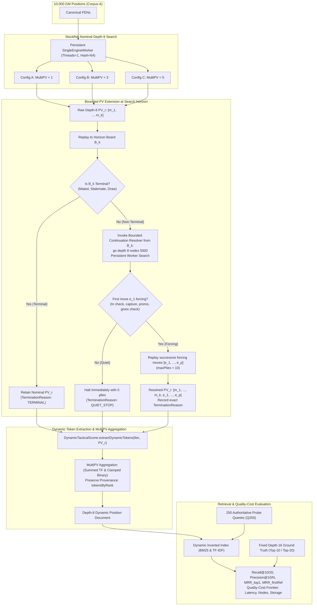

# Research Specification: Direct Dynamic-Token Generation Using Shallower Stockfish Search (Depth 8, MultiPV 1/3/5)

**Specification ID:** `SPEC-RESEARCH-DYNAMIC-SIMILARITY-DEPTH8-MULTIPV`  
**Revision:** 2.2 (Post Spec-Compliance Review Synthesis)  
**Date:** 2026-11-06  
**Status:** DRAFT FOR FINAL REVIEW (Implementation Strictly Paused)  
**Parent Research Issues:** [#722](https://github.com/NathanZK/ChessEcho/issues/722), [#721](https://github.com/NathanZK/ChessEcho/issues/721), [#607](https://github.com/NathanZK/ChessEcho/issues/607)  
**Active Research Issue:** [#723](https://github.com/NathanZK/ChessEcho/issues/723)  
**Target Repository:** [NathanZK/ChessEcho](https://github.com/NathanZK/ChessEcho)  
**Execution Worktree:** `implement_issue_702_praxis` (branch: `research/issue-722-combined-filtering-dynamic-similarity`)  

---

## Document Revision History & Change Summary

| Revision | Date | Author | Key Changes |
|---|---|---|---|
| 1.0 | 2026-11-06 | Antigravity | Initial draft proposing depth-8 search with nominal MultiPV 1, 3, 5. |
| 2.0 | 2026-11-06 | Antigravity | Major Peer-Review Corrections: quiescence semantics reclassified as bounded PV extension; 6 MultiPV retrieval conditions; corrected retrieval metrics and tie-breaking; provisional quality-cost frontier; cache schema alignment. |
| 2.1 | 2026-11-06 | Antigravity | Surgical Peer-Review Corrections: universal non-terminal horizon gating; reconciled batch runtime feasibility arithmetic ($T_{\text{pos}}/36$ min); 13-parameter cache preimage and configuration file isolation; precision corrections (early/middle/late pilot strata, separate BM25/TF-IDF exhaustion, fixed Precision@10 denominator, TT clearHash policy). |
| **2.2** | **2026-11-06** | **Antigravity** | **Spec-Compliance Review Synthesis & Final Parameter Rigor:**<br>1. *Scope Boundaries (§1.4):* Explicitly locked production code (`backend/src/main/`) as strictly read-only; confined all harness, benchmarks, and cache runners to `backend/src/test/` and `docs/research/`.<br>2. *Subprocess & Extension Mechanics (§4.4, §5.1, §5.2):* Added dedicated `SingleEngineWorker.resolveForcingPvExtension` that avoids process destruction (`quit`); mandates temporarily resetting `MultiPV 1` on worker before horizon search to avoid node splitting; specified 10-second watchdog timeouts and crash-recovery procedures.<br>3. *Horizon Semantics Rigor (§5.2):* Replaced claims of establishing horizon quietness with accurate wording: resolver examines whether the engine-selected continuation begins with a forcing move, without exploring alternative forcing branches.<br>4. *Cache Identity & Preimage Rigor (§10.B):* Decoupled downstream token aggregation (`tokenAgg`) from engine evaluation cache key preimage; preimage strictly indexes engine search outputs via an exact **15-parameter specification** (covering engine, binHash, depth, multipv, threads, hash, ponder, syzygy, analyseMode, hashPolicy, ext, extLimits, extTimeoutMs, tokenVersion, and normalizedFen); defined canonicalFen (4 fields) vs normalizedFen (6 fields).<br>5. *Model A Reconciliation (§4.3, §9.4):* Reconciled Model A with general episode flag clamping ($\text{tf} \le 1.0$ for `?*`); defined Model A as primary baseline for C3/C5/C6 in Artifact 3.<br>6. *Example Artifact Integrity (§10):* Authored full JSON schemas for Artifact 1 (`timing_pilot_results.json`) and Artifact 3 (`retrieval_results.json`) using explicit placeholders and null values to ensure illustrative schemas cannot be mistaken for empirical results.<br>7. *Metric Rigor & Edge Cases (§6.2, §6.3, §8):* Defined candidate pool restriction to $S > 0$; handled boundary division in $\text{Precision@N}$ and $\text{MRR@N\_firstRef}$; defined novelty edge cases and FP collision rates.<br>8. *Pilot Determinism & Verification (§7.2, §12):* Formally specified stratified sampling code with `Random(42L)` and cyclic configuration interleaving; separated execution targets for Phase 3 corpus generation vs Phase 4 retrieval benchmarking, plus unit tests for TT clear policy and 15-parameter cache serialization. |

---

## 1. Research Objectives & Empirical Hypotheses

### 1.1 Context & Motivation
Previous investigations under GitHub Issue #722 established that static candidate filtering—whether based on $\alpha$-weighted relational pawn tokens, inverted indices, Leiden graph community detection, or Ganguly/Bizjak relational closure (attack and defence closure)—suffers from severe structural information loss when used as a pre-filter for dynamic similarity:
- Clustered static graphs (System 3) discard **97.92%** of top-10 dynamic targets ($N \approx 76.1$, Recall@10 = 2.08%).
- Attack closure (System C1) suffers an **82.20% zero-overlap ceiling** with dynamic references and 79.6% candidate-pool exhaustion at $N=1000$ due to extreme term sparsity and coordinate rigidity.
- Defence closure (System C2) requires retaining 1 in every 5 database positions ($N=1000$, $\text{CRR} = 80.47\%$) to retrieve 29.00% of dynamic targets, with recall dropping below 4.3% at practical candidate budgets ($N \le 80$).
- Diagnostic D2 (evaluating 2,853 continuation captures across 10,000 GM positions in `connectivity_closure_ablation_results.json`) demonstrated that major tactical captures occur at a macro mean depth of **10.16 plies**, with over **97.69% of continuation captures** (and 98.20% of root-player captures) completely decoupled from root static attack geometry.

These findings demonstrate that static representations cannot serve as a reliable substitute or pre-filter for engine-derived dynamic similarity. Tactical motifs emerge along multi-ply search trees through deflections, pins, and sacrifices that do not exist at root ply 0.

### 1.2 Core Research Question
Instead of cascading dynamic reranking behind a static filter, can we **directly generate dynamic tokens using shallower Stockfish search (nominal depth 8)** and retrieve positions that match our fixed Stockfish depth-16 ground truth, with high recall and substantially lower computational cost?

### 1.3 Hypotheses & Provisional Interpretation Targets
*Note:* The thresholds below represent provisional targets for empirical interpretation, not rigid Go/No-Go approval gates:
- **Hypothesis 1 (Depth-8 Recall Feasibility):** Direct dynamic tokens generated at nominal depth 8 with bounded PV extension preserve $\ge 50\%$ Recall@10 against the fixed depth-16 reference standard at candidate budget $N=200$ (and $\ge 70\%$ at $N=1000$), substantially exceeding static retrieval baselines ($\le 8.52\%$ at $N=200$).
- **Hypothesis 2 (MultiPV Incremental Information vs. Noise):** Additional MultiPV lines (MultiPV 3 and MultiPV 5) retrieve distinct dynamic neighbours not captured by MultiPV 1, but at the cost of expanding token document length and introducing vocabulary noise. The recall gain between MultiPV 1 and MultiPV 3/5 must justify the increased engine search time.
- **Hypothesis 3 (Computational Efficiency):** Depth-8 token generation reduces per-position engine analysis latency by at least $5\times$ to $10\times$ compared to depth 16, enabling scalable offline indexing and faster query-time candidate generation.

### 1.4 Scope Boundaries & Architectural Constraints
- **Strictly In-Scope:**
  - Designing, running, and analyzing the Depth-8 MultiPV research experiment for GitHub Issue #723.
  - Adding research-only runners, benchmark tests, pilot scripts, and cache serialization classes under `backend/src/test/kotlin/com/chessecho/research/`.
  - Storing evaluation caches and experimental results under `backend/src/test/resources/research/`.
  - Authoring diagnostic research reports under `docs/research/`.
- **Strictly Out-of-Scope (Locked Production Boundaries):**
  - **Zero Production Modifications:** Production code under `backend/src/main/` is strictly READ-ONLY. No service classes, production controllers, or schema classes will be altered.
  - **Immutable Reference Data:** Depth-16 reference ground truth (`engine_evaluation_cache_d16_mpv1.json`) and Corpus A (`corpus_a.json`) are immutable. Exactly zero reference records will be modified or regenerated.
  - **Deferred Production Integration:** Integrating depth-8 dynamic retrieval into the interactive web UI or production similarity pipeline is explicitly deferred until Issue #723 research findings are reviewed and approved.

---

## 2. Existing Implementation Audit

A comprehensive audit of the existing codebase was conducted to establish exact contracts, capabilities, and constraints:

### 2.1 Dynamic Tactical Token Semantics (`DynamicTacticalScorer.kt`)
Dynamic tactical tokens are extracted along move sequences starting at root ply 0 following the Bizjak & Guid (2020) feature extraction methodology:
- **Move Cadence Tokens:** `!-<piece>` (e.g. `!-P`, `!-N`, `!-Q`) representing pieces moved.
- **Immediate Capture Tokens:** `!x<piece>` (e.g. `!xQ`, `!xR`) for captured pieces.
- **Created Attack Threats:** `!<source_piece>><target_piece>` (e.g. `!N>Q`, `!B>R`) when a moved piece creates a direct attack on an opposing piece from its destination square.
- **Consecutive Move & Capture Bigrams:** `!-<p1><p2>` (e.g. `!-RN`) and `!x<c1><c2>` (e.g. `!xPQ`).
- **Tactical Checkmate Flags:** `!#<piece>` and `!#<p1><p2>`.
- **General Episode Flags:**
  - `?px`: Player made at least one capture.
  - `?ox`: Opponent made at least one capture.
  - `?+`: At least one check was delivered.
  - `?=`: At least one pawn promotion occurred.
  - `?#`: Continuation ends in checkmate.
- **Sacrifice Tokens:** `?S` (general sacrifice flag) and `!S<piece>` (e.g. `!SQ`) when a player piece of higher value moves to a square and is captured on the immediate next ply by an opponent piece of lower or equal value without a prior equal recapture.

*Audit Constraint:* The token extraction logic is deterministic and operates on a `(fen: String, moves: List<String>)` pair. It does not inspect engine scores or search depth; it strictly reflects the board states produced by applying `moves` to `fen`.

### 2.2 Stockfish Subprocess Management & MultiPV Handling
The codebase houses two primary Stockfish execution pathways:
1. **Production Pipeline (`StockfishService.kt`):**
   - Uses `BatchEngineSession` for similarity search: initializes a single Stockfish subprocess with `setoption name MultiPV value <k>` and sends `go depth <depth>`.
   - Collects all lines matching `info ... multipv <rank> ... depth <d> ... pv <moves>`.
   - *Limitation Discovered:* `DynamicTacticalScorer.collectCandidateTokens` and `PositionSimilarityService.buildDynamicRankedResult` currently hardcode extraction to **`rank == 1` only** (`res.principalVariations.firstOrNull { it.rank == 1 }?.moves`). MultiPV variations for rank $\ge 2$ are parsed and returned in DTOs, but discarded during token scoring.
2. **Research Pipeline (`DynamicEngineResearchRunner.kt`):**
   - Spawns a thread pool of `SingleEngineWorker` instances, setting `setoption name MultiPV value $multiPv`, `Threads 1`, `Hash 64`, `Ponder false`, `SyzygyPath <empty>`.
   - Sends `position fen $normalizedFen` and `go depth $depth`.
   - Parses `multipv` rank lines into `CachedPvLine(rank, scoreCp, moves)`.
   - *Limitation Discovered:* Like the production service, `DynamicEngineResearchRunner` historically called `dynamicScorer.extractDynamicTokens(normalizedFen, rank1Moves)` on **rank 1 only**. MultiPV 3 and 5 runs generated multiple PVs in the cache, but dynamic tokens were only extracted from rank 1.

### 2.3 Existing Quiescence & Forcing PV Extension Audit (`StockfishService.kt`)
The codebase contains a forcing continuation method: `resolveForcingPvContinuation(fen: String, options: QuiescenceOptions)`. An adversarial inspection reveals its precise operational mechanics:

#### A. Single Linear Continuation Replay (Not Full Quiescence Search)
The existing implementation does **not** conduct an alpha-beta quiescence tree search over candidate moves. Instead, it:
1. Runs an engine search (`go depth ${options.maxDepth} nodes ${options.maxNodes}`).
2. Takes the **single linear PV** returned on the final `info` update (`output.pvMoves`).
3. Replays that single sequence sequentially in `replayForcingPv`.
4. As soon as a move in that single line is quiet, it stops (`QUIET_STOP`).
*Crucial Conclusion:* The resolver does **not** explore alternative forcing branches or consider counter-tactics outside the engine's preferred PV. It is a **bounded principal-variation extension**, not a full quiescence search.

#### B. Definition of Tactical Quietness (`isForcingMove`):
In `StockfishService.kt:906–926`, a move is classified as forcing if and only if:
1. The side to move is in check (`board.isKingAttacked`),
2. The move is a capture (destination square occupied or en passant pawn capture),
3. The move is a pawn promotion (`move.promotion != Piece.NONE`), or
4. The move delivers check to the opposing king (`givesCheck`).
A position is quiet when none of these apply.

#### C. Incomplete vs. Quiet Termination Semantics:
In `StockfishService.kt`, termination reasons represent fundamentally different tactical states:
- **`QUIET_STOP` (Quiet):** The engine's chosen continuation encountered a non-forcing move.
- **`TERMINAL` (Terminal):** Checkmate, stalemate, or draw on the board.
- **`PLY_LIMIT` (Incomplete):** Bounded extension hit `maxPlies` (10 plies) while forcing moves were still active. The position is **not** confirmed quiet.
- **`NODE_LIMIT` (Incomplete):** Search reached `maxNodes` (5,000 nodes) before resolving.
- **`TIMEOUT` (Incomplete):** Watchdog timer expired (250 ms).
- **`PV_EXHAUSTED` (Incomplete):** Engine PV ended without reaching an explicit quiet move.

*Guarantee Limitation:* The current implementation **cannot guarantee** that a position has reached a tactically quiet state. It only guarantees that the single evaluated PV was replayed until either a quiet move was played, a terminal state was reached, or computational resources were exhausted.

---

## 3. Experimental Architecture & Data Flow



---

## 4. MultiPV Isolation & Experimental Configurations

### 4.1 MultiPV Search Isolation
MultiPV search alters alpha-beta pruning windows, move ordering, and depth allocation across roots. Consequently, the rank-1 PV produced under MultiPV 3 or 5 is not guaranteed to be identical to the rank-1 PV produced under MultiPV 1.

To strictly isolate MultiPV search effects from token volume inflation, the experiment mandates evaluating **six discrete retrieval conditions**:

| Retrieval Condition ID | Engine Configuration | PV Ranks Evaluated | Purpose / Evaluation Question |
|---|---|---|---|
| **C1: MPV1_R1** | Nominal Depth 8, MultiPV 1 | Rank 1 alone | Pure depth-8 baseline. |
| **C2: MPV3_R1** | Nominal Depth 8, MultiPV 3 | Rank 1 alone | Isolates alpha-beta search distortion on rank 1 under MultiPV 3. |
| **C3: MPV3_R13** | Nominal Depth 8, MultiPV 3 | Ranks 1–3 aggregated | Measures tactical branching contribution of top 3 lines. |
| **C4: MPV5_R1** | Nominal Depth 8, MultiPV 5 | Rank 1 alone | Isolates search distortion on rank 1 under MultiPV 5. |
| **C5: MPV5_R13** | Nominal Depth 8, MultiPV 5 | Ranks 1–3 aggregated | Direct comparison against MPV3_R13 under 5-line search. |
| **C6: MPV5_R15** | Nominal Depth 8, MultiPV 5 | Ranks 1–5 aggregated | Full 5-line tactical envelope. |

### 4.2 Cross-Configuration Rank-1 Consistency Check
For all 10,000 positions in Corpus A, the experiment will measure:
- **Move-1 Identity Rate:** Percentage of positions where `bestmove` (ply 0) is identical across MPV1, MPV3, and MPV5.
- **Full PV Concordance:** Jaccard overlap of the entire rank-1 move sequence between configurations.
- **Score Stability:** Centipawn score difference $|\text{score}_{\text{MPV1}} - \text{score}_{\text{MPV3}}|$.
- **Token Concordance:** Jaccard overlap of dynamic tokens extracted from rank 1 across configurations.

### 4.3 MultiPV Token Aggregation & Ablation Models
For a position $p$ with available PV lines $M = \min(K, |\text{lines}|)$:
1. Each line $r \in \{1, \dots, M\}$ yields resolved moves $M_r(p)$ and tokens $T_r(p) = \text{extractDynamicTokens}(\text{normalizedFen}(p), M_r(p))$.
2. Tokens are stored with strict provenance in `tokensByRank: Map<Int, Map<String, Double>>`.
3. Four aggregation schemes will be independently benchmarked:
   - **Model A (Summed Term Frequencies with Clamped Episode Flags - Primary Baseline):**
     - For cadence moves, captures, created threats, sacrifices, and tactical checkmates (`!-*`, `!x*`, `!>*`, `!S*`, `!#*`):
       $$\text{tf}(t, p) = \sum_{r=1}^M \text{tf}(t, M_r(p))$$
     - For qualitative episode flags (`?px`, `?ox`, `?+`, `?=`, `?#`, `?S`): clamped to binary presence:
       $$\text{tf}(t, p) = \min\left(1.0, \sum_{r=1}^M \text{tf}(t, M_r(p))\right)$$
       This prevents qualitative motifs (such as a check or capture occurring across multiple lines) from accumulating artificial term frequency while preserving tactical frequency for distinct moves and threats.
     - *Primary Baseline Role:* Model A serves as the authoritative aggregation rule for primary multi-line retrieval conditions: **C3 (MPV3_R13)**, **C5 (MPV5_R13)**, and **C6 (MPV5_R15)** in Artifact 3.
   - **Model B (Clamped Binary Presence Ablation):** $\text{tf}(t, p) = 1.0$ if term $t$ appears in any line $r \in \{1..M\}$. Prevents frequent moves from overpowering discriminative tactical flags.
   - **Model C (Individual Rank Evaluation Ablation):** Independent retrieval using rank $r$ alone ($r \in \{1, 2, 3, 4, 5\}$).
   - **Model D (Cumulative Rank Combinations Ablation):** Cumulative retrieval across successive ranks: $R_1$, $R_{1+2}$, $R_{1+2+3}$, $R_{1+2+3+4}$, $R_{1+2+3+4+5}$.

### 4.4 Engine Execution Controls & Transposition Table Policy
To guarantee deterministic, order-independent evaluation across the 6-worker pool:
- **Transposition Table Reset Policy (`hashPolicy: clearHash`):** Prior to evaluating each root position FEN, every `SingleEngineWorker` process issues:
  ```uci
  ucinewgame
  isready
  ```
  and awaits `readyok` (matching `DynamicEngineResearchRunner.kt:295–298` and `StockfishResearchRunner.kt:86–88`). This completely flushes Stockfish's internal transposition table (TT) between root positions, guaranteeing that search depth, move ordering, and PV outputs are strictly order-independent and 100% reproducible regardless of worker thread scheduling or position batch sequence.
- **Worker Subprocess Preservation & Stream Isolation:**
  - `SingleEngineWorker` instances maintain long-lived `Process` handles across the entire batch run.
  - To prevent accidental subprocess destruction, the research runner uses dedicated worker methods that stream UCI commands and read responses up to `bestmove` without issuing `quit`.
- **Worker MultiPV Scoping for Horizon Extension:**
  - When evaluating root positions under MultiPV 3 or MultiPV 5, workers execute with `setoption name MultiPV value <k>`.
  - When resolving horizon continuations from board $B_k$, the worker temporarily sets `setoption name MultiPV value 1` prior to sending `go depth 8 nodes 5000`. This dedicates the entire 5,000-node budget to the single linear continuation and guarantees that `pvMoves` parses the unique rank-1 line without overwriting. After reading `bestmove`, the worker restores `setoption name MultiPV value <k>` for subsequent roots.
- **Process Crash & Watchdog Timeout Recovery:**
  - Each search command is bounded by a 10,000 ms watchdog timer.
  - If a worker process deadlocks or crashes, the runner kills the failed process, launches a fresh replacement worker, re-applies engine configuration options, logs the failure, records `TerminationReason.TIMEOUT` for the active position, and resumes batch processing without dropping subsequent positions.
- **Fixed Engine Controls:**
  - `Threads`: 1 (strict single-threaded search per worker)
  - `Hash`: 64 MB
  - `Ponder`: false
  - `SyzygyPath`: `<none>` (tablebases disabled to ensure search determinism)
  - `UCI_AnalyseMode`: true
- **Engine Binary Provenance:** Stockfish 19 executable verified via SHA-256 binary checksum recorded in benchmark metadata.

---

## 5. Bounded PV Extension Mechanics & Architecture

### 5.1 Resolving the Extension Design Question
**Design Decision:** The experiment adopts **Approach A (Bounded Extension from Horizon Board $B_k$)** rather than querying an unsearched horizon or relying solely on Stockfish's internal PV:
- *Rationale:* Stockfish's UCI `pv` string frequently terminates mid-exchange at depth 8. Appending forcing continuation moves ensures that tactical recaptures and check evasions are represented in the token sequence.
- *Persistent Worker Reuse:* Extension search is executed directly on the active `SingleEngineWorker` process via a dedicated stream method `SingleEngineWorker.resolveForcingPvExtension(...)`. This completely eliminates the 50,000-process spawn bottleneck, reuses the existing worker stdin/stdout streams without issuing process-destroying `quit` commands, and ensures uninterrupted throughput.

### 5.2 Horizon Continuation Resolution & Execution Protocol
For each PV rank $r \in \{1, \dots, M\}$ with nominal depth-8 moves $[m_1, \dots, m_k]$:
1. Replay $[m_1, \dots, m_k]$ on a board initialized from root FEN to obtain horizon board $B_k$.
2. **Terminal Board Check:** If $B_k$ is terminal (checkmated, stalemated, or drawn by rule), set $E_r = \emptyset$, record `TerminationReason.TERMINAL`, and stop extension.
3. **Continuation Resolver Invocation (Universal Non-Terminal Policy):**
   For every non-terminal horizon $B_k$, the bounded continuation resolver (`SingleEngineWorker.resolveForcingPvExtension`) is invoked directly on the active worker:
   - Temporarily send `setoption name MultiPV value 1` (if worker multiPv > 1) to ensure the 5,000-node search is dedicated to a single continuation line.
   - Send `position fen $B_k.fen` and `go depth 8 nodes 5000`.
   - Read output until `bestmove` and restore `setoption name MultiPV value <k>`.
   - If engine returns an empty PV (e.g. immediate unhandled draw or no moves):
     - Outcome: $E_r = \emptyset$, plies resolved = 0, `TerminationReason.PV_EXHAUSTED`.
   - Otherwise, `applyNextForcingMove` evaluates move $e_1$ from $B_k$:
     - If $e_1$ is **non-forcing** (`!isForcingMove(B_k, e_1)` and `!B_k.isKingAttacked`):
       - Halt immediately: $E_r = \emptyset$, plies resolved = 0, `TerminationReason.QUIET_STOP`.
       - *Operational Semantics & Structural Limitation:* The resolver examines the engine-selected principal variation from $B_k$ and determines whether this selected continuation begins with a forcing move (`isForcingMove(B_k, e_1)` or `B_k.isKingAttacked`). Crucially, the resolver does **not** explore alternative forcing branches outside the engine's preferred line; therefore, halting with `QUIET_STOP` indicates only that the engine's preferred continuation begins quietly—it cannot establish that no alternative tactical continuation exists from $B_k$.
     - If $e_1$ is **forcing** (in check, capture, promotion, or gives check):
       - Apply $e_1$ and sequentially replay subsequent continuation moves $[e_2, \dots, e_p]$ bounded by `maxPlies = 10`.
   - **Termination Reason Precedence:**
     - `QUIET_STOP`: Reached an unforced move in the engine PV.
     - `TERMINAL`: Reached checkmate, stalemate, or draw during replay.
     - `PLY_LIMIT`: Hit `maxPlies = 10` while moves remained forcing (takes precedence over node limit if plies = 10).
     - `NODE_LIMIT`: Search exhausted 5,000 nodes and engine truncated line before quietness was reached.
     - `TIMEOUT`: Worker watchdog timer (10,000 ms) expired.
     - `PV_EXHAUSTED`: Engine PV ended while moves were forcing without reaching an explicit quiet move or node cap.
   - Concatenated sequence: $M_r^{\text{resolved}} = [m_1, \dots, m_k, e_1, \dots, e_p]$.
   - Record exact `TerminationReason` for line $r$.
4. **Computational Cost Implications:**
   - Invoking the engine from $B_k$ for every non-terminal line introduces an additional bounded search per rank.
   - Because `nodes` is capped at 5,000 and search depth is capped at 8, this adds an estimated $\sim 10-25$ ms of wall-clock time per non-terminal line on a single worker thread.
   - For MultiPV 1, this represents a modest $\approx 10-20$ ms overhead; for MultiPV 5, resolving all 5 lines adds up to $\sim 50-100$ ms per position. This overhead is explicitly tracked in $T_{\text{ext}}$ and accounted for in the feasibility budget.
5. **Architectural Distinction: Bounded Single-PV Replay vs. Full Quiescence Tree Search:**
   - It is essential to emphasize that `resolveForcingPvExtension` is a **bounded single-PV extension**, not an alpha-beta quiescence tree search.
   - A full quiescence search explores all legal captures and checks across an alpha-beta minimax tree to establish tactical quietness.
   - In contrast, the single-PV resolver examines only the engine's single preferred line. It determines whether this selected sequence begins with a forcing move, but does not explore alternative forcing branches. It therefore cannot establish that no alternative tactical continuation exists from $B_k$.
   - The implementation guarantees bounded linear extension along the engine's principal variation, but does not provide a formal minimax proof of tactical quiescence.

### 5.3 Treatment of Incomplete Lines
Positions whose extensions end in resource-limited states (`PLY_LIMIT`, `NODE_LIMIT`, `TIMEOUT`, `PV_EXHAUSTED`) are **retained and flagged** in the dataset:
- Tokens are extracted from all moves successfully applied up to the cutoff point.
- The proportion of incomplete lines will be reported per configuration.
- A sensitivity ablation will measure retrieval metrics with incomplete lines included versus excluded.

---

## 6. Corrected Retrieval Evaluation & Fixed Ground Truth

### 6.1 Fixed Depth-16 Ground Truth Contract
- **Immutable Artifact:** `backend/src/test/resources/research/engine_evaluation_cache_d16_mpv1.json` (10,252 positions).
- Exactly zero reference records will be recomputed, modified, or regenerated.
- Reference standards are computed for all 250 probe queries ($Q_{250}$, 139 White, 111 Black sampled via `kotlin.random.Random(42L)`):
  - `bm25Top10` and `bm25Top20` (BM25 dynamic reference)
  - `tfidfTop10` and `tfidfTop20` (RSJ TF-IDF Cosine reference)
- All depth-8 configurations are evaluated against both reference sets separately.

### 6.2 Candidate Universe & Evaluation Constraints
- **Same-Side Constraint:** $\text{cand}.\text{sideToMove} == \text{query}.\text{sideToMove}$.
- **Canonical Position Inequality:** $\text{cand}.\text{canonicalFen} \neq \text{query}.\text{canonicalFen}$ (strictly excluding duplicate board states regardless of metadata).
- **Positive-Score Eligibility & Candidate Pool Definition:**
  Candidates must produce a strictly positive similarity score ($S_{\text{model}}(q, c) > 0$) to enter the eligible pool:
  $$U_{\text{eligible}}(q) = \{c \in \text{Corpus A} : c.\text{sideToMove} == q.\text{sideToMove} \land c.\text{canonicalFen} \neq q.\text{canonicalFen} \land S_{\text{model}}(q, c) > 0\}$$
  Candidates are ranked deterministically by the 3-tuple:
  `compareByDescending { score }.thenBy { canonicalFen }.thenBy { positionId }`.
  The retrieved candidate pool of budget $N$ is:
  $$C_N(q) = \text{take}(N, U_{\text{eligible}}(q))$$
  If $|U_{\text{eligible}}(q)| < N$, then $|C_N(q)| < N$ (reflecting candidate pool exhaustion).
- **Candidate Budgets ($N$):** Evaluated at 6 discrete budgets:
  $$N \in \{50, 80, 100, 200, 500, 1000\}$$
  *(Note: Budget $N=80$ is restored to ensure exact parity with Issue #722 baselines).*
- **Query Evaluation Mode:**
  - **Primary Protocol (Symmetric Querying):** Query $q$ uses its newly generated Depth-8 tokens corresponding to the evaluated configuration.
  - **Diagnostic Control (Asymmetric Querying):** Query $q$ uses authoritative Depth-16 ground truth tokens evaluated against the Depth-8 candidate index for Conditions C1 (MPV1) and C6 (MPV5) across all 6 budgets $N$ to isolate query degradation from candidate degradation. Results are serialized in Artifact 3 under dedicated sub-keys.

### 6.3 Corrected Metric Definitions

1. **Recall@10:**
   $$\text{Recall@10}(q, N) = \frac{|C_N(q) \cap \text{Top10}_{\text{d16}}(q)|}{10}$$
2. **Relevant Recovered Count (@10):** Absolute count of Top-10 reference instances retrieved (out of $250 \times 10 = 2,500$).
3. **Recall@20:** Proportion of Top-20 reference neighbours retrieved within budget $N$.
4. **Precision@10 (True Precision at 10):**
   $$\text{Precision@10}(q) = \frac{|C_{10}(q) \cap \text{Top10}_{\text{d16}}(q)|}{10}$$
   *Clarification on Fixed Denominator:* The denominator is strictly fixed at 10 even if fewer than 10 candidates are returned ($|C_{10}(q)| < 10$). A candidate pool that exhausts before returning 10 candidates is directly penalized for starvation, reflecting practical retrieval utility.
5. **Precision@N (Candidate Pool Purity at Budget $N$):**
   $$\text{Precision@N}(q) = \begin{cases} \frac{|C_N(q) \cap \text{Top10}_{\text{d16}}(q)|}{\min(N, |C_N(q)|)}, & \text{if } |C_N(q)| > 0 \\ 0.0, & \text{if } |C_N(q)| = 0 \end{cases}$$
   Measures candidate pool purity without penalizing pools smaller than budget $N$, with explicit $0.0$ handling when $|C_N(q)| = 0$.
6. **Mean Reciprocal Rank of #1 Reference Neighbour (`MRR@N_top1`):**
   $$\text{MRR@N\_top1} = \frac{1}{|Q|} \sum_{q \in Q} \begin{cases} \frac{1}{\text{rank}(c_1^*(q))}, & \text{if } c_1^*(q) \in C_N(q) \\ 0.0, & \text{otherwise} \end{cases}$$
7. **Mean Reciprocal Rank of First Retrieved Reference Member (`MRR@N_firstRef`):**
   $$\text{MRR@N\_firstRef} = \frac{1}{|Q|} \sum_{q \in Q} \begin{cases} \frac{1}{\min_{c \in (C_N(q) \cap \text{Top10}_{\text{d16}}(q))} \text{rank}(c)}, & \text{if } C_N(q) \cap \text{Top10}_{\text{d16}}(q) \neq \emptyset \\ 0.0, & \text{otherwise} \end{cases}$$
8. **Candidate Pool Exhaustion Rate (%):**
   Reported separately for **BM25** ($\text{Exhaustion}_{\text{BM25}}(N)$) and **TF-IDF** ($\text{Exhaustion}_{\text{TF-IDF}}(N)$):
   $$\text{Exhaustion}_{\text{model}}(N) = \frac{1}{|Q|} \sum_{q \in Q} \mathbb{I}(|\{c \in U(q) : S_{\text{model}}(q, c) > 0\}| < N) \times 100\%$$
   Measures the percentage of queries where the count of candidate positions with non-zero similarity score ($S_{\text{model}}(q, c) > 0$) is strictly less than candidate budget $N$. Separating BM25 from TF-IDF isolates whether term sparsity and zero-overlap failures differ between probabilistic document-length normalized scoring (BM25) and unnormalized vector-space scoring (RSJ TF-IDF Cosine).
9. **Unique Candidates Retrieved:** Count of distinct position IDs appearing across all 250 candidate pools.

---

## 7. Quality-Cost Evaluation & Pre-Execution Timing Pilot

### 7.1 Multi-Dimensional Quality-Cost Frontier
The experiment evaluates retrieval performance against true computational cost, partitioned strictly into three distinct operational phases:

1. **Engine Dynamic Token-Generation Cost:**
   - **Nominal Engine Search Time ($T_{\text{nominal}}$):** Mean, median, and P90 wall-clock latency per position for initial depth-8 search.
   - **Application Extension Time ($T_{\text{ext}}$):** Wall-clock latency spent in bounded PV continuation resolution across all active PV ranks.
   - **Total Per-Position Latency ($T_{\text{pos}}$):** $T_{\text{nominal}} + T_{\text{ext}}$ (including UCI communication, `ucinewgame` TT reset, Bizjak token extraction, and JSON formatting).
   - **Stockfish Nodes Searched:** Mean, median, and P90 UCI node count extracted from engine output.
   - **Throughput:**
     - *Per-Worker Throughput:* Positions / second / worker core.
     - *Aggregate Throughput:* Total positions / second across the 6-worker pool.
   - **Storage Footprint:** Serialized JSON cache size (MB) per configuration file.

2. **Index Construction Cost:**
   - **Index Build Wall-Clock Latency:** Time required to construct dynamic inverted indices (BM25 and TF-IDF) from the token documents of all 10,000 corpus positions.
   - **Posting List Cardinality & Memory Footprint:** Total postings entries, unique terms, and resident memory footprint (MB) of the candidate indices.

3. **Query-Time Retrieval Latency:**
   - **Candidate Scoring Latency:** Wall-clock time to score, rank, and retrieve candidates for the 250 probe queries across candidate budgets $N \in \{50, 80, 100, 200, 500, 1000\}$.
   - **Per-Query Latency:** Mean, median, and P90 scoring and ranking latency per query (in milliseconds).

### 7.2 Pre-Execution Timing Pilot (50 Positions)
To establish empirical runtime bounds without risking runaway execution:
1. **Pilot Selection Criteria & Deterministic Sampling Algorithm:**
   Select exactly 50 positions from `corpus_a.json` via stratified deterministic sampling using `kotlin.random.Random(42L)`:
   - 15 Early-game positions ($\text{ply} \le 12$)
   - 25 Middle-game positions ($13 \le \text{ply} \le 40$)
   - 10 Late-game positions ($\text{ply} > 40$)
   *Exact Kotlin Implementation Contract:*
   ```kotlin
   val early = corpus.filter { it.ply <= 12 }.sortedBy { it.canonicalFen }.shuffled(kotlin.random.Random(42L)).take(15)
   val mid   = corpus.filter { it.ply in 13..40 }.sortedBy { it.canonicalFen }.shuffled(kotlin.random.Random(42L)).take(25)
   val late  = corpus.filter { it.ply > 40 }.sortedBy { it.canonicalFen }.shuffled(kotlin.random.Random(42L)).take(10)
   val pilotPositions = early + mid + late
   ```
   *Taxonomic Justification:* Strata are designated by ply count intervals (`early-game`, `middle-game`, `late-game`) rather than strict opening/middlegame/endgame classifications, recognizing that ply count does not strictly correspond to chess phases (e.g. rapid early queen trades into queenless positions vs. closed structures retaining full material beyond ply 40).
2. **Warm-Up Procedure:** Evaluate and discard 5 untimed dummy positions before recording metrics to eliminate JVM JIT compilation and OS disk caching transients.
3. **Cyclic Interleaved Configuration Execution:**
   To prevent CPU thermal throttling or background OS noise from systematically biasing MultiPV comparisons, each pilot position $i \in \{0, \dots, 49\}$ is evaluated across Configurations A (MPV1), B (MPV3), and C (MPV5) in a cyclic interleaved order:
   - Position index $i \pmod 3 == 0 \implies \text{Order: } [A, B, C]$
   - Position index $i \pmod 3 == 1 \implies \text{Order: } [B, C, A]$
   - Position index $i \pmod 3 == 2 \implies \text{Order: } [C, A, B]$
4. **Feasibility Gates & Runtime Projection Arithmetic:**
   - The pilot is designed to establish empirical runtime projections and hardware feasibility.
   - Token novelty will **not** be used to prematurely reject a configuration during the pilot.
   - **Batch Runtime Projection Formula:** For a corpus of $N_{\text{corpus}} = 10,000$ positions evaluated across $W = 6$ parallel worker cores, the projected wall-clock execution time for configuration $C$ is:
     $$T_{\text{batch}}(C) = \frac{N_{\text{corpus}} \times T_{\text{pos}}(C)}{W \times 60,000 \text{ ms/min}} = \frac{T_{\text{pos}}(C)}{36} \quad \text{[minutes]}$$
     where $T_{\text{pos}}(C) = T_{\text{nominal}}(C) + T_{\text{ext}}(C)$ is the mean per-position engine generation latency in milliseconds.
   - **Combined Corpus Feasibility Gate (60 Minutes):**
     The 60-minute feasibility gate applies to the **cumulative generation of all three experimental configurations** (MPV1, MPV3, and MPV5) on the 6-worker pool:
     $$T_{\text{total\_batch}} = T_{\text{batch}}(\text{MPV1}) + T_{\text{batch}}(\text{MPV3}) + T_{\text{batch}}(\text{MPV5}) \le 60 \text{ minutes}$$
     This corresponds to a cumulative per-position latency ceiling across the three configurations:
     $$\sum_{C \in \{\text{MPV1}, \text{MPV3}, \text{MPV5}\}} T_{\text{pos}}(C) \le 60 \times 36 = 2,160 \text{ ms}$$
     representing an average across the three configurations of $\bar{T}_{\text{pos}} \le 720$ ms/position.
   - **Individual MultiPV-5 Feasibility Threshold:**
     If MultiPV 5 alone exhibits mean latency $T_{\text{pos}}(\text{MPV5}) > 1,800$ ms/position (projecting $T_{\text{batch}}(\text{MPV5}) > 50$ minutes on 6 workers, leaving insufficient headroom for MPV1 and MPV3 within a reasonable execution window), execution will pause, and resource trade-offs (e.g. evaluating MPV5 on a targeted candidate subset or adjusting extension parameters) will be presented for review before proceeding with full corpus generation.
   - **Gate Breach Action & Failure Handling:**
     If either the combined 60-minute gate or the MultiPV 5 threshold is breached during the pilot:
     1. Batch corpus generation is **blocked** from starting.
     2. The runner immediately flushes `depth8_multipv_timing_pilot_results.json` to disk with status `"GATE_BREACHED"`.
     3. An issue update summarizing measured latencies and candidate mitigations (e.g. bounding MPV5 extension nodes or reducing candidate depth) is submitted to GitHub Issue #723 for user decision.

---

## 8. MultiPV Contribution Analysis

To determine whether additional MultiPV ranks provide genuine discriminative information or mere token inflation:
1. **Vocabulary Expansion:** Measure unique vocabulary size $V_K$ and mean document length across Corpus A.
2. **Token Set Novelty:** For each position $p$:
   $$\text{Novelty}(K, p) = \begin{cases} \frac{|T_K(p) \setminus T_1(p)|}{|T_K(p)|}, & \text{if } |T_K(p)| > 0 \\ 0.0, & \text{if } |T_K(p)| = 0 \end{cases}$$
3. **Tactical Motif Category Breakdown:** Measure the distribution of newly introduced tokens across all Bizjak feature families:
   - Tactical checks (`?+`)
   - Immediate captures (`!x*`, `!x**`)
   - Created attack threats (`!*>*`)
   - Piece sacrifices (`?S`, `!S*`)
   - Pawn promotions (`?=`)
   - Tactical checkmates (`?#`, `!#*`)
   - General capture flags (`?px`, `?ox`)
   - Piece move cadences (`!-*`, `!-**`)
4. **Incremental Depth-16 Neighbour Recovery:** Quantify dynamic reference candidates retrieved by Condition C3 (MPV3_R13) or C6 (MPV5_R15) that were missed by Condition C1 (MPV1_R1) at candidate budgets $N = 200$ and $N = 1000$.
5. **Noise & False-Positive Collision Analysis:** Measure whether MultiPV token expansion introduces non-reference candidate collisions in BM25 scoring:
   $$\text{FP\_Collision\_Rate}(K, N) = \frac{1}{|Q|} \sum_{q \in Q} \frac{\max\left(0, |C_{N, K}(q) \setminus \text{Top10}_{\text{d16}}(q)| - |C_{N, 1}(q) \setminus \text{Top10}_{\text{d16}}(q)|\right)}{N} \times 100\%$$

---

## 9. Potential Confounders & Failure Modes

1. **MultiPV Search Behavior Divergence:** MultiPV search alters alpha-beta pruning windows and move ordering. Addressed by isolating Condition C2 (MPV3_R1) and C4 (MPV5_R1) against C1 (MPV1_R1) to quantify pure search distortion.
2. **Unequal Search Effort at Nominal Depth 8:** Tactical positions require exponentially more nodes than quiet endgames. Controlled by tracking UCI node counts per position and reporting median/P90 metrics alongside means.
3. **BM25 Document Length Normalization Artifacts:** Documents with fewer than $K$ lines ($|D| \approx 30$) receive artificial BM25 length boosts over 5-line documents ($|D| \approx 150$). Mitigated by reporting unnormalized TF-IDF Cosine rankings alongside BM25.
4. **Qualitative Episode Flag Inflation:** Clamping general episode flags (`?*`) to $\text{tf} \le 1.0$ across lines prevents qualitative motifs from accumulating artificial term frequency.
5. **Unusually Long Forcing Sequences:** Tactically volatile positions exceeding 10 plies are bounded by `maxPlies = 10` and `maxNodes = 5000L` to prevent execution runaway.
6. **Duplicate & Transposed Positions:** Reused positions or transpositions across alternate lines are controlled via canonical FEN hashing.
7. **Depth-8 Tactical Horizon Blindness:** Tactical motifs requiring $> 8$ nominal plies will be invisible at depth 8. The report will cross-reference recall against the Diagnostic D2 macro capture depth (10.16 plies) from `connectivity_closure_ablation_results.json`.
8. **Positions with Fewer than $K$ Legal Moves:** Handled gracefully by iterating $r \in 1..\min(K, |\text{lines}|)$ without padding.
9. **Environment & Stockfish Version Divergence:** Enforced through single-threaded execution (`Threads 1`), fixed hash (`Hash 64`), `Ponder false`, and binary verification.

---

## 10. Output Artifacts & Serialization Schemas

### Artifact 1: Timing Pilot Results
`backend/src/test/resources/research/depth8_multipv_timing_pilot_results.json`  
*Schema (Record of pre-execution empirical bounds and feasibility verification):*
```json
{
  "metadata": {
    "generatedAt": "<TIMESTAMP_PLACEHOLDER: ISO-8601>",
    "sampleCount": 50,
    "workerCount": 6,
    "stockfishVersion": "Stockfish 19",
    "stockfishBinarySha256": "<SHA256_HEX_PLACEHOLDER: 64 hex chars>",
    "status": "<STATUS_PLACEHOLDER: PENDING | PASSED | GATE_BREACHED>"
  },
  "feasibilitySummary": {
    "combinedCorpusMeanLatencyMs": null,
    "combinedCorpusProjectedWallClockMinutes": null,
    "combinedCorpusCeilingMinutes": 60.0,
    "gateBreached": null
  },
  "configurations": {
    "MPV1": {
      "nominalDepth": 8,
      "multiPv": 1,
      "totalLatencyMs": { "mean": null, "median": null, "p90": null, "min": null, "max": null },
      "nominalLatencyMs": { "mean": null, "median": null, "p90": null },
      "extensionLatencyMs": { "mean": null, "median": null, "p90": null },
      "nominalNodes": { "mean": null, "median": null, "p90": null },
      "extensionNodes": { "mean": null, "median": null, "p90": null },
      "totalNodes": { "mean": null, "median": null, "p90": null },
      "terminationReasonCounts": {
        "QUIET_STOP": null,
        "TERMINAL": null,
        "PLY_LIMIT": null,
        "NODE_LIMIT": null,
        "TIMEOUT": null,
        "PV_EXHAUSTED": null
      },
      "strataLatencyMs": {
        "early-game": { "mean": null, "median": null, "p90": null },
        "middle-game": { "mean": null, "median": null, "p90": null },
        "late-game": { "mean": null, "median": null, "p90": null }
      }
    },
    "MPV3": { "nominalDepth": 8, "multiPv": 3 },
    "MPV5": { "nominalDepth": 8, "multiPv": 5 }
  }
}
```

### Artifact 2: Engine Evaluation Cache (Depth 8 MultiPV)

#### A. Configuration-Isolated Cache Files
To eliminate cross-configuration cache pollution, thread write contention, and accidental overwriting, experimental configurations write to strictly isolated cache files:
- **Configuration A (MultiPV 1):** `backend/src/test/resources/research/engine_evaluation_cache_d8_mpv1.json`
- **Configuration B (MultiPV 3):** `backend/src/test/resources/research/engine_evaluation_cache_d8_mpv3.json`
- **Configuration C (MultiPV 5):** `backend/src/test/resources/research/engine_evaluation_cache_d8_mpv5.json`
- *(Reference Ground Truth remains immutable in `backend/src/test/resources/research/engine_evaluation_cache_d16_mpv1.json`)*.

#### B. Cache Key Preimage Specification & Collision Prevention
The engine evaluation cache records raw Stockfish search lines and unaggregated per-rank tokens (`tokensByRank`). Downstream token aggregation models (Model A–D) are applied at index construction time; therefore, the engine evaluation cache key preimage strictly specifies the engine execution parameters and tactical token extraction version.

Each cache record is indexed by a 64-character SHA-256 hex digest generated from an exact, canonical preimage string specifying all **15 parameters**:
```
engine=Stockfish 19:binHash=<binSha256>:depth=8:multipv=<k>:threads=1:hash=64:ponder=false:syzygy=none:analyseMode=true:hashPolicy=clearHash:ext=bounded_pv:extLimits=d8_n5000_p10:extTimeoutMs=10000:tokenVersion=bizjak_v1:fen=<normalizedFen>
```
Where:
- `engine`: Engine release identifier (`Stockfish 19`).
- `binHash`: 64-character SHA-256 hex checksum of the local Stockfish executable.
- `depth`: Nominal search depth integer (`8`).
- `multipv`: MultiPV line count integer (`1`, `3`, or `5`).
- `threads`: UCI `Threads` setting (`1`).
- `hash`: UCI `Hash` transposition table size in MB (`64`).
- `ponder`: UCI `Ponder` flag (`false`).
- `syzygy`: Endgame tablebase path (`none`).
- `analyseMode`: UCI `UCI_AnalyseMode` option (`true`).
- `hashPolicy`: Transposition table clearing policy (`clearHash`, enforcing `ucinewgame` + `isready` prior to root search).
- `ext`: Bounded extension method (`bounded_pv`).
- `extLimits`: Search bounds for extension (`d8_n5000_p10` representing depth 8, nodes 5000, maxPlies 10).
- `extTimeoutMs`: Watchdog timeout policy in milliseconds (`10000`, enforcing the 10-second subprocess watchdog).
- `tokenVersion`: Dynamic tactical token extractor implementation version (`bizjak_v1`).
- `fen`: 6-field normalized FEN (`normalizedFen`) required by chesslib: `"<canonicalFen> 0 1"`.

*FEN Distinction & Canonical Integrity:*
- `canonicalFen`: The standard 4-field position identifier used throughout the project (`"<board> <color> <castling> <en_passant>"`). Stored in the record JSON body.
- `normalizedFen`: The 6-field representation (`"<canonicalFen> 0 1"`) required by `DynamicTacticalScorer.extractDynamicTokens` to avoid `IllegalArgumentException`. Used in the hash preimage.

*Collision Prevention Guarantee:* Because all search parameters, extension limits, watchdog timeouts, feature extraction versions, and board positions are embedded into the preimage, record keys are cryptographically unique ($p < 10^{-60}$), guaranteeing zero collision across distinct positions and configurations.

#### C. Cache Record Schema (Compatible with `CachedEngineRecord` and `DynamicReferenceRankingEvaluator`):
```json
{
  "<sha256_cache_key_placeholder>": {
    "canonicalFen": "<board> <color> <castling> <en_passant>",
    "normalizedFen": "<board> <color> <castling> <en_passant> 0 1",
    "depth": 8,
    "multiPv": 5,
    "bestMove": "<uci_move_placeholder>",
    "scoreCp": null,
    "principalVariations": [
      {
        "rank": 1,
        "scoreCp": null,
        "moves": ["<uci_move_placeholder>"],
        "nominalDepth": 8,
        "nominalMoves": ["<uci_move_placeholder>"],
        "extensionMoves": ["<uci_move_placeholder>"],
        "terminationReason": "<TERMINATION_REASON_PLACEHOLDER: QUIET_STOP | TERMINAL | PLY_LIMIT | NODE_LIMIT | TIMEOUT | PV_EXHAUSTED>",
        "nominalNodes": null,
        "extensionNodes": null,
        "totalNodes": null
      }
    ],
    "dynamicTokens": {
      "<token_placeholder>": 1.0
    },
    "tokensByRank": {
      "1": { "<token_placeholder>": 1.0 }
    },
    "elapsedMs": null,
    "timedOut": false
  }
}
```

### Artifact 3: Full Candidate Retrieval & Benchmark Results
`backend/src/test/resources/research/depth8_multipv_retrieval_results.json`  
*Schema (Record of all retrieval conditions, budgets, metrics, and ablations):*
```json
{
  "metadata": {
    "generatedAt": "<TIMESTAMP_PLACEHOLDER: ISO-8601>",
    "queryCount": 250,
    "corpusCount": 10000,
    "referenceArtifact": "engine_evaluation_cache_d16_mpv1.json"
  },
  "conditions": {
    "C1_MPV1_R1": {
      "bm25": {
        "50": {
          "recallAt10": null,
          "recallAt20": null,
          "precisionAt10": null,
          "precisionAtN": null,
          "mrrAtNTop1": null,
          "mrrAtNFirstRef": null,
          "exhaustionRate": null,
          "relevantRecoveredCount": null,
          "uniqueCandidatesRetrieved": null
        },
        "80": {}, "100": {}, "200": {}, "500": {}, "1000": {}
      },
      "tfidf": {},
      "incompleteLinesAblation": {
        "excludedCount": null,
        "bm25RecallAt10_N200": null
      }
    },
    "C2_MPV3_R1": {},
    "C3_MPV3_R13": {},
    "C4_MPV5_R1": {},
    "C5_MPV5_R13": {},
    "C6_MPV5_R15": {},
    "ABLATION_MODEL_B": {},
    "ABLATION_MODEL_C": {},
    "ABLATION_MODEL_D": {},
    "ASYMMETRIC_DIAGNOSTIC": {
      "C1_MPV1_R1": {},
      "C6_MPV5_R15": {}
    }
  }
}
```

### Artifact 4: Formal Diagnostic Research Report
`docs/research/issue-723-depth8-dynamic-retrieval-report.md`

---

## 11. Execution Sequence & Phasing

1. **Phase 1: Implementation Audit & Specification Finalization (Current Phase)**  
   - Complete architectural review, 3-reviewer spec compliance audit, and synthesis (complete).
   - Update specification and align GitHub Issue #723.
   - Await explicit user review and approval before writing any code.
2. **Phase 2: Pre-Execution Timing Pilot (50 Positions)**  
   - Run Configurations A, B, and C on the 50 stratified pilot positions.
   - Measure actual latency, node counts, and PV extension profiles.
   - Confirm hardware feasibility against the 60-minute combined corpus gate.
3. **Phase 3: Corpus A Dataset Generation (10,000 Positions - Offline Batch)**  
   - Dedicated runner populates the three configuration cache files (`_mpv1.json`, `_mpv3.json`, `_mpv5.json`).
   - Executes with TT resets (`clearHash`), persistent worker reuse, and watchdog recovery.
4. **Phase 4: Candidate Retrieval Benchmark & Ablations**  
   - Dedicated retrieval runner loads pre-generated cache files from Phase 3.
   - Builds dynamic inverted indices for all 6 retrieval conditions and aggregation schemes.
   - Executes BM25 and TF-IDF retrieval across 250 probe queries.
   - Evaluates quality-cost frontier, MultiPV contributions, and asymmetric controls.
5. **Phase 5: Synthesis, Reporting & GitHub Issue Disposition**  
   - Publish research report and post final findings comment to GitHub Issue #723.

---

## 12. Reproducible Verification & Execution Commands

### Phase 1: Unit Test & Ground Truth Verification
```bash
# Verify StockfishService extension replay and quiescence options
cd backend && ./gradlew test --tests "com.chessecho.service.StockfishServiceTest"

# Verify dynamic tactical token extraction semantics
cd backend && ./gradlew test --tests "com.chessecho.similarity.DynamicTacticalScorerTest"

# Verify immutable depth-16 ground truth reference evaluator
cd backend && ./gradlew test --tests "com.chessecho.research.DynamicReferenceRankingEvaluatorTest"

# Verify worker transposition table reset policy (ucinewgame / isready)
cd backend && ./gradlew test --tests "com.chessecho.research.EngineTranspositionTablePolicyTest"

# Verify 15-parameter cache key SHA-256 preimage generation and record serialization
cd backend && ./gradlew test --tests "com.chessecho.research.Depth8CacheSerializationTest"
```

### Phase 2: Timing Pilot Runner (Post-Approval)
```bash
cd backend && ./gradlew test --tests "com.chessecho.research.Depth8MultiPvTimingPilotTest"
```

### Phase 3: Offline Corpus Generation Runner (Post-Approval)
```bash
cd backend && ./gradlew test --tests "com.chessecho.research.Depth8MultiPvCorpusGenerationTest"
```

### Phase 4: Candidate Retrieval Benchmark & Ablations (Post-Approval)
```bash
# Full retrieval benchmark across all conditions and budgets
cd backend && ./gradlew test --tests "com.chessecho.research.Depth8MultiPvRetrievalBenchmarkTest"

# Cross-configuration Rank-1 consistency check
cd backend && ./gradlew test --tests "com.chessecho.research.Depth8Rank1ConsistencyTest"
```
