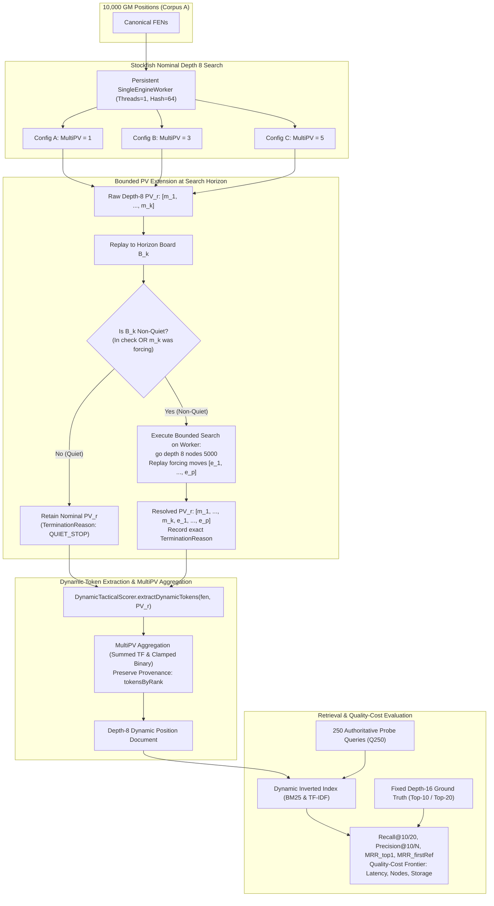

# Research Specification: Direct Dynamic-Token Generation Using Shallower Stockfish Search (Depth 8, MultiPV 1/3/5)

**Specification ID:** `SPEC-RESEARCH-DYNAMIC-SIMILARITY-DEPTH8-MULTIPV`  
**Revision:** 2.0 (Post Peer-Review Corrections)  
**Date:** 2026-11-06  
**Status:** DRAFT FOR FINAL REVIEW (Implementation Strictly Paused)  
**Parent Research Issues:** [#722](https://github.com/NathanZK/ChessEcho/issues/722), [#721](https://github.com/NathanZK/ChessEcho/issues/721), [#607](https://github.com/NathanZK/ChessEcho/issues/607)  
**Active Research Issue:** [#723](https://github.com/NathanZK/ChessEcho/issues/723)  
**Target Repository:** [NathanZK/ChessEcho](https://github.com/NathanZK/ChessEcho)  
**Execution Worktree:** `implement_issue_702_praxis` (branch: `research/issue-722-combined-filtering-dynamic-similarity`)  

---

## Document Revision History & Change Summary

| Revision | Date | Author | Key Changes |
|---|---|---|---|
| 1.0 | 2026-11-06 | Antigravity | Initial draft proposing depth-8 search with nominal MultiPV 1, 3, 5. |
| **2.0** | **2026-11-06** | **Antigravity** | **Major Peer-Review Corrections:**<br>1. *Quiescence Semantics (Section 5):* Renamed and reclassified application quiescence as a **bounded principal-variation extension**; resolved circular horizon gating; documented that single-PV extension cannot guarantee full tactical quietness; preserved termination reasons (`QUIET_STOP`, `PV_EXHAUSTED`, `PLY_LIMIT`, `NODE_LIMIT`, `TIMEOUT`, `TERMINAL`) per line.<br>2. *MultiPV Isolation & Provenance (Section 4 & 8):* Added 6 explicit retrieval conditions (MPV1-r1, MPV3-r1, MPV3-r1..3, MPV5-r1, MPV5-r1..3, MPV5-r1..5); added rank-1 move/score/token comparisons across configurations; added ablations comparing summed TF, binary presence, individual ranks, and cumulative ranks.<br>3. *Retrieval Metrics (Section 6):* Corrected `Precision@10` (first 10 candidates) vs `Precision@N` (top $N$ candidates); disambiguated MRR into `MRR@N_top1` (#1 reference candidate) and `MRR@N_firstRef` (first retrieved member of reference Top-10); separated BM25 and TF-IDF reference evaluations; enforced 3-tuple tie-breaking.<br>4. *Quality-Cost Evaluation (Section 7):* Replaced hard approval gates with provisional interpretation targets; defined multi-dimensional quality-cost frontier; revised 50-position pilot to prevent token novelty from prematurely rejecting configurations; added warm-up and randomized execution order.<br>5. *Reproducibility & Schemas (Section 10 & 13):* Reconciled cache schema with `CachedEngineRecord` (retaining `dynamicTokens` and SHA-256 string keys); specified Stockfish 19 binary SHA-256 and full UCI settings; added concrete Gradle CLI execution commands; corrected report path to Issue #723. |

---

## 1. Research Objectives & Empirical Hypotheses

### 1.1 Context & Motivation
Previous investigations under GitHub Issue #722 established that static candidate filtering—whether based on $\alpha$-weighted relational pawn tokens, inverted indices, Leiden graph community detection, or Ganguly/Bizjak relational closure (attack and defence closure)—suffers from severe structural information loss when used as a pre-filter for dynamic similarity:
- Clustered static graphs (System 3) discard **97.92%** of top-10 dynamic targets ($N \approx 76.1$, Recall@10 = 2.08%).
- Attack closure (System C1) suffers an **82.20% zero-overlap ceiling** with dynamic references and 79.6% candidate-pool exhaustion at $N=1000$ due to extreme term sparsity and coordinate rigidity.
- Defence closure (System C2) requires retaining 1 in every 5 database positions ($N=1000$, $\text{CRR} = 80.47\%$) to retrieve 29.00% of dynamic targets, with recall dropping below 4.3% at practical candidate budgets ($N \le 80$).
- Diagnostic D2 (evaluating 2,853 continuation captures across 10,000 GM positions in `connectivity_closure_ablation_results.json`) demonstrated that major tactical captures occur at a macro mean depth of **10.16 plies**, with over **97.69% of continuation captures** (and 98.20% of root-player captures) completely decoupled from root static attack geometry.

These findings demonstrate that static representations cannot serve as a reliable substitute or pre-filter for engine-derived dynamic similarity. Tactical motifs emerge along multi-ply search trees through deflections, pins, and sacrifices that do not exist at root ply 0.

### 1.2 Core Research Question
Instead of cascading dynamic reranking behind a static filter, can we **directly generate dynamic tokens using shallower Stockfish search (nominal depth 8)** and retrieve positions that match our fixed Stockfish depth-16 ground truth, with high recall and substantially lower computational cost?

### 1.3 Hypotheses & Provisional Interpretation Targets
*Note:* The thresholds below represent provisional targets for empirical interpretation, not rigid Go/No-Go approval gates:
- **Hypothesis 1 (Depth-8 Recall Feasibility):** Direct dynamic tokens generated at nominal depth 8 with bounded PV extension preserve $\ge 50\%$ Recall@10 against the fixed depth-16 reference standard at candidate budget $N=200$ (and $\ge 70\%$ at $N=1000$), substantially exceeding static retrieval baselines ($\le 8.52\%$ at $N=200$).
- **Hypothesis 2 (MultiPV Incremental Information vs. Noise):** Additional MultiPV lines (MultiPV 3 and MultiPV 5) retrieve distinct dynamic neighbours not captured by MultiPV 1, but at the cost of expanding token document length and introducing vocabulary noise. The recall gain between MultiPV 1 and MultiPV 3/5 must justify the increased engine search time.
- **Hypothesis 3 (Computational Efficiency):** Depth-8 token generation reduces per-position engine analysis latency by at least $5\times$ to $10\times$ compared to depth 16, enabling scalable offline indexing and faster query-time candidate generation.

---

## 2. Existing Implementation Audit

A comprehensive audit of the existing codebase was conducted to establish exact contracts, capabilities, and constraints:

### 2.1 Dynamic Tactical Token Semantics (`DynamicTacticalScorer.kt`)
Dynamic tactical tokens are extracted along move sequences starting at root ply 0 following the Bizjak & Guid (2020) feature extraction methodology:
- **Move Cadence Tokens:** `!-<piece>` (e.g. `!-P`, `!-N`, `!-Q`) representing pieces moved.
- **Immediate Capture Tokens:** `!x<piece>` (e.g. `!xQ`, `!xR`) for captured pieces.
- **Created Attack Threats:** `!<source_piece>><target_piece>` (e.g. `!N>Q`, `!B>R`) when a moved piece creates a direct attack on an opposing piece from its destination square.
- **Consecutive Move & Capture Bigrams:** `!-<p1><p2>` (e.g. `!-RN`) and `!x<c1><c2>` (e.g. `!xPQ`).
- **Tactical Checkmate Flags:** `!#<piece>` and `!#<p1><p2>`.
- **General Episode Flags:**
  - `?px`: Player made at least one capture.
  - `?ox`: Opponent made at least one capture.
  - `?+`: At least one check was delivered.
  - `?=`: At least one pawn promotion occurred.
  - `?#`: Continuation ends in checkmate.
- **Sacrifice Tokens:** `?S` (general sacrifice flag) and `!S<piece>` (e.g. `!SQ`) when a player piece of higher value moves to a square and is captured on the immediate next ply by an opponent piece of lower or equal value without a prior equal recapture.

*Audit Constraint:* The token extraction logic is deterministic and operates on a `(fen: String, moves: List<String>)` pair. It does not inspect engine scores or search depth; it strictly reflects the board states produced by applying `moves` to `fen`.

### 2.2 Stockfish Subprocess Management & MultiPV Handling
The codebase houses two primary Stockfish execution pathways:
1. **Production Pipeline (`StockfishService.kt`):**
   - Uses `BatchEngineSession` for similarity search: initializes a single Stockfish subprocess with `setoption name MultiPV value <k>` and sends `go depth <depth>`.
   - Collects all lines matching `info ... multipv <rank> ... depth <d> ... pv <moves>`.
   - *Limitation Discovered:* `DynamicTacticalScorer.collectCandidateTokens` and `PositionSimilarityService.buildDynamicRankedResult` currently hardcode extraction to **`rank == 1` only** (`res.principalVariations.firstOrNull { it.rank == 1 }?.moves`). MultiPV variations for rank $\ge 2$ are parsed and returned in DTOs, but discarded during token scoring.
2. **Research Pipeline (`DynamicEngineResearchRunner.kt`):**
   - Spawns a thread pool of `SingleEngineWorker` instances, setting `setoption name MultiPV value $multiPv`, `Threads 1`, `Hash 64`, `Ponder false`, `SyzygyPath <empty>`.
   - Sends `position fen $normalizedFen` and `go depth $depth`.
   - Parses `multipv` rank lines into `CachedPvLine(rank, scoreCp, moves)`.
   - *Limitation Discovered:* Like the production service, `DynamicEngineResearchRunner` historically called `dynamicScorer.extractDynamicTokens(normalizedFen, rank1Moves)` on **rank 1 only**. MultiPV 3 and 5 runs generated multiple PVs in the cache, but dynamic tokens were only extracted from rank 1.

### 2.3 Existing Quiescence & Forcing PV Extension Audit (`StockfishService.kt`)
The codebase contains a forcing continuation method: `resolveForcingPvContinuation(fen: String, options: QuiescenceOptions)`. An adversarial inspection reveals its precise operational mechanics:

#### A. Single Linear Continuation Replay (Not Full Quiescence Search)
The existing implementation does **not** conduct an alpha-beta quiescence tree search over candidate moves. Instead, it:
1. Runs an engine search (`go depth ${options.maxDepth} nodes ${options.maxNodes}`).
2. Takes the **single linear PV** returned on the final `info` update (`output.pvMoves`).
3. Replays that single sequence sequentially in `replayForcingPv`.
4. As soon as a move in that single line is quiet, it stops (`QUIET_STOP`).
*Crucial Conclusion:* The resolver does **not** explore alternative forcing branches or consider counter-tactics outside the engine's preferred PV. It is a **bounded principal-variation extension**, not a full quiescence search.

#### B. Definition of Tactical Quietness (`isForcingMove`):
In `StockfishService.kt:906–926`, a move is classified as forcing if and only if:
1. The side to move is in check (`board.isKingAttacked`),
2. The move is a capture (destination square occupied or en passant pawn capture),
3. The move is a pawn promotion (`move.promotion != Piece.NONE`), or
4. The move delivers check to the opposing king (`givesCheck`).
A position is quiet when none of these apply.

#### C. Incomplete vs. Quiet Termination Semantics:
In `StockfishService.kt`, termination reasons represent fundamentally different tactical states:
- **`QUIET_STOP` (Quiet):** The engine's chosen continuation encountered a non-forcing move.
- **`TERMINAL` (Terminal):** Checkmate, stalemate, or draw on the board.
- **`PLY_LIMIT` (Incomplete):** Bounded extension hit `maxPlies` (10 plies) while forcing moves were still active. The position is **not** confirmed quiet.
- **`NODE_LIMIT` (Incomplete):** Search reached `maxNodes` (5,000 nodes) before resolving.
- **`TIMEOUT` (Incomplete):** Watchdog timer expired (250 ms).
- **`PV_EXHAUSTED` (Incomplete):** Engine PV ended without reaching an explicit quiet move.

*Guarantee Limitation:* The current implementation **cannot guarantee** that a position has reached a tactically quiet state. It only guarantees that the single evaluated PV was replayed until either a quiet move was played, a terminal state was reached, or computational resources were exhausted.

---

## 3. Experimental Architecture & Data Flow



---

## 4. MultiPV Isolation & Experimental Configurations

### 4.1 MultiPV Search Isolation
MultiPV search alters alpha-beta pruning windows, move ordering, and depth allocation across roots. Consequently, the rank-1 PV produced under MultiPV 3 or 5 is not guaranteed to be identical to the rank-1 PV produced under MultiPV 1.

To strictly isolate MultiPV search effects from token volume inflation, the experiment mandates evaluating **six discrete retrieval conditions**:

| Retrieval Condition ID | Engine Configuration | PV Ranks Evaluated | Purpose / Evaluation Question |
|---|---|---|---|
| **C1: MPV1_R1** | Nominal Depth 8, MultiPV 1 | Rank 1 alone | Pure depth-8 baseline. |
| **C2: MPV3_R1** | Nominal Depth 8, MultiPV 3 | Rank 1 alone | Isolates alpha-beta search distortion on rank 1 under MultiPV 3. |
| **C3: MPV3_R13** | Nominal Depth 8, MultiPV 3 | Ranks 1–3 aggregated | Measures tactical branching contribution of top 3 lines. |
| **C4: MPV5_R1** | Nominal Depth 8, MultiPV 5 | Rank 1 alone | Isolates search distortion on rank 1 under MultiPV 5. |
| **C5: MPV5_R13** | Nominal Depth 8, MultiPV 5 | Ranks 1–3 aggregated | Direct comparison against MPV3_R13 under 5-line search. |
| **C6: MPV5_R15** | Nominal Depth 8, MultiPV 5 | Ranks 1–5 aggregated | Full 5-line tactical envelope. |

### 4.2 Cross-Configuration Rank-1 Consistency Check
For all 10,000 positions in Corpus A, the experiment will measure:
- **Move-1 Identity Rate:** Percentage of positions where `bestmove` (ply 0) is identical across MPV1, MPV3, and MPV5.
- **Full PV Concordance:** Jaccard overlap of the entire rank-1 move sequence between configurations.
- **Score Stability:** Centipawn score difference $|\text{score}_{\text{MPV1}} - \text{score}_{\text{MPV3}}|$.
- **Token Concordance:** Jaccard overlap of dynamic tokens extracted from rank 1 across configurations.

### 4.3 MultiPV Token Aggregation & Ablation Models
For a position $p$ with available PV lines $M = \min(K, |\text{lines}|)$:
1. Each line $r \in \{1, \dots, M\}$ yields resolved moves $M_r(p)$ and tokens $T_r(p) = \text{extractDynamicTokens}(\text{fen}(p), M_r(p))$.
2. Tokens are stored with strict provenance in `tokensByRank: Map<Int, Map<String, Double>>`.
3. Four aggregation schemes will be independently benchmarked:
   - **Model A (Summed Term Frequencies):** $\text{tf}(t, p) = \sum_{r=1}^M \text{tf}(t, M_r(p))$.
   - **Model B (Clamped Binary Presence):** $\text{tf}(t, p) = 1.0$ if term $t$ appears in any line $r \in \{1..M\}$. Prevents frequent moves from overpowering discriminative tactical flags.
   - **Model C (Individual Rank Evaluation):** Independent retrieval using rank $r$ alone ($r \in \{1, 2, 3, 4, 5\}$).
   - **Model D (Cumulative Rank Combinations):** Cumulative retrieval: $R_1$, $R_{1+2}$, $R_{1+2+3}$, $R_{1+2+3+4}$, $R_{1+2+3+4+5}$.

---

## 5. Bounded PV Extension Mechanics & Architecture

### 5.1 Resolving the Extension Design Question
**Design Decision:** The experiment adopts **Approach A (Bounded Extension from Horizon Board $B_k$)** rather than querying an unsearched horizon or relying solely on Stockfish's internal PV:
- *Rationale:* Stockfish's UCI `pv` string frequently terminates mid-exchange at depth 8. Appending forcing continuation moves ensures that tactical recaptures and check evasions are represented in the token sequence.
- *Persistent Worker Reuse:* Extension search is executed directly on the active `SingleEngineWorker` process using `position fen $B_k.fen\ngo depth 8 nodes 5000`. This completely eliminates the 50,000-process spawn bottleneck.

### 5.2 Horizon Gating Rule & Execution Protocol
For each PV rank $r \in \{1, \dots, M\}$ with nominal moves $[m_1, \dots, m_k]$:
1. Replay $[m_1, \dots, m_k]$ on a board initialized from root FEN to obtain horizon board $B_k$.
2. Check terminal conditions: If $B_k$ is checkmated, stalemated, or drawn, set $E_r = \emptyset$, record `TerminationReason.TERMINAL`, and stop.
3. **Horizon Gating Check:**
   Quiescence extension is triggered **if and only if**:
   - $B_k$ is in check (`B_k.isKingAttacked == true`), OR
   - The terminal nominal move $m_k$ was forcing (`isForcingMove(B_{k-1}, m_k) == true`).
4. If the gating condition is FALSE:
   - The line is tactically quiet. Set $E_r = \emptyset$, record `TerminationReason.QUIET_STOP`.
5. If the gating condition is TRUE:
   - Send `position fen $B_k.fen\ngo depth 8 nodes 5000` to the persistent worker.
   - Replay the returned extension moves $[e_1, \dots, e_p]$ through `applyNextForcingMove` bounded by `maxPlies = 10`.
   - Concatenate: $M_r^{\text{resolved}} = [m_1, \dots, m_k, e_1, \dots, e_p]$.
   - Record the exact `TerminationReason` returned (`QUIET_STOP`, `PV_EXHAUSTED`, `PLY_LIMIT`, `NODE_LIMIT`, or `TIMEOUT`).

### 5.3 Treatment of Incomplete Lines
Positions whose extensions end in resource-limited states (`PLY_LIMIT`, `NODE_LIMIT`, `TIMEOUT`, `PV_EXHAUSTED`) are **retained and flagged** in the dataset:
- Tokens are extracted from all moves successfully applied up to the cutoff point.
- The proportion of incomplete lines will be reported per configuration.
- A sensitivity ablation will measure retrieval metrics with incomplete lines included versus excluded.

---

## 6. Corrected Retrieval Evaluation & Fixed Ground Truth

### 6.1 Fixed Depth-16 Ground Truth Contract
- **Immutable Artifact:** `backend/src/test/resources/research/engine_evaluation_cache_d16_mpv1.json` (10,252 positions).
- Exactly zero reference records will be recomputed, modified, or regenerated.
- Reference standards are computed for all 250 probe queries ($Q_{250}$, 139 White, 111 Black sampled via `kotlin.random.Random(42L)`):
  - `bm25Top10` and `bm25Top20` (BM25 dynamic reference)
  - `tfidfTop10` and `tfidfTop20` (RSJ TF-IDF Cosine reference)
- All depth-8 configurations are evaluated against both reference sets separately.

### 6.2 Candidate Universe & Evaluation Constraints
- **Same-Side Constraint:** $\text{cand}.\text{sideToMove} == \text{query}.\text{sideToMove}$.
- **Canonical Position Inequality:** $\text{cand}.\text{canonicalFen} \neq \text{query}.\text{canonicalFen}$ (strictly excluding duplicate board states regardless of metadata).
- **Candidate Budgets ($N$):** Evaluated at 6 discrete budgets:
  $$N \in \{50, 80, 100, 200, 500, 1000\}$$
  *(Note: Budget $N=80$ is restored to ensure exact parity with Issue #722 baselines).*
- **Deterministic 3-Tuple Tie-Breaking:**
  `compareByDescending { score }.thenBy { canonicalFen }.thenBy { positionId }`.
- **Query Evaluation Mode:**
  - **Primary Protocol (Symmetric Querying):** Query $q$ uses its newly generated Depth-8 tokens corresponding to the evaluated configuration.
  - **Diagnostic Control (Asymmetric Querying):** Query $q$ uses authoritative Depth-16 tokens against the Depth-8 candidate index to isolate query degradation from candidate degradation.

### 6.3 Corrected Metric Definitions

1. **Recall@10:**
   $$\text{Recall@10}(q, N) = \frac{|C_N(q) \cap \text{Top10}_{\text{d16}}(q)|}{10}$$
2. **Relevant Recovered Count (@10):** Absolute count of Top-10 reference instances retrieved (out of $250 \times 10 = 2,500$).
3. **Recall@20:** Proportion of Top-20 reference neighbours retrieved within budget $N$.
4. **Precision@10 (True Precision at 10):**
   $$\text{Precision@10}(q) = \frac{|C_{10}(q) \cap \text{Top10}_{\text{d16}}(q)|}{10}$$
5. **Precision@N (Candidate Pool Purity at Budget $N$):**
   $$\text{Precision@N}(q) = \frac{|C_N(q) \cap \text{Top10}_{\text{d16}}(q)|}{\min(N, |C_N(q)|)}$$
6. **Mean Reciprocal Rank of #1 Reference Neighbour (`MRR@N_top1`):**
   $$\text{MRR@N\_top1} = \frac{1}{|Q|} \sum_{q \in Q} \frac{1}{\text{rank}(c_1^*(q))} \quad (\text{rank} > N \implies 0)$$
7. **Mean Reciprocal Rank of First Retrieved Reference Member (`MRR@N_firstRef`):**
   $$\text{MRR@N\_firstRef} = \frac{1}{|Q|} \sum_{q \in Q} \frac{1}{\min_{c \in \text{Top10}_{\text{d16}}(q)} \text{rank}(c)} \quad (\text{rank} > N \implies 0)$$
8. **Candidate Pool Exhaustion Rate (%):** Percentage of queries where eligible candidates ($\text{BM25} > 0$) is less than $N$.
9. **Unique Candidates Retrieved:** Count of distinct position IDs appearing across all 250 candidate pools.

---

## 7. Quality-Cost Evaluation & Pre-Execution Timing Pilot

### 7.1 Multi-Dimensional Quality-Cost Frontier
The experiment evaluates retrieval performance against true computational cost:
- **Nominal Engine Search Time ($T_{\text{nominal}}$):** Mean/median/P90 wall-clock latency per position.
- **Application Extension Time ($T_{\text{ext}}$):** Latency spent in bounded PV extension.
- **Total Per-Position Latency ($T_{\text{total}}$):** $T_{\text{nominal}} + T_{\text{ext}}$.
- **Stockfish Nodes Searched:** Mean and P90 nodes extracted from UCI output.
- **Throughput:**
  - *Per-Worker Throughput:* Positions / second / worker core.
  - *Aggregate Throughput:* Total positions / second across 6-worker pool.
- **Index Construction & Query Retrieval Latency:** Time to index 10,000 documents and score 250 queries.
- **Storage Footprint:** Serialized JSON cache size (MB) and memory usage.

### 7.2 Pre-Execution Timing Pilot (50 Positions)
To establish empirical runtime bounds without risking runaway execution:
1. **Pilot Selection Criteria:** Select exactly 50 positions from `corpus_a.json` via stratified deterministic sampling using `kotlin.random.Random(42L)`:
   - 15 Opening positions ($\text{ply} \le 12$)
   - 25 Middlegame positions ($13 \le \text{ply} \le 40$)
   - 10 Endgame positions ($\text{ply} > 40$)
2. **Warm-Up Procedure:** Evaluate and discard 5 untimed dummy positions before recording metrics to eliminate JVM JIT and OS disk caching transients.
3. **Randomized Configuration Execution:** To prevent CPU thermal throttling or background OS noise from biasing MultiPV comparisons, pilot positions are evaluated in randomized interleaved order across Configurations A, B, and C.
4. **Feasibility Gates (Non-Rejection):**
   - The pilot is designed to estimate full-corpus runtime and hardware feasibility.
   - Token novelty will **not** be used to prematurely reject a configuration during the pilot.
   - If projected full Corpus A runtime for MultiPV 5 exceeds **60 minutes** on 6 worker cores (mean latency $> 220$ ms/position), stop and present resource trade-offs for review before proceeding.

---

## 8. MultiPV Contribution Analysis

To determine whether additional MultiPV ranks provide genuine discriminative information or mere token inflation:
1. **Vocabulary Expansion:** Measure unique vocabulary size $V_K$ and mean document length across Corpus A.
2. **Token Set Novelty:** For each position:
   $$\text{Novelty}(K) = \frac{|T_K(p) \setminus T_1(p)|}{|T_K(p)|}$$
3. **Tactical Motif Category Breakdown:** Measure the distribution of newly introduced tokens across:
   - Tactical checks (`?+`)
   - Material captures (`!x`)
   - Piece sacrifices (`?S`, `!S<piece>`)
   - Pawn promotions (`?=`)
   - Piece moves (`!-`)
4. **Incremental Depth-16 Neighbour Recovery:** Quantify dynamic reference candidates retrieved by Condition C3 (MPV3_R13) or C6 (MPV5_R15) that were missed by Condition C1 (MPV1_R1).
5. **Noise & Collision Analysis:** Measure whether MultiPV token inflation increases false-positive candidate collisions in BM25 scoring.

---

## 9. Potential Confounders & Failure Modes

1. **MultiPV Search Behavior Divergence:** MultiPV search alters alpha-beta pruning windows and move ordering. Addressed by isolating Condition C2 (MPV3_R1) and C4 (MPV5_R1) against C1 (MPV1_R1) to quantify pure search distortion.
2. **Unequal Search Effort at Nominal Depth 8:** Tactical positions require exponentially more nodes than quiet endgames. Controlled by tracking UCI node counts per position and reporting median/P90 metrics alongside means.
3. **BM25 Document Length Normalization Artifacts:** Documents with fewer than $K$ lines ($|D| \approx 30$) receive artificial BM25 length boosts over 5-line documents ($|D| \approx 150$). Mitigated by reporting unnormalized TF-IDF Cosine rankings alongside BM25.
4. **Qualitative Episode Flag Inflation:** Clamping general episode flags (`?*`) to $\text{tf} \le 1.0$ across lines prevents qualitative motifs from accumulating artificial term frequency.
5. **Unusually Long Forcing Sequences:** Tactically volatile positions exceeding 10 plies are bounded by `maxPlies = 10` and `maxNodes = 5000L` to prevent execution runaway.
6. **Duplicate & Transposed Positions:** Reused positions or transpositions across alternate lines are controlled via canonical FEN hashing.
7. **Depth-8 Tactical Horizon Blindness:** Tactical motifs requiring $> 8$ nominal plies will be invisible at depth 8. The report will cross-reference recall against the Diagnostic D2 macro capture depth (10.16 plies) from `connectivity_closure_ablation_results.json`.
8. **Positions with Fewer than $K$ Legal Moves:** Handled gracefully by iterating $r \in 1..\min(K, |\text{lines}|)$ without padding.
9. **Environment & Stockfish Version Divergence:** Enforced through single-threaded execution (`Threads 1`), fixed hash (`Hash 64`), `Ponder false`, and binary verification.

---

## 10. Output Artifacts & Serialization Schemas

### Artifact 1: Timing Pilot Results
`backend/src/test/resources/research/depth8_multipv_timing_pilot_results.json`

### Artifact 2: Engine Evaluation Cache (Depth 8 MultiPV)
`backend/src/test/resources/research/engine_evaluation_cache_d8_multipv.json`  
*Schema (Fully compatible with `CachedEngineRecord` and `DynamicReferenceRankingEvaluator`):*
```json
{
  "<sha256_cache_key>": {
    "canonicalFen": "r1bqkbnr/pppp1ppp/2n5/4p3/4P3/5N2/PPPP1PPP/RNBQKB1R w KQkq - 2 3",
    "normalizedFen": "r1bqkbnr/pppp1ppp/2n5/4p3/4P3/5N2/PPPP1PPP/RNBQKB1R w KQkq - 0 1",
    "depth": 8,
    "multiPv": 5,
    "bestMove": "f1c4",
    "scoreCp": 35,
    "principalVariations": [
      {
        "rank": 1,
        "scoreCp": 35,
        "moves": ["f1c4", "g8f6", "d2d3", "f8c5"],
        "nominalDepth": 8,
        "nominalMoves": ["f1c4", "g8f6", "d2d3"],
        "extensionMoves": ["f8c5"],
        "terminationReason": "QUIET_STOP",
        "nodes": 1420
      }
    ],
    "dynamicTokens": {
      "!-B": 2.0,
      "!-N": 1.0,
      "!-P": 1.0
    },
    "tokensByRank": {
      "1": { "!-B": 1.0, "!-N": 1.0, "!-P": 1.0 },
      "2": { "!-B": 1.0 }
    },
    "elapsedMs": 38,
    "timedOut": false
  }
}
```

### Artifact 3: Full Candidate Retrieval & Benchmark Results
`backend/src/test/resources/research/depth8_multipv_retrieval_results.json`  
Contains metrics for all 6 retrieval conditions across budgets $N \in \{50, 80, 100, 200, 500, 1000\}$ against both BM25 and TF-IDF depth-16 ground truth.

### Artifact 4: Formal Diagnostic Research Report
`docs/research/issue-723-depth8-dynamic-retrieval-report.md`

---

## 11. Execution Sequence & Phasing

1. **Phase 1: Implementation Audit & Specification Finalization (Current Phase)**  
   - Complete architectural review and peer-review corrections (complete).
   - Update specification and align GitHub Issue #723.
   - Await explicit user review and approval before writing any code.
2. **Phase 2: Pre-Execution Timing Pilot (50 Positions)**  
   - Run Configurations A, B, and C on the 50 stratified pilot positions.
   - Measure actual latency, node counts, and PV extension profiles.
3. **Phase 3: Corpus A Dataset Generation (10,000 Positions)**  
   - Batch execute depth-8 MultiPV search across Corpus A with progress tracking and persistent caching.
4. **Phase 4: Candidate Retrieval Benchmark & Ablations**  
   - Build dynamic inverted indices for all 6 retrieval conditions.
   - Execute BM25 and TF-IDF retrieval across 250 probe queries.
   - Evaluate quality-cost frontier and MultiPV contributions.
5. **Phase 5: Synthesis, Reporting & GitHub Issue Disposition**  
   - Publish research report and post final findings comment to GitHub Issue #723.

---

## 12. Reproducible Verification & Execution Commands

### Phase 1: Unit Test & Ground Truth Verification
```bash
# Verify StockfishService extension replay and quiescence options
cd backend && ./gradlew test --tests "com.chessecho.service.StockfishServiceTest"

# Verify dynamic tactical token extraction semantics
cd backend && ./gradlew test --tests "com.chessecho.similarity.DynamicTacticalScorerTest"

# Verify immutable depth-16 ground truth reference evaluator
cd backend && ./gradlew test --tests "com.chessecho.research.DynamicReferenceRankingEvaluatorTest"
```

### Phase 2: Timing Pilot Runner (Post-Approval)
```bash
cd backend && ./gradlew test --tests "com.chessecho.research.Depth8MultiPvTimingPilotTest"
```

### Phase 3 & 4: Full Corpus Generation & Benchmark (Post-Approval)
```bash
cd backend && ./gradlew test --tests "com.chessecho.research.Depth8MultiPvRetrievalBenchmarkTest"
```
