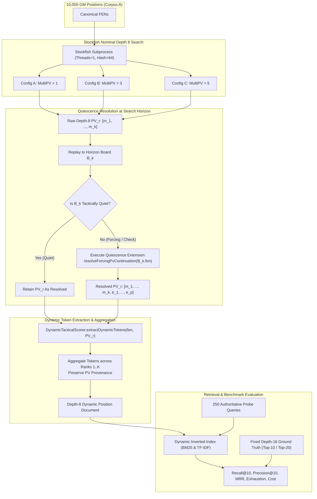

# Research Specification: Direct Dynamic-Token Generation Using Shallower Stockfish Search (Depth 8, MultiPV 1/3/5)

**Specification ID:** `SPEC-RESEARCH-DYNAMIC-SIMILARITY-DEPTH8-MULTIPV`  
**Date:** 2026-11-06  
**Status:** DRAFT FOR PEER REVIEW (Implementation Paused)  
**Parent Research Issues:** [#722](https://github.com/NathanZK/ChessEcho/issues/722), [#721](https://github.com/NathanZK/ChessEcho/issues/721), [#607](https://github.com/NathanZK/ChessEcho/issues/607)  
**Target Repository:** [NathanZK/ChessEcho](https://github.com/NathanZK/ChessEcho)  
**Execution Worktree:** `implement_issue_702_praxis` (branch: `research/issue-722-combined-filtering-dynamic-similarity` or new experiment branch)  

---

## 1. Research Objectives & Empirical Hypotheses

### 1.1 Context & Motivation
Previous investigations under GitHub Issue #722 established that static candidate filtering—whether based on $\alpha$-weighted relational pawn tokens, inverted indices, Leiden graph community detection, or Ganguly/Bizjak relational closure (attack and defence closure)—suffers from severe structural information loss when used as a pre-filter for dynamic similarity. Specifically:
- Clustered static graphs (System 3) discard **97.92%** of top-10 dynamic targets ($N \approx 76.1$, Recall@10 = 2.08%).
- Attack closure (System C1) suffers an **82.20% zero-overlap ceiling** with dynamic references and 79.6% candidate-pool exhaustion at $N=1000$ due to extreme term sparsity and coordinate rigidity.
- Defence closure (System C2) requires retaining 1 in every 5 database positions ($N=1000$, $\text{CRR} = 80.47\%$) to retrieve 29.00% of dynamic targets, with recall dropping below 4.3% at practical candidate budgets ($N \le 80$).

These findings demonstrate that static representations cannot serve as a reliable substitute or pre-filter for engine-derived dynamic similarity. Tactical motifs emerge along multi-ply search trees (mean capture depth of 10.16 plies) through deflections, pins, and sacrifices that do not exist at root ply 0.

### 1.2 Core Research Question
Instead of cascading dynamic reranking behind a static filter, can we **directly generate dynamic tokens using shallower Stockfish search (nominal depth 8)** and retrieve positions that match our fixed Stockfish depth-16 ground truth, with high recall and substantially lower computational cost?

### 1.3 Hypotheses
- **Hypothesis 1 (Depth-8 Recall Feasibility):** Direct dynamic tokens generated at nominal depth 8 with quiescence resolution preserve $\ge 50\%$ Recall@10 against the fixed depth-16 reference standard at candidate budget $N=200$ (and $\ge 70\%$ at $N=1000$), substantially exceeding static retrieval baselines ($\le 8.52\%$ at $N=200$).
- **Hypothesis 2 (MultiPV Incremental Information vs. Noise):** Additional MultiPV lines (MultiPV 3 and MultiPV 5) retrieve distinct dynamic neighbours not captured by MultiPV 1, but at the cost of expanding token document length and introducing vocabulary noise. The recall gain between MultiPV 1 and MultiPV 3/5 must justify the increased engine search time.
- **Hypothesis 3 (Computational Efficiency):** Depth-8 token generation reduces per-position engine analysis latency by at least $5\times$ to $10\times$ compared to depth 16, enabling scalable offline indexing and faster query-time candidate generation.

---

## 2. Existing Implementation Audit

A comprehensive audit of the existing codebase was conducted to establish exact semantics, capabilities, and constraints before specifying experimental adaptations:

### 2.1 Dynamic Tactical Token Semantics (`DynamicTacticalScorer.kt`)
Dynamic tactical tokens are extracted along move sequences starting at root ply 0 following the Bizjak & Guid (2020) feature extraction methodology:
- **Move Cadence Tokens:** `!-<piece>` (e.g. `!-P`, `!-N`, `!-Q`) representing pieces moved.
- **Immediate Capture Tokens:** `!x<piece>` (e.g. `!xQ`, `!xR`) for captured pieces.
- **Created Attack Threats:** `!<source_piece>><target_piece>` (e.g. `!N>Q`, `!B>R`) when a moved piece creates a direct attack on an opposing piece from its destination square.
- **Consecutive Move & Capture Bigrams:** `!-<p1><p2>` (e.g. `!-RN`) and `!x<c1><c2>` (e.g. `!xPQ`).
- **Tactical Checkmate Flags:** `!#<piece>` and `!#<p1><p2>`.
- **General Episode Flags:**
  - `?px`: Player made at least one capture.
  - `?ox`: Opponent made at least one capture.
  - `?+`: At least one check was delivered.
  - `?=`: At least one pawn promotion occurred.
  - `?#`: Continuation ends in checkmate.
- **Sacrifice Tokens:** `?S` (general sacrifice flag) and `!S<piece>` (e.g. `!SQ`) when a player piece of higher value moves to a square and is captured on the immediate next ply by an opponent piece of lower or equal value without a prior equal recapture.

*Audit Constraint:* The token extraction logic is deterministic and operates on a `(fen: String, moves: List<String>)` pair. It does not inspect engine scores or search depth; it strictly reflects the board states produced by applying `moves` to `fen`.

### 2.2 Stockfish Subprocess Management & MultiPV Handling
The codebase houses two primary Stockfish execution pathways:
1. **Production Pipeline (`StockfishService.kt`):**
   - Uses `BatchEngineSession` for similarity search: initializes a single Stockfish subprocess with `setoption name MultiPV value <k>` and sends `go depth <depth>`.
   - Collects all lines matching `info ... multipv <rank> ... depth <d> ... pv <moves>`.
   - *Limitation Discovered:* `DynamicTacticalScorer.collectCandidateTokens` and `PositionSimilarityService.buildDynamicRankedResult` currently hardcode extraction to **`rank == 1` only** (`res.principalVariations.firstOrNull { it.rank == 1 }?.moves`). MultiPV variations for rank $\ge 2$ are parsed and returned in DTOs, but discarded during token scoring.
2. **Research Pipeline (`DynamicEngineResearchRunner.kt`):**
   - Spawns a thread pool of `SingleEngineWorker` instances, setting `setoption name MultiPV value $multiPv`, `Threads 1`, `Hash 64`.
   - Sends `position fen $normalizedFen` and `go depth $depth`.
   - Parses `multipv` rank lines into `CachedPvLine(rank, scoreCp, moves)`.
   - *Limitation Discovered:* Like the production service, `DynamicEngineResearchRunner` currently calls `dynamicScorer.extractDynamicTokens(normalizedFen, rank1Moves)` on **rank 1 only**. MultiPV 3 and 5 runs generated multiple PVs in the cache, but dynamic tokens were only extracted from rank 1.

### 2.3 Existing Quiescence Search Implementation (`StockfishService.kt`)
The application contains an explicit quiescence-resolution method: `resolveForcingPvContinuation(fen: String, options: QuiescenceOptions)`.

#### A. Existing Definition of Tactical Quietness:
In `StockfishService.kt`, a move is classified by `isForcingMove(board: Board, move: Move)`:
```kotlin
private fun isForcingMove(board: Board, move: Move): Boolean {
    if (board.isKingAttacked) return true // Check evasion
    val isCapture = board.getPiece(move.to) != Piece.NONE ||
        (board.getPiece(move.from).pieceType == PieceType.PAWN && move.from.file != move.to.file)
    if (isCapture) return true // Captures (including en passant)
    if (move.promotion != Piece.NONE) return true // Promotions
    board.doMove(move)
    val givesCheck = board.isKingAttacked
    board.undoMove()
    return givesCheck // Direct checks
}
```
A position is **tactically quiet** when:
- The side to move is NOT in check (`!board.isKingAttacked`), AND
- The next move is NOT a capture, NOT a pawn promotion, and does NOT deliver check.
When `applyNextForcingMove` encounters a quiet move, it terminates with `TerminationReason.QUIET_STOP`.

#### B. Existing Bounds & Termination Policies:
Quiescence search is bounded by `QuiescenceOptions`:
- `maxDepth = 8` (nominal engine search limit)
- `maxNodes = 5000L` (hard node cap)
- `timeoutMs = 250L` (watchdog timer)
- `maxPlies = 10` (maximum forcing plies resolved)

Termination reasons:
- `QUIET_STOP`: Next move is quiet.
- `TERMINAL`: Checkmate, stalemate, or draw.
- `PLY_LIMIT`: Reached 10 plies of forcing moves.
- `NODE_LIMIT`: Exceeded 5,000 nodes.
- `TIMEOUT`: Exceeded timeout.
- `PV_EXHAUSTED`: Engine PV ended without quiet move.

#### C. Critical Execution Path Limitation Discovered in Audit:
In `StockfishServiceTest.kt` (`resolveForcingPvContinuation halts with 0 plies when first PV move is quiet`), if `resolveForcingPvContinuation` is called on a position where the *first* move is quiet, it immediately returns **0 plies** (`moves.isEmpty()`, `QUIET_STOP`). It was designed for `EngineMoveProvider` to check if a specific post-move position has an immediate tactical continuation.

Therefore, for depth-8 dynamic token generation, calling `resolveForcingPvContinuation` directly from root ply 0 would truncate non-tactical openings after 0 plies. The experimental architecture must instead execute the nominal depth-8 search first, and then apply quiescence resolution to the terminal state of the depth-8 PV if a forcing sequence is active at the horizon.

---

## 3. Experimental Architecture & Data Flow



---

## 4. Experimental Configurations & Controls

### 4.1 Primary Configurations

| Parameter | Configuration A | Configuration B | Configuration C |
|---|---:|---:|---:|
| **Nominal Stockfish Depth** | 8 | 8 | 8 |
| **MultiPV Count ($K$)** | **1** | **3** | **5** |
| **Stockfish Threads** | 1 | 1 | 1 |
| **Stockfish Hash Size** | 64 MB | 64 MB | 64 MB |
| **Quiescence Search Policy** | Active at horizon | Active at horizon | Active at horizon |
| **Max Quiescence Plies** | 10 | 10 | 10 |
| **Max Quiescence Nodes** | 5,000 | 5,000 | 5,000 |
| **Token Extraction Schema** | Bizjak Dynamic | Bizjak Dynamic | Bizjak Dynamic |
| **Evaluated Candidate Budgets ($N$)** | 50, 100, 200, 500, 1000 | 50, 100, 200, 500, 1000 | 50, 100, 200, 500, 1000 |
| **Candidate Universe** | Same-side, $c \neq q$ | Same-side, $c \neq q$ | Same-side, $c \neq q$ |

### 4.2 MultiPV Token Aggregation Model
For a position $p$ analyzed under MultiPV $= K$:
1. Each PV line $r \in \{1, \dots, K\}$ produces a resolved move list $M_r(p)$ after quiescence resolution.
2. Dynamic tokens are extracted independently for each line:
   $$T_r(p) = \text{extractDynamicTokens}(\text{fen}(p), M_r(p))$$
3. The multi-PV token document combines terms across all $K$ lines:
   - **Term Frequency:** $\text{tf}(t, p) = \sum_{r=1}^K \text{tf}(t, M_r(p))$ (accumulating term occurrences across lines).
   - **Provenance Tracking:** The serialized record retains `tokensByRank: Map<Int, Map<String, Double>>` mapping rank $r \to T_r(p)$, allowing post-hoc ablation of individual ranks without re-running Stockfish.

---

## 5. Quiescence Search Integration Details

### 5.1 Distinguishing Internal Stockfish Quiescence from Application Quiescence
- **Stockfish Internal `qsearch`:** Stockfish internally extends tactical captures and checks to compute its minimax alpha-beta score (`score cp`). However, the UCI `pv` output string is truncated at the transposition table / PV update boundary and does not guarantee that the terminal position $B_k$ is quiet.
- **Application-Level Quiescence Extension:** The application ensures that the move sequence used for token generation resolves all tactical exchanges.

### 5.2 Horizon Quiescence Resolution Algorithm
For each PV rank $r \in \{1, \dots, K\}$ with nominal moves $[m_1, m_2, \dots, m_k]$:
1. Replay $[m_1, \dots, m_k]$ on a chess board initialized from `fen` to obtain board $B_k$.
2. Check terminal conditions on $B_k$:
   - If $B_k$ is checkmated, stalemated, or drawn by rule: mark line as terminal, set extension moves $E_r = \emptyset$, and proceed to token extraction.
3. Evaluate quietness of $B_k$:
   - Check if $B_k$ is in check (`board.isKingAttacked`).
   - If $B_k$ is NOT in check, probe whether the top engine move from $B_k$ is forcing via `isForcingMove`.
4. If $B_k$ is NOT quiet:
   - Invoke `stockfishService.resolveForcingPvContinuation(B_k.fen, options)` with `QuiescenceOptions(maxDepth=8, maxNodes=5000, timeoutMs=250, maxPlies=10)`.
   - The returned forcing moves $[e_1, \dots, e_p]$ are appended to the nominal PV:
     $$M_r^{\text{resolved}} = [m_1, \dots, m_k, e_1, \dots, e_p]$$
5. If $B_k$ is quiet:
   $$M_r^{\text{resolved}} = [m_1, \dots, m_k]$$
6. This policy applies identically to every rank in Configurations A, B, and C.

---

## 6. Fixed Ground Truth & Retrieval Evaluation Methodology

### 6.1 Fixed Ground Truth Contract
- **Reference Standard:** The depth-16 MultiPV=1 dynamic ground truth stored in `backend/src/test/resources/research/engine_evaluation_cache_d16_mpv1.json` is **immutable**.
- Exactly zero positions in the reference standard will be modified, recomputed, or substituted.
- Reference rankings for each query $q \in Q_{250}$ are computed over the unpruned candidate universe using BM25 and RSJ TF-IDF, defining the authoritative `bm25Top10`, `bm25Top20`, `tfidfTop10`, and `tfidfTop20` sets.

### 6.2 Evaluated Candidate Budgets
Candidate pools are evaluated at 5 discrete budgets:
$$N \in \{50, 100, 200, 500, 1000\}$$

### 6.3 Retrieval Metrics Reported per Configuration and Budget
1. **Recall@10:** Proportion of ground-truth Top-10 dynamic neighbours retrieved within the top $N$ candidates:
   $$\text{Recall@10}(q, N) = \frac{|C_N(q) \cap \text{Top10}_{\text{d16}}(q)|}{10}$$
2. **Relevant Recovered Count (@10):** Absolute count of Top-10 neighbours retrieved (out of 2,500 total instances across 250 queries).
3. **Recall@20:** Proportion of ground-truth Top-20 dynamic neighbours retrieved.
4. **Precision@10:** Proportion of retrieved candidates that belong to ground-truth Top-10:
   $$\text{Precision@10}(q, N) = \frac{|C_N(q) \cap \text{Top10}_{\text{d16}}(q)|}{\min(N, |C_N(q)|)}$$
5. **Mean Reciprocal Rank (MRR):** Reciprocal rank of the #1 ground-truth dynamic neighbour:
   $$\text{MRR} = \frac{1}{|Q|} \sum_{q \in Q} \frac{1}{\text{rank}(c_1^*(q))}$$
   (where $\text{rank} = \infty \implies 0$ if not retrieved within budget $N$).
6. **Positive Candidate Pool Exhaustion Rate (%):** Percentage of queries where the count of candidates with $\text{BM25} > 0$ is smaller than the requested budget $N$.
7. **Unique Candidates Retrieved:** Distribution of unique candidates across all queries.

---

## 7. Computational Cost Methodology & Timing Pilot

### 7.1 Measurable Cost Metrics
For each configuration:
- **Total Engine Search Time (s):** Wall-clock time spent inside Stockfish subprocesses.
- **Per-Position Latency (ms):** Mean, median, P90, min, and max analysis latency.
- **Stockfish Nodes Searched:** Total and mean nodes searched per position (extracted from UCI `nodes` tokens).
- **Throughput:** Positions analyzed per second per worker core.
- **Quiescence Work:** Number of positions requiring horizon extension, mean extension plies added, and extension execution time.
- **Indexing & Retrieval Time:** Time to construct inverted indices and execute BM25 ranking across 250 queries.
- **Storage Footprint:** Size of serialized cache file on disk and in-memory representation footprint.

### 7.2 Pre-Execution Timing Pilot (50 Positions)
Before committing to full 10,000-position Corpus A generation:
1. Select 50 representative positions from Corpus A across diverse game phases (15 opening, 25 middlegame, 10 endgame).
2. Execute Configurations A, B, and C on the timing pilot under identical hardware settings (1 thread, 64 MB hash).
3. Measure actual latency, node counts, and PV lengths.
4. Project full-run execution time and disk requirements.
5. **Gating Rule:** If MultiPV 5 exceeds $4\times$ the latency of MultiPV 1 with $< 5\%$ projected token novelty, stop and review before running the full corpus.

---

## 8. MultiPV Contribution Analysis

To determine whether MultiPV 3 and 5 provide discriminative value or mere token inflation:
1. **Token Vocabulary Expansion:** Measure total vocabulary size $V_1, V_3, V_5$ and mean document lengths across Corpus A.
2. **Token Set Novelty:** For each position, compute:
   $$\text{Novelty}(K) = \frac{|T_{K}(p) \setminus T_1(p)|}{|T_{K}(p)|}$$
3. **Incremental Dynamic Recall:** Measure newly entering depth-16 neighbours retrieved by Configuration B (MPV 3) and Configuration C (MPV 5) that were missed by Configuration A (MPV 1).
4. **Noise / False-Positive Analysis:** Assess whether additional PVs increase false-positive collisions in BM25 by inflating document lengths with non-tactical alternate moves.
5. **Rank Attribution:** Evaluate recall achieved by individual ranks ($r=1$ vs $r=2$ vs $r=3$) using the preserved `tokensByRank` metadata.

---

## 9. Potential Confounders & Failure Modes

1. **MultiPV Non-Independence:** Alternate PVs in quiet positions often represent minor piece moves that share identical tactical flags (`!-N`, `!-B`) with rank 1, artificially boosting term frequencies without adding new tactical concepts.
2. **Document Length Inflation & BM25 BM25 Parameter Sensitivity:** BM25 length normalization ($b=0.75$) penalizes documents longer than average. If MultiPV 5 inflates document lengths from 30 to 100 terms, genuine tactical tokens may receive lower BM25 weights. The experiment will evaluate unnormalized TF-IDF alongside BM25 to isolate length penalties.
3. **Quiescence Runaway / Asymmetry:** Certain tactical positions (e.g. perpetual check threats or complex piece scrambles) may consume maximum quiescence plies (10 plies) while quiet positions terminate in 0 plies. Bounding by `maxPlies = 10` and `maxNodes = 5000` guarantees strict computational upper bounds.
4. **Depth-8 Tactical Horizon Blindness:** Tactics requiring 9+ plies of preparation before the first capture will be invisible to depth 8. The experiment will compare recall against continuation capture depth from Diagnostic D2 to quantify the horizon effect.
5. **Stockfish Version / Hardware Divergence:** Search nodes and pruning behavior vary across Stockfish builds. The benchmark will record Stockfish binary SHA-256 and enforce deterministic single-threaded UCI options (`Threads 1`, `Hash 64`, `Ponder false`).

---

## 10. Output Artifacts & Serialization Schemas

All results will be serialized into dedicated, reproducible research artifacts:

### Artifact 1: Timing Pilot Results
`backend/src/test/resources/research/depth8_multipv_timing_pilot_results.json`

### Artifact 2: Engine Evaluation Cache (Depth 8, MultiPV 1/3/5)
`backend/src/test/resources/research/engine_evaluation_cache_d8_multipv.json`
Schema:
```json
{
  "cacheKey": {
    "canonicalFen": "...",
    "depth": 8,
    "multiPv": 5,
    "principalVariations": [
      {
        "rank": 1,
        "nominalMoves": ["e2e4", "e7e5"],
        "quiescenceMoves": ["g1f3"],
        "resolvedMoves": ["e2e4", "e7e5", "g1f3"],
        "scoreCp": 35,
        "isQuietStop": true
      }
    ],
    "tokensByRank": {
      "1": { "!-P": 2.0, "!-N": 1.0 },
      "2": { "!-P": 1.0, "!-N": 2.0 }
    },
    "aggregatedDynamicTokens": { "!-P": 3.0, "!-N": 3.0 },
    "elapsedMs": 42,
    "nodesSearched": 1420
  }
}
```

### Artifact 3: Full Benchmark Results
`backend/src/test/resources/research/depth8_multipv_candidate_retrieval_results.json`
Contains all metrics for Configurations A, B, and C across budgets $N \in \{50, 100, 200, 500, 1000\}$ against the depth-16 ground truth.

### Artifact 4: Formal Research Report
`docs/research/issue-725-depth8-dynamic-retrieval-report.md`

---

## 11. Phased Execution Sequence

1. **Phase 1: Implementation Audit & Specification Approval (Current Phase)**  
   - Complete architectural audit (complete).
   - Author formal experimental specification (this document).
   - Create new GitHub issue linking preceding research Issue #722.
   - Await explicit user review and approval.
2. **Phase 2: Timing Pilot Execution (50 Positions)**  
   - Run Configurations A, B, and C on 50 positions.
   - Verify quiescence extension behavior and measure latency/node profiles.
3. **Phase 3: Corpus A Dataset Generation (10,000 Positions)**  
   - Batch execute depth-8 MultiPV search across Corpus A with progress tracking and persistent caching.
4. **Phase 4: Candidate Retrieval & Evaluation Benchmark**  
   - Build inverted indices for Configs A, B, and C.
   - Run retrieval across 250 probe queries at budgets $N \in \{50, 100, 200, 500, 1000\}$.
   - Evaluate recall, precision, MRR, pool exhaustion, and MultiPV contributions against depth-16 ground truth.
5. **Phase 5: Synthesis, Reporting & Issue Disposition**  
   - Compile comprehensive research report.
   - Update the new GitHub issue with final findings.

---

## 12. Acceptance Criteria & Interpretation Framework

| Outcome | Quantitative Criteria | Interpretation |
|---|---|---|
| **Strong Success** | Config A Recall@10 $\ge 50\%$ at $N=200$ (and $\ge 70\%$ at $N=1000$); latency reduction $\ge 5\times$ vs d16. | Depth-8 dynamic search is a viable, high-performance candidate generator for dynamic similarity. |
| **Moderate Success (MultiPV Dependent)** | Config A Recall@10 $< 40\%$ at $N=200$, but Config B/C Recall@10 $\ge 55\%$ with acceptable latency. | MultiPV search is necessary to capture dynamic branching, justifying additional search cost. |
| **Equivocal** | Depth-8 recall matches static defence closure (~$8.5\%$ at $N=200$, ~$29\%$ at $N=1000$) despite engine execution cost. | Shallow search suffers from tactical truncation; deeper evaluation or alternative pruning is required. |
| **Failure / Rejection** | Recall@10 $< 20\%$ at $N=200$; pool exhaustion or noise dominates. | Depth-8 search cannot reliably predict depth-16 dynamic similarity; alternative dynamic sketching must be explored. |

---

## 13. Reproducible Verification Commands

```bash
# Verify unit tests for StockfishService and QuiescenceOptions
cd backend && ./gradlew test --tests "com.chessecho.service.StockfishServiceTest"

# Verify DynamicTacticalScorer token semantics
cd backend && ./gradlew test --tests "com.chessecho.similarity.DynamicTacticalScorerTest"

# Verify existing depth-16 baseline ground truth evaluation
cd backend && ./gradlew test --tests "com.chessecho.research.DynamicReferenceRankingEvaluatorTest"
```
