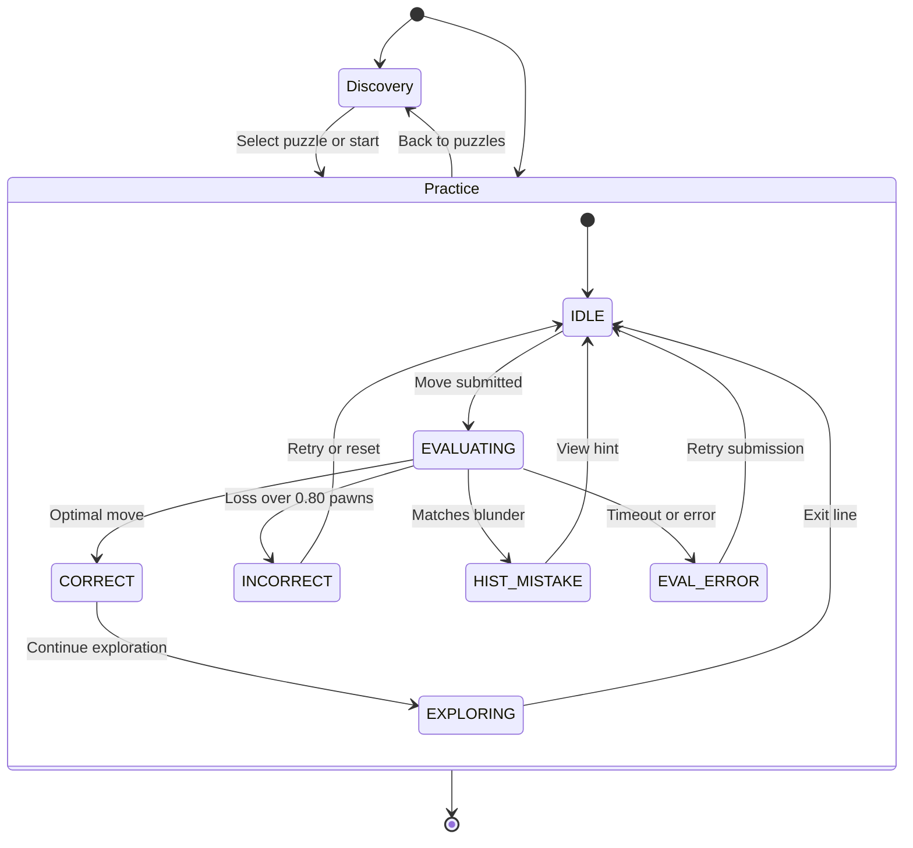
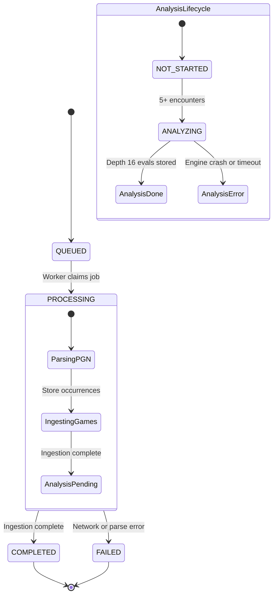
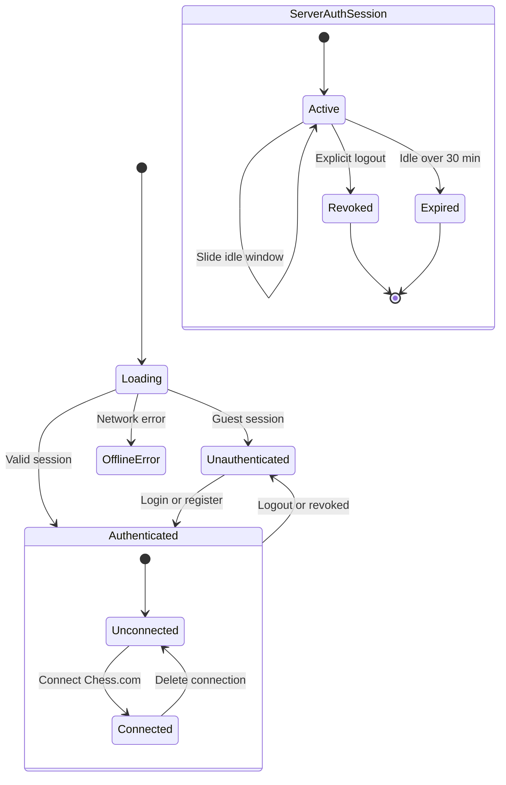

# State-Lifecycle Diagrams

This document models the core user-facing state lifecycles in ChessProbe using Mermaid diagrams.

---

### 1. Practice Puzzle Lifecycle

This diagram captures catalog view mode transitions (`mode: 'discovery' | 'practice'`) and board solving states (`PuzzleFeedbackState`):

**Solving State Transitions & Evaluation Policies:**
- **`IDLE` &rarr; `EVALUATING`**: User drags or clicks a move on `ChessBoardArea`. Input listeners freeze and `isEvaluatingMove` turns true.
- **`CORRECT`**: Engine validates candidate move within acceptable threshold ($\le 0.80$ pawn loss or engine optimal PV). Unlocks emerald banner and `Continue Exploration &rarr;` CTA.
- **`INCORRECT`**: Engine evaluation loss exceeds $0.80$ pawns. Board displays inaccurate banner and automatically rolls the piece back to the puzzle baseline for retry.
- **`HIST_MISTAKE` (HISTORICAL_MISTAKE)**: User plays the exact suboptimal move played in their original game. Displays a coaching hint banner suggesting the target move and rolls back.
- **`EVAL_ERROR` (EVALUATION_ERROR)**: Subprocess engine crash, 500ms timeout ceiling, or network API failure. Leaves board editable for resubmission.

---

### 2. Import Job Lifecycle

This diagram models the backend asynchronous import job lifecycle (`AsyncJob.ALLOWED_STATUSES`) and analysis pipeline (`AsyncJob.analysisStatus`):

**Asynchronous Import & Analysis Guarantees:**
- **Job Status (`AsyncJob.status`)**: Follows strict unidirectional transitions: `QUEUED` &rarr; `PROCESSING` &rarr; `COMPLETED` / `FAILED`. Only one active (`QUEUED` or `PROCESSING`) job is permitted per Chess.com account connection (enforced by a partial unique index).
- **Processing Sub-states**: Monthly PGN archives downloaded from Chess.com are parsed in-memory with zero temporary disk writes. Positions encountered are persisted as 4-field FEN occurrences.
- **Engine Analysis (`AsyncJob.analysisStatus`)**: Operates as an independent background pipeline. Positions meeting the $\ge 5$ encounter threshold are queued for Stockfish depth 16 evaluation. Successful completion marks terminal `COMPLETED` and advances the monotonic generation counter to invalidate `PositionSimilarityCache`.

---

### 3. Session & Authentication Lifecycle

This diagram captures client bootstrap state (`useAccountSession.ts`), account connection state (`AccountConnectionStatus`), and backend session management (`AuthSession` entity):

**Session Management & Auth Boundary Invariants:**
- **Bootstrap Protocol**: On application launch, client invokes `GET /api/me` with `credentials: 'include'`. An HTTP 401 is treated as a normal guest state (`status = 'unauthenticated'`), serving a readable CSRF double-submit cookie.
- **Sliding Idle Window**: Authenticated requests refresh `idle_expires_at` (30-minute idle window) up to a 30-day absolute ceiling (`expires_at`).
- **Session Revocation**: `POST /api/logout` sets `revoked_at` timestamp on `AuthSession` and transmits a zero-age deletion cookie (`Max-Age=0`). Revoked and expired sessions are deleted by a scheduled database cleanup worker.
