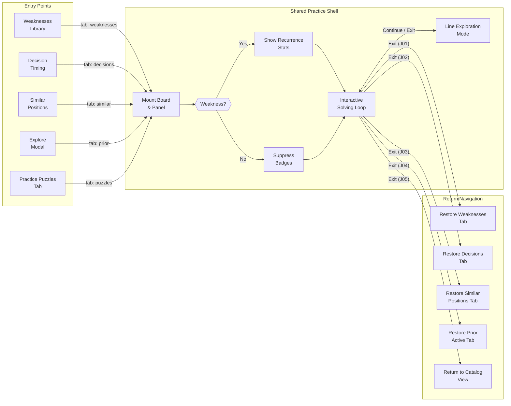
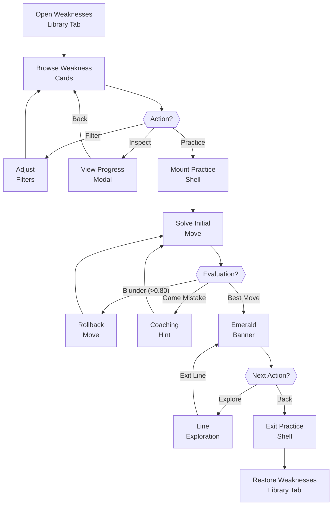
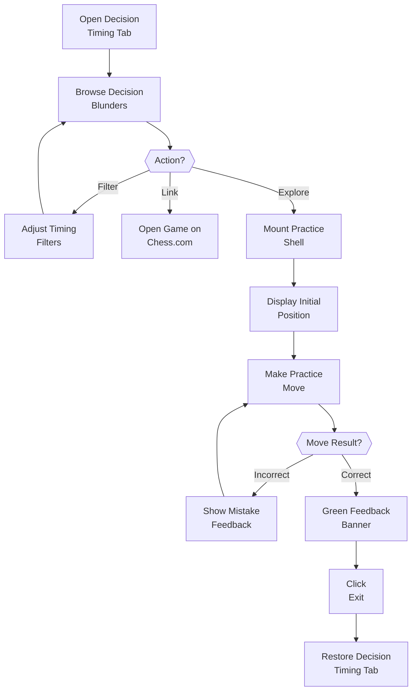
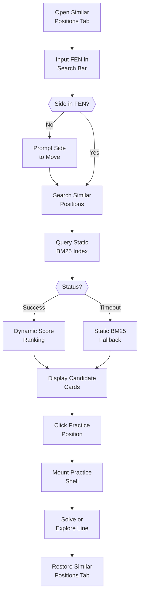
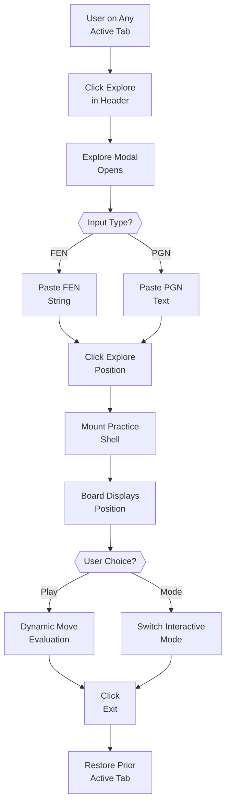
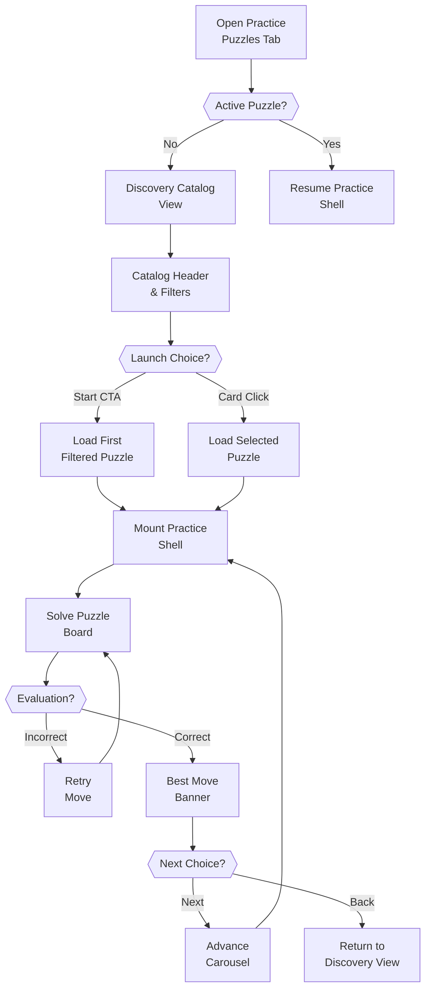
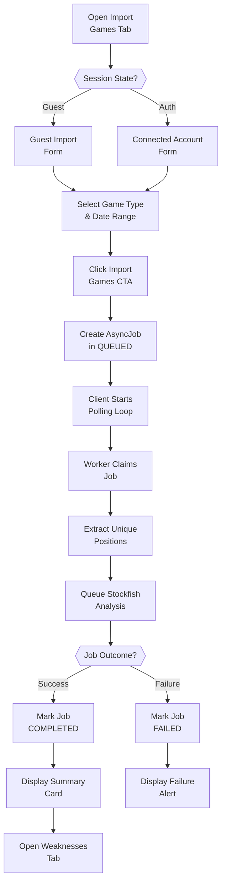
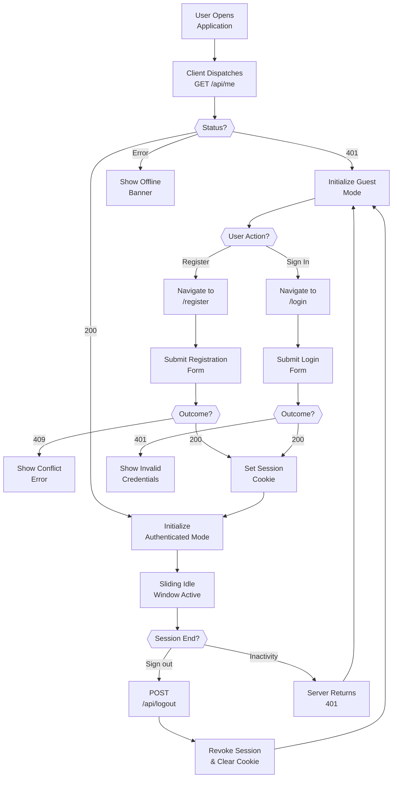

# User Journey Flowcharts

This document visually models the actual user experience across ChessProbe's canonical journeys using Mermaid flowcharts. It is written to allow product owners, testers, and developers to inspect, challenge, and verify user interactions without needing to read application source code.

---

## 1. Master Shared-Practice Convergence Architecture

Five distinct user entry points converge into the unified shared-practice shell (`PracticePuzzlesView`), each preserving its own entry context and return routing.

*\*Note: Decision Timing (J02) and Similar Positions (J03) positions check database evidence; if the user blundered $\ge 5$ times in that exact FEN, `isWeaknessBacked` resolves true, otherwise recurrence stats remain suppressed. Entry routes pass originating context (`originatingTab: 'weaknesses'`, `'long-decisions'`, `'similar-positions'`, `priorActiveTab`, or `'puzzles'`) to ensure return navigation restores the correct tab.*

---

## 2. Shared-Practice Entry Point Flowcharts

### 2.1 Journey 1: Weaknesses Library Practice (J01)
*User goal: Review recurrent personal blunders identified by engine analysis and practice the correct alternatives.*

**Key Interaction Details (J01):**
- **Catalog Filtering**: Allows filtering by player color (White/Black), time control (Bullet/Blitz/Rapid/Classical), and minimum mistake threshold (0.30 – 2.00 pawns).
- **Evaluation Rules**: Any move incurring $>0.80$ pawn loss is rejected and rolled back. If the user repeats their historical game mistake, an educational hint is surfaced.
- **Return Contract**: Exiting practice or line exploration restores the `#weaknesses` tab, preserving active filters and scroll position.

---

### 2.2 Journey 2: Decision Review / Timing Practice (J02)
*User goal: Identify moves where excessive clock time was burned and practice making the decision under simulated time pressure.*

**Key Interaction Details (J02):**
- **Decision Filters**: Allows filtering by duration (seconds spent on move), severity (`Critical`, `Significant`, `Minor`), and game speed.
- **Stopwatch / Timer**: Practice shell provides optional countdown or stopwatch simulating original clock conditions.
- **Return Contract**: Restores `#long-decisions` view state, re-applying query parameters, selected occurrence, and scroll position.

---

### 2.3 Journey 3: Similar Positions Search & Practice (J03)
*User goal: Search personal games for positions tactically similar to an arbitrary board layout, then practice candidate matches.*

**Key Interaction Details (J03):**
- **FEN Validation**: Accepts 4-field or incomplete FEN strings. If turn token is omitted, client prompts user to select White or Black before querying.
- **Two-Stage Retrieval**: Queries static BM25 structural index up to 200 candidates, then attempts Stockfish depth 8 dynamic tactical reranking on top 100 candidates.
- **Graceful Fallback**: If engine analysis exceeds the 500ms watchdog or semaphore permits are exhausted, static BM25 ranking is returned with `dynamicSimilarityApplied = false`.

---

### 2.4 Journey 4: Explore Position Modal (J04)
*User goal: Paste an arbitrary FEN or PGN from an external study/game to analyze or practice with engine evaluation.*

**Key Interaction Details (J04):**
- **Input Flexibility**: Modal supports both raw orthodox FEN strings and multi-move PGN text.
- **Supplied Position Policy**: Governed by #662 AC9. Positions are solved as puzzles with move evaluation and blunder rollback. Recurrence badges (mistake counts) are strictly hidden (`isWeaknessBacked: false`).
- **Return Destination**: Exit closes exploration and restores whatever application tab was active immediately prior to opening the header modal.

---

### 2.5 Journey 5: Practice Puzzles Direct Tab (J05)
*User goal: Browse personal puzzle catalog directly and solve puzzles sequentially in a focused training carousel.*

**Key Interaction Details (J05):**
- **Dual Mode**: Toggles between discovery catalog (`mode: 'discovery'`) and interactive puzzle carousel (`mode: 'practice'`).
- **Carousel Navigation**: Solving a puzzle enables "Next Puzzle &rarr;" button to advance through the filtered list.
- **Return Navigation**: Clicking "Back to Puzzles" returns to discovery mode while preserving active filter bar selections.

---

## 3. Data Pipeline & Identity Journey Flowcharts

### 3.1 Journeys 6 & 7: Game Import & Asynchronous Analysis Pipeline
*User goal: Import historical Chess.com games and generate automated Stockfish analysis without freezing the browser.*

**Key Pipeline Details (J06/J07):**
- **Concurrency & Identity Control**: Unauthenticated guest imports identify jobs by username. Authenticated imports require an active `AccountConnection` owned by caller. Enforces at most 1 active job per account.
- **In-Memory Streaming**: PGN files streamed from Chess.com public archives are parsed directly in memory with 0 disk writes.
- **Polling Loop**: Client polls `GET /api/jobs/{id}` at 2-second intervals until terminal status (`COMPLETED` or `FAILED`).

---

### 3.2 Journeys 8, 9 & 10: Session Bootstrap, Registration, and Login Lifecycle
*User goal: Maintain seamless guest access while providing optional secure user registration, session persistence, and clean sign-out.*

**Key Security & Auth Details (J08/J09/J10):**
- **Guest State First**: Initial HTTP 401 on `GET /api/me` is not an error; it establishes guest session state and sets the readable double-submit `XSRF-TOKEN` cookie.
- **Credentials & Registration**: Canonical lowercased email, salted PBKDF2 hash, constant-time validation. Duplicate registrations return `409 REGISTRATION_CONFLICT`.
- **Session Duration**: HttpOnly Secure `CHESSPROBE_SESSION` cookie with sliding 30-minute inactivity timeout and 30-day absolute expiration cap. Explicit logout revokes the server session row immediately.

---

## 4. Source-Specific Divergence & Behavioral Contracts

The following table summarizes observable behavioral differences across the five entry routes into shared practice:

| Dimension | J01 (Weaknesses) | J02 (Decisions) | J03 (Similar Positions) | J04 (Supplied Position) | J05 (Practice Catalog) |
|---|---|---|---|---|---|
| **Originating Route** | `#weaknesses` | `#long-decisions` | `#similar-positions` | Header Explore Modal | Direct `#puzzles` tab |
| **`activePuzzle.source`** | `'weakness'` | `'long-decision'` | `'similar'` | `'supplied'` | `'weakness'` / `'catalog'` |
| **Recurrence Badges Allowed?** | Yes (`isWeaknessBacked: true`) | Only if $\ge 5$ blunders exist | Only if $\ge 5$ blunders exist | No (strictly hidden) | Yes (`isWeaknessBacked: true`) |
| **Initial Target Move Pre-Defined?** | Yes (Engine PV Best Move) | Yes (Calculated Best Move) | Yes (Candidate Engine PV) | No (Arbitrary FEN/PGN) | Yes (Catalog Puzzle Move) |
| **Move Rollback on Blunder?** | Yes (Rolls back if $>0.80$ pawns loss) | Yes (Rolls back if $>0.80$ loss) | Yes (Rolls back if $>0.80$ loss) | Yes (Dynamic eval rollback) | Yes (Rolls back if $>0.80$ loss) |
| **Answer Secrecy Enforcement?** | Strict (Continuation hidden pre-move) | Strict (Continuation hidden pre-move) | Strict (Continuation hidden pre-move) | Exempt (Engine PV visible) | Strict (Continuation hidden pre-move) |
| **Exit Destination** | `#weaknesses` | `#long-decisions` | `#similar-positions` | Tab active before modal | `#puzzles` (Catalog view) |
| **Context Snapshot Restored?** | Scroll position | Filters, severity, timer | Query FEN & candidates | Modal dismissed | Catalog filter selections |

---

## 5. Product Owner Walkthrough: Key Challenge Points

This section highlights real-world user scenarios for product-owner review and decision:

### Scenario A: Disconnecting Account During Active Exploration
- **What happens:** If a user is practicing a weakness in Line Exploration and disconnects their Chess.com account in another tab/window:
  - `handleDisconnect` calls `clearAccountUiState()`.
  - The in-flight puzzle is cleared, and `longDecisionReturnSnapshotRef` is reset to null.
  - The view drops back into guest mode cleanly without rendering corrupted historical blunders.

### Scenario B: Dynamic Similarity Engine Timeout
- **What happens:** When searching similar positions for a complex tactical middlegame, Stockfish candidate reranking might hit the 500ms watchdog ceiling under heavy load:
  - The system **does not crash or show an error modal**.
  - It seamlessly falls back to static relational BM25 scoring and sets `dynamicSimilarityApplied: false`.
  - An informational indicator explains that static ranking was applied.

### Scenario C: Custom FEN Exploration vs. Puzzle Rollback
- **What happens:** In J04 (Explore Position modal), a user pastes a custom position to analyze. If they intentionally play a blunder move to test a defense:
  - The system currently treats it under the standard puzzle policy: it evaluates move loss, flags it as inaccurate, and rolls the board back.
  - *Product Owner Question:* Should supplied position exploration operate as a strict puzzle (rolling back blunders), or should it offer an unconstrained "Sandbox Mode" where any legal move can be played and explored? (Tracked in Traceability Matrix).
